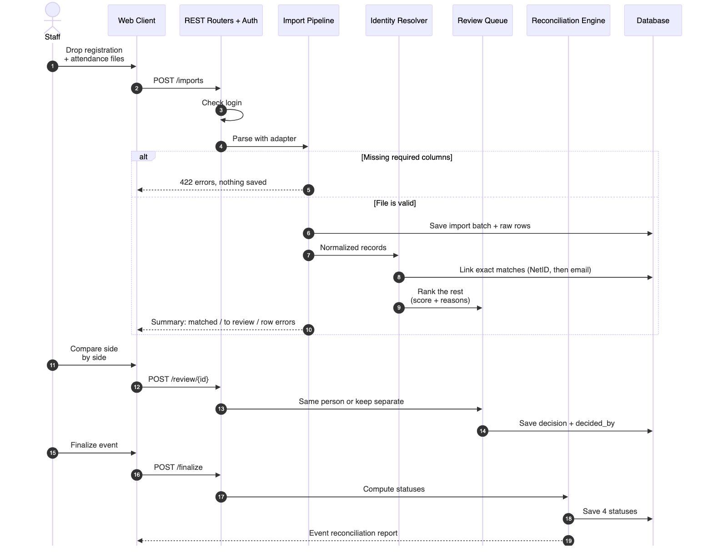
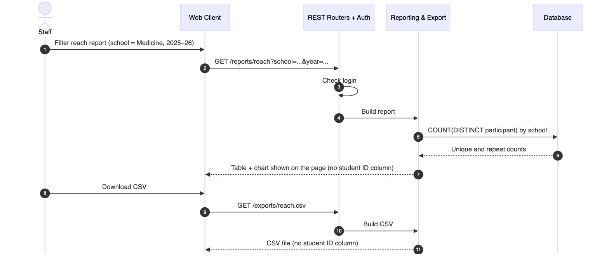

# Project Scope and High-Level Design

## Program Registration & Attendance Reconciliation Hub

**Team:** Brandon Y Lau, Molly Tran, Jennifer Sun, Zhenyu (Eric) Song
**Sponsor:** Kayleigh Anderson-Natale, PhD, Director of Postdoc and Professional Development, UCI Graduate Division
**Version:** 1.0, October 2026. Based on the sponsor proposal, the 10/7/26 kickoff meeting, and the sponsor's sample export templates.

---

## 1. Project Overview

### 1.1 Purpose

The Graduate & Postdoctoral Scholar Resource Center (GPSRC) in UCI Graduate Division runs professional development, wellness, fellowship, and certificate programs for graduate students and postdocs. Registration happens in CampusGroups/ZotSpot or 12twenty. Attendance comes from an iPad/laptop check-in form, a Zoom report, or a paper sheet.

Today, student assistants reconcile these sources by hand. They mark attendees in the platform, export the list, and paste it into a year-long "GPSRC Data Project" spreadsheet. This process has three problems:

- The two platforms export different fields; 12twenty has neither a NetID nor a student ID.
- Walk-ins arrive with most fields blank.
- The sheet counts rows, not people, so staff cannot easily answer a question like "how many *unique* School of Medicine students attended this year?"

We will build a secure, file-based web application that:

- imports these known exports,
- resolves each record to one participant,
- routes uncertain matches to staff, and
- shows event, reach, and data-quality reports directly on the web page, with CSV download.

It replaces the spreadsheet comparison and the copy-paste step. It does not replace the registration platforms.

### 1.2 Target users and stakeholders

| Stakeholder | Role | Main interest |
|---|---|---|
| GPSRC staff: program staff (Kayleigh, Rosie, Karen) and student assistants | Staff user (the only role) | Less manual cross-checking (about 20–30 min per event today), trustworthy data, and fast reporting to leadership |
| Graduate Division leadership; partner schools | Report consumers (no login) | Evidence of reach, e.g., the new dean's request for a year of data, or Biological Sciences asking how many of its students attended |
| Graduate students and postdocs | Data subjects (no login) | Privacy of their records (FERPA) |
| UCI OIT / data team | Future owners | Hosting, security review, and later integration |

### 1.3 Success criteria and key deliverables

The MVP must meet the sponsor's six acceptance criteria:

1. Each supported format imports, and unusable files produce validation errors.
2. Exact matches are made automatically. Uncertain ones go to staff review and are never merged automatically.
3. Registration and attendance remain separate evidence and yield four statuses: **attended, absent, walk-in, unresolved**.
4. The demo covers a one-time event. The proposal also required a multi-session certificate cohort, but the sponsor has since removed certificate and multi-session programs from scope.
5. Authorized users can generate the required reports and a reconciled export.
6. Only signed-in GPSRC staff can use the system. The proposal also required a read-only role, but the sponsor has since dropped it; every user is staff with the same access.

Our MOV (Assignment 2) adds four measurable targets:

- Reduce per-event reconciliation time (up to 50 attendees) from the 20–30 minute baseline by the percentage agreed with the sponsor.
- Auto-match 100% of records that share a NetID or a normalized UCI email.
- Merge 0 uncertain matches without staff confirmation.
- Produce a unique-attendees-by-school report in under one minute.

**Deliverables (by December 4, 2026):**

- the web prototype with a setup guide,
- the schema and data dictionary,
- import templates, field mappings, and synthetic sample files,
- the matching and review workflow, with test cases,
- the event, reach, and data-quality reports and a reconciled export,
- a user guide, automated tests, a known-limitations list, and handoff documentation.

## 2. Scope Definition

### 2.1 System boundaries

| In scope (MVP) | Stretch goals / backlog | Out of scope |
|---|---|---|
| Imports of four known file formats into a common data model | Data-request workbook (identifiers plus blank institutional fields), the preferred first stretch goal | Direct student-information-system (SIS) integration |
| Exact matching plus staff-reviewed suggestions | Re-import of returned enrichment files; postdoc roster enrichment | Live CampusGroups, 12twenty, or Zoom APIs; arbitrary spreadsheet parsing |
| One-time events | Import of the historical GPSRC Data Project sheet *(our proposal; to confirm with sponsor)* | UCI SSO, production hosting, and production deployment |
| Core reports, dashboard, exports, and exception views | Cross-event aliases, record merge/split; an audit log of imports, review decisions, finalizations, and CSV exports | Automatic fuzzy merges and predictive analytics |
| Staff login (one role) | Additional dashboards and charts | Certificate and multi-session programs (cohorts, sessions, requirements, awards), removed by the sponsor; writing back to the registration platforms |

### 2.2 Major features

- **F1. Staff accounts.** Every user is GPSRC staff (program staff or a student assistant) with one login and the same access: import, review, finalize, view reports, and download CSV. There is no read-only role.
- **F2. Events.** Create one-time events. Each carries the metadata the GPSRC sheet tracks today: date, term, modality, hosts/partners, event type, and registration platform.
- **F3. Import and validation.** Staff drag and drop registration and attendance files. A wrong or incomplete template is rejected; a row with missing values is imported and flagged.
- **F4. Normalization.**
  - Each source's columns map to common fields, and names and emails are cleaned.
  - A NetID is derived from plain `netid@uci.edu` addresses.
  - Unknown fields stay blank and are never inferred.
- **F5. Identity matching.**
  - Automatic matches use only NetID (including a NetID derived from a plain `netid@uci.edu` address), then normalized email.
  - Student/employee ID is never enough for an automatic match, because it is self-entered and unreliable (A3). A matching ID only raises a candidate's score and appears as one of the reasons.
  - Records without an exact match get up to three ranked candidates, each with a confidence score and the reasons behind it.
- **F6. Review queue.** Staff compare records side by side and choose "same person" or "keep separate." Every decision is saved with the staff member who made it and can be reversed.
- **F7. Event reconciliation.** The system assigns each person attended, absent, walk-in, or unresolved, and staff then finalize the event.
- **F8. Participant directory.** One record per person, with history across events (e.g., how many events a student attended in 2025–26).
- **F9. Reports and export.**
  - Reports: event reconciliation, program reach (unique and repeat participants), and data quality.
  - Filters: school, department/program, affiliation, domestic/international, event, event type, and term or date range.
  - On-page view: results appear directly on the web page as a table and chart, e.g., the unique Biological Sciences students who attended either Bagel Breakfast (10/7).
  - Export: CSV, including the existing GPSRC Data Project layout. For example, staff could pull the Bagel Breakfast attendees to invite to the new Donut Breakfast.
- **F10. Data quality.** Views of missing IDs, likely duplicates, conflicting student IDs, and unmatched records. A full audit log is a backlog item (Section 2.1).

### 2.3 Supported input files and assumptions

The fields below come from the sponsor's templates, whose headers match the real exports.

| Source | Used as | Identifiers | Notes |
|---|---|---|---|
| CampusGroups / ZotSpot export | Registration and attendance | Net ID (set by login), email, self-entered Student ID # | Also school, department, affiliation, domestic/international. Walk-ins added as guests have only name, email, and NetID. |
| 12twenty export | Registration; the `Attended?` column serves as attendance | Email only (usually `netid@uci.edu`) | Program, Graduation Term, College/School, Degree Level. No NetID or student ID. |
| GPSRC check-in Google Form | In-person attendance | UCI email | Name, affiliation, "Reason for visit" (used to select the event's rows) |
| Zoom participant report | Virtual attendance | Email, when present | Self-entered display name, join/leave times, duration |

**Assumptions:**

- **A1. Sample data.** The sample files are synthetic or de-identified, with headers identical to the real exports (confirmed 10/7). Raw CSVs have been promised.
- **A2. NetID is the preferred key.** A NetID is unique. 12twenty emails equal `netid@uci.edu` about 99% of the time. The exceptions go to review: dot-name addresses, `@hs.uci.edu` addresses, and often postdocs.
- **A3. Student ID is never an automatic match key.** Students enter it themselves and it is often wrong, and the sponsor advised not to rely on it (10/7). It serves only as a hint during review. Pairing it with a name is also a FERPA concern.
- **A4. Small volumes.** Most events have under 50 attendees, files are small, and only a few staff use the system at once.
- **A5. The platforms stay the system of record.** CampusGroups and 12twenty remain the systems of record. The Hub never writes back to them.
- **A6. Synthetic data only.** Only synthetic data is used during the capstone. Production use, SSO, hosting, and retention require later UCI review.

### 2.4 Initial technology stack

| Layer | Choice |
|---|---|
| Frontend | React 18 + TypeScript (Vite), MUI + DataGrid, TanStack Query, react-dropzone, Recharts |
| Backend API | Python 3.12, FastAPI on Uvicorn, Pydantic v2 |
| Data processing | pandas + openpyxl (read CSV/XLSX imports, write CSV exports), RapidFuzz (name and email similarity) |
| Database | PostgreSQL 16, SQLAlchemy 2.0, Alembic migrations, JSONB for raw rows |
| Security | Argon2 password hashing, JWT in an httpOnly cookie, login checks as FastAPI dependencies, HTTPS |
| Testing | pytest + HTTPX, Vitest + React Testing Library, Playwright (end-to-end demo path) |
| Delivery | Docker Compose (Nginx, API, PostgreSQL), GitHub Actions CI |

## 3. High-Level Architecture (C4 Model)

### 3.1 Level 1: System context

*Figure 1. System context.*

The Hub has no live connection to any external system:

- **Inputs:** staff, usually student assistants, download export files from each platform and upload them to the Hub. That is why the arrows run from people to systems rather than between the Hub and the platforms.
- **Outputs:** reports are shown directly on the web page and can be downloaded as CSV files.
- **Students and postdocs** never use the Hub directly.

### 3.2 Level 2: Containers

*Figure 2. Containers.*

The system has four containers:

- **Web Client.** A React single-page app (SPA) running in the browser.
- **Web Server.** Nginx serves the SPA, terminates HTTPS, and forwards `/api` requests.
- **API Application.** A FastAPI service that holds all of the business logic.
- **Database.** PostgreSQL stores the participants, events, evidence, review decisions, and every imported row as JSONB, along with its file name and checksum. Uploaded files are parsed in memory, so there is no separate file store.

One Docker Compose file runs the same stack on a laptop or on a single cloud VM for the shared sponsor demo.

For the demo, we can either run it locally via Docker on one laptop and project the screen, or temporarily deploy it to the cloud (Vercel/Render/Neon) so everyone can click a live link from their own devices. 

### 3.3 Level 3: Components of the API Application

*Figure 3. Components of the API Application. All components read and write through a shared SQLAlchemy repository layer; only the main database links are drawn.*

How one event flows through the components:

1. Staff create the event and upload the registration and attendance files.
2. The **Import Pipeline** picks the adapter for the file's template, validates the file, and normalizes each row into a stored source record.
3. The **Exact Matcher** links records to known participants by NetID, then by normalized email. A student/employee ID alone never links a record.
4. Any leftover record goes to the **Candidate Ranker**. It scores candidates by name and email similarity and treats a matching student ID only as a hint. Its top suggestions wait in the **Review Queue** for a staff decision.
5. The **Reconciliation Engine** then computes each person's status, and staff finalize the event.
6. **Reporting & Export** serves the on-page reports and CSV downloads.

### 3.4 Core data model

*Figure 4. Core data model (key attributes only).*

The data model enforces three of the proposal's requirements:

- **Traceability.** Every imported row is kept as a `SOURCE_RECORD`, so any participant or piece of evidence can be traced back to its file and row (proposal #17).
- **Separate evidence.** `REGISTRATION` and `ATTENDANCE` are separate tables. `EVENT_OUTCOME` is computed from them and never overwrites them (#13).
- **No inference.** `PARTICIPANT` demographics are nullable and are filled only from sources that actually provide them (#18).

### 3.5 Key scenarios

The sequence diagrams below show how the components from Figure 3 interact at runtime in the two most important scenarios.

**Scenario 1: Staff reconcile a one-time event.**

*Figure 5. Scenario 1: reconcile a one-time event.*

- **Rejected files.** A file with missing required columns is rejected before anything is saved (step 5).
- **Exact matches.** These are linked by NetID or email only (step 8).
- **Everything else.** Remaining records wait in the Review Queue. Nothing is merged until a staff member decides (steps 11–14).
- **Undecided records.** Any record still undecided at finalization is reported as **unresolved** (steps 15–19).

**Scenario 2: Staff run a reach report and download it as CSV.**

*Figure 6. Scenario 2: on-page reach report and CSV download.*

- **On-page report.** Staff filter the unique-participant report and see the table and chart directly on the page (steps 1–7).
- **CSV download.** The same filtered result downloads as a CSV file (steps 8–11).
- **Privacy.** The student ID column is left out of both, following the sponsor's FERPA guidance. This covers acceptance criterion 5.

## 4. Design Rationale

| Decision | Choice (vs. alternative) | Why | Trade-off |
|---|---|---|---|
| Deployment model | A local desktop tool (vs. Shared web app with a server database) | For MVP purposes, and pending confirmation with sponsor regarding OIT requirements (The sponsor wants all staff to log in to one tool that builds up data over the year (10/7)) | Cannot support multiple logins from multiple computers |
| Architecture style | Modular monolith (vs. microservices) | Four part-time developers and 10 weeks call for one deployable. The modules mirror Figure 3, so they can be split later. | One growing codebase; boundaries are kept by code review |
| Backend framework | FastAPI (vs. Django) | One set of Pydantic models validates both import rows and API payloads. pandas and RapidFuzz run in the same process. The OpenAPI spec generates a typed React client. It was also the team's initial choice. | No built-in auth or admin, so we write a small auth module with a single staff role |
| Database | PostgreSQL (vs. DynamoDB or SQLite) | Reports need joins, `COUNT(DISTINCT)`, and group-by. Foreign keys protect evidence links, and JSONB keeps raw rows. Dev and demo use the same engine. | Managed RDS costs money, so the demo runs Postgres in a container with backups |
| Import approach | One adapter per known template (vs. generic column inference) | The proposal excludes arbitrary parsing, the headers are stable, and per-template adapters give precise error messages | Each new format needs a new small, tested adapter |
| Report output | On-page tables and charts plus CSV download (vs. XLSX or Google Sheets export) | The sponsor wants to filter and see results directly on the page, then download them as CSV (10/7). CSV opens in both Excel and Google Sheets and is simple to test. | No formatting or multiple sheets in a download; files are written as UTF-8 with a BOM so Excel shows names correctly |
| Identity matching | Exact rules on NetID and email, ranked suggestions, and a human decision (vs. automatic fuzzy merge or ML) | The sponsor wants human review when no record matches, and the proposal forbids auto-merge. The displayed reasons are easy to verify. | Staff handle the edge cases; the exact rules keep their number small |
| Student/employee ID | A review hint only, never an automatic match (deviates from the proposal's exact-ID list, workflow step 8) | IDs are self-entered and often wrong, and the sponsor said not to rely on them (10/7). A single typo would silently merge two different people, breaking the "no merge without staff confirmation" rule. | Records that share only a student ID always need one staff click |
| Access model | One staff role (vs. separate Staff and read-only Viewer roles) | The sponsor dropped the read-only role; every user is GPSRC staff | Anyone signed in can change data. Each import, match decision, and finalization records who did it, and decisions are reversible; a full audit log, including CSV exports, is in the backlog |
| Evidence model | Source records kept separate from resolved participants | Traceable, reversible decisions; evidence is never overwritten | More tables and joins |
| Privacy | Synthetic data; NetID as the cross-platform key; student ID left out of on-page reports and default exports; HTTPS | Follows the sponsor's FERPA guidance (no name shown together with a student ID) and proposal #19–23 | Student IDs appear only in the review screen and participant record |
| Processing | Synchronous imports (vs. a task queue) | Files have tens to hundreds of rows and parse in seconds | Very large historical files may later need a background job |
| Packaging | Docker Compose, with a single-VM demo | Cheap, moves between a laptop and AWS unchanged, and easy to hand off to UCI OIT | Not highly available; acceptable because production hosting is out of scope |

**Constraints and open risks.**

- **Hosting and cost.** Undecided. Kayleigh is consulting her department and OIT, and we will bring an AWS cost estimate to the 10/14 check-in. If cloud hosting is not approved, the same Docker setup runs locally.
- **Sample data.** Raw CSVs are still pending. We must also confirm whether the CampusGroups export lists registrants who did not attend, because the "absent" status depends on it.
- **Identity edge cases.** Some records will land in review or stay unresolved: dot-name and `hs.uci.edu` emails, postdocs, and Zoom display names such as "iPhone."
- **Scope change: certificate and multi-session programs.** The sponsor removed certificate programs from scope, and with them the proposal's multi-session program model. These proposal items are not delivered: programs and sessions in #12, #15, #16, the cohort half of #27, and the certificate report in #34. A later phase could add program, session, and cohort tables on top of the existing events and participants.
- **Team capacity.** Several members work full-time. The narrow MVP and the separate stretch list protect the schedule.
