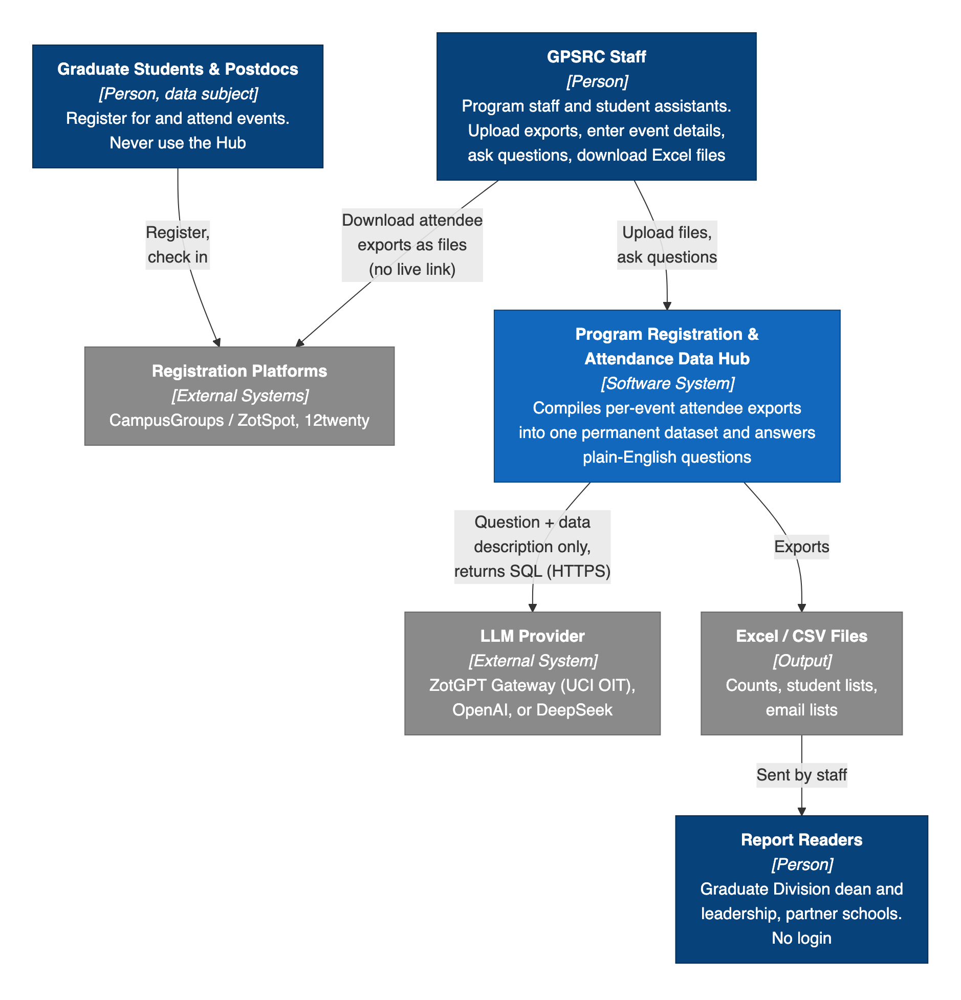
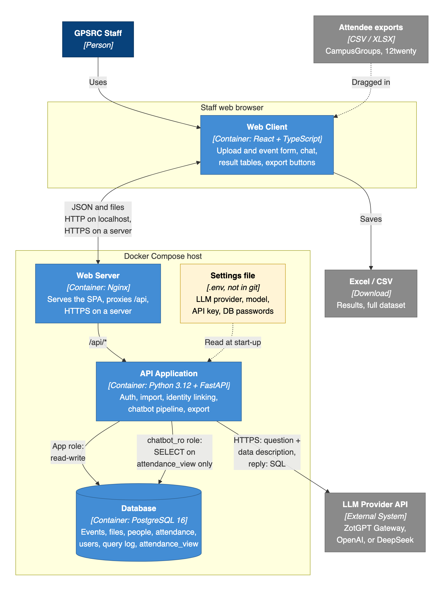
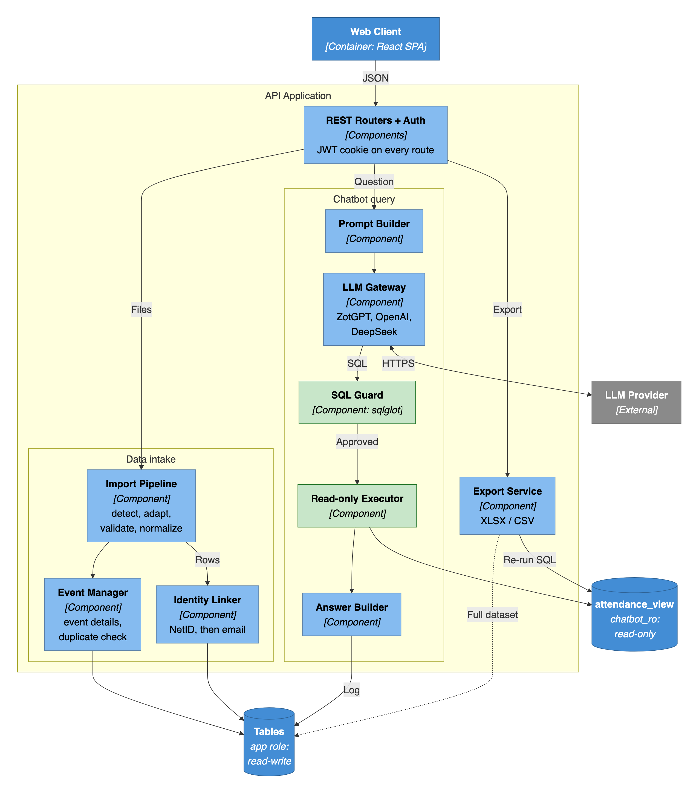
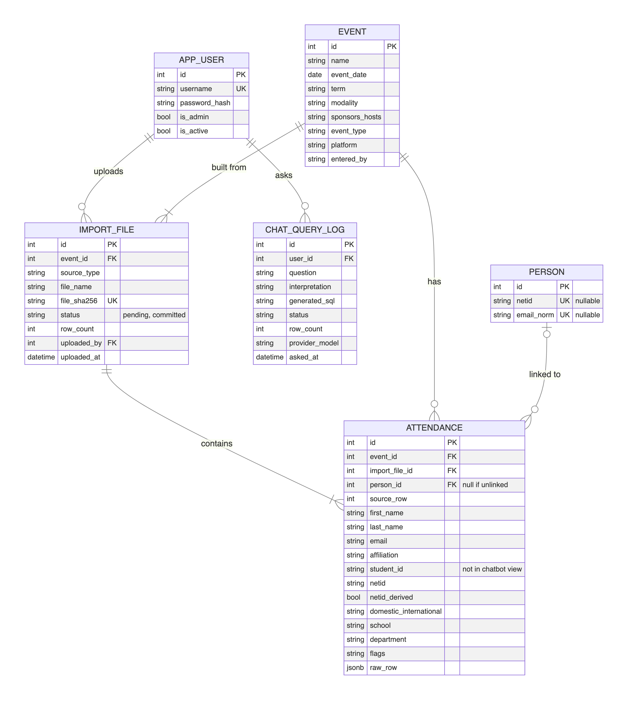
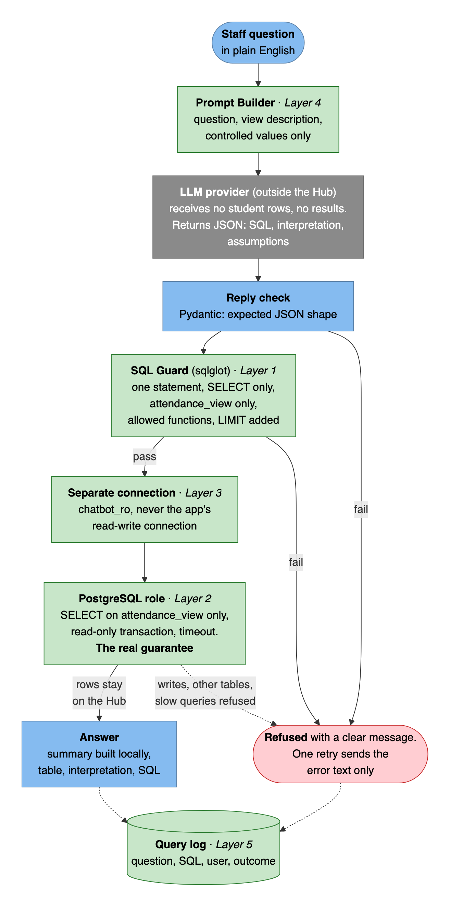
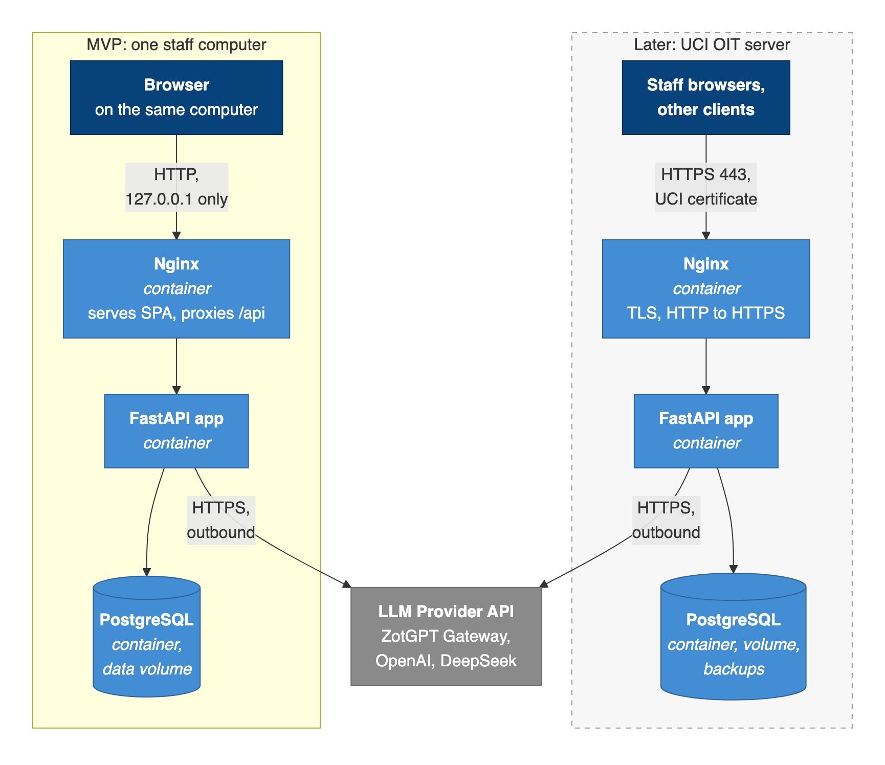
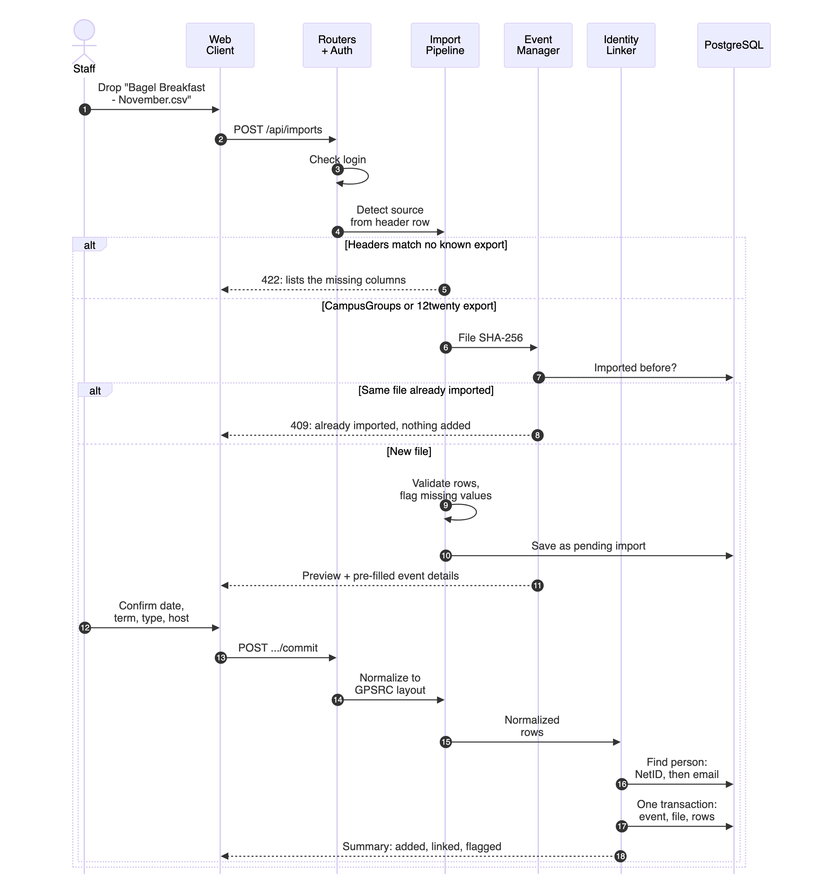
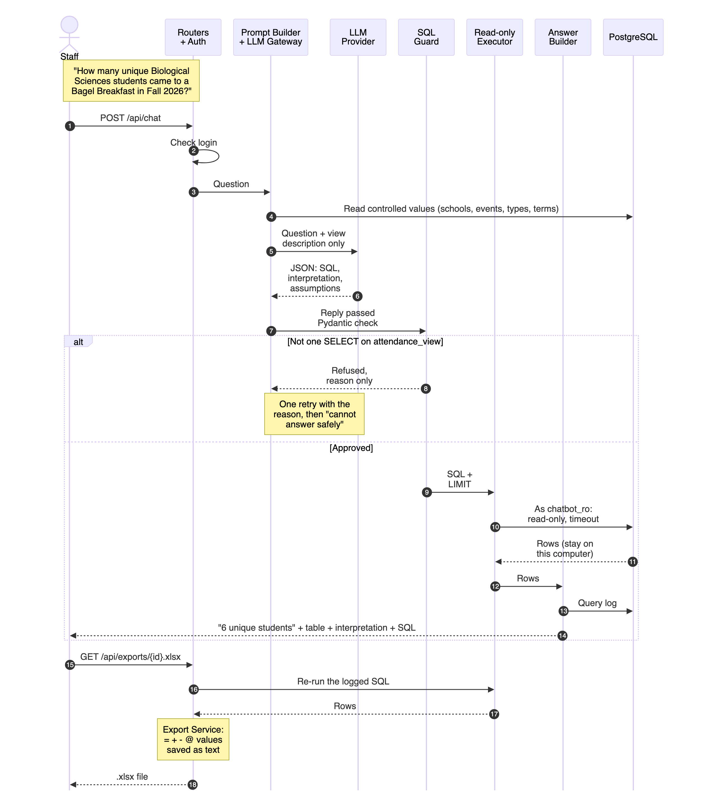

# Project Scope and High-Level Design

## Program Registration & Attendance Data Hub

**Team:** Brandon Y Lau, Molly Tran, Jennifer Sun, Zhenyu (Eric) Song

**Sponsor:** Kayleigh Anderson-Natale, PhD, Director of Postdoc and Professional Development, UCI Graduate Division

**Version:** 2.0, October 16, 2026. Replaces version 1.0 (`deprecated_assignment1.md`), which described a registration–attendance reconciliation hub. The sponsor changed the project's focus on October 14.

**Sources:** the sponsor proposal, the 10/7 and 10/14 sponsor meetings, the 10/16 instructor meeting, the GPSRC data-process note, and the sponsor's sample files in `data/`.

| Section | Contents |
|---|---|
| 1. Project Overview | Purpose, users and stakeholders, success criteria, deliverables, milestones |
| 2. Scope Definition | Scope changes, system boundaries, prioritized features, inputs, assumptions, technology stack, acceptance criteria |
| 3. High-Level Architecture | C4 context, container, and component diagrams; data model; chatbot pipeline and safety layers; deployment; two key scenarios |
| 4. Design Rationale | Major decisions with alternatives and trade-offs; constraints; risks |
| Appendices | Chatbot benchmark examples, glossary, source documents |

All diagrams are Mermaid sources in `diagrams/*.mmd`, rendered to the PNG files shown here.

---

## 1. Project Overview

### 1.1 Purpose

The Graduate & Postdoctoral Scholar Resource Center (GPSRC) in UCI Graduate Division runs professional development, wellness, and fellowship events for graduate students and postdocs. Each event produces one attendance file. Today the data flows like this:

1. Students and postdocs register on **CampusGroups/ZotSpot** or **12twenty**.
2. At the event they check in on an iPad or laptop (a Google Form), or they join on Zoom.
3. Student assistants compare the check-ins with the registrations and mark attendance on the platform.
4. They download the platform's attendee list for that event and paste it into a year-long "GPSRC Data Project" spreadsheet, adding event details by hand.

Step 3, reconciliation, is routine work for front-desk staff, and the sponsor said it is not a pain point, so automating it is optional. The problem is what happens **after** step 4:

- **The data is scattered.** It sits in one file per event and one large spreadsheet per year. Excel becomes hard to filter and combine across terms and years.
- **The two platforms export different fields.** 12twenty has no NetID, Student ID, or domestic/international field, and it says "Program" where CampusGroups says "Department".
- **Common questions are hard to answer.** A new dean asked for a full year of programming data. A school asked how many of its students attended. Staff want to invite past Bagel Breakfast attendees to a new Donut Breakfast. The spreadsheet counts rows, not people, so even "how many *unique* students came" takes manual work.
- **Staff are not SQL users.** The sponsor has some SQL experience, but it is long unused.

**What we will build.** A tool that runs on one computer:

- Staff drag in each event's attendee export, unchanged, and confirm the event details.
- The Hub adds every upload to **one permanent dataset** that keeps growing across academic years.
- Staff ask questions in plain English through an **AI chatbot**. They get exact numbers, student lists, and email lists, and download them as Excel files.
- The chatbot never sends student records to the AI provider. The AI only writes SQL, and the Hub runs that SQL locally under a read-only database role.

**What it does not do.** It does not replace CampusGroups or 12twenty, and it never writes back to them. In the MVP it does not reconcile registrations with check-ins; that is an optional P2 feature.

**Why it matters.** The sponsor was clear that the value is not mainly time saved. It is the ability to **show the GPSRC's work to leadership** (reach by school, by program, and by unique students) and to **find gaps in service**, for example low attendance from humanities students.

### 1.2 Target users and stakeholders

| Stakeholder | Role | Main interest |
|---|---|---|
| Kayleigh Anderson-Natale, Director (sponsor) | Primary user | Answer reporting questions quickly; show GPSRC reach to the dean and partner schools |
| Rosie Victor and Karen Friedlander, GPSRC staff | Users | Keep the existing data process; confirm export formats; pull outreach lists |
| GPSRC student assistants | Users who upload files | A simple upload flow that matches the files they already download |
| Graduate Division dean and leadership; partner schools | Report readers (no login) | Accurate counts and lists, e.g., how many of a school's students attended |
| Graduate students and postdocs | Data subjects (no login) | Privacy of their records under FERPA |
| UCI OIT | Possible future host; runs ZotGPT | Security review before hosting the tool or using real data |
| Course instructors and TAs | Reviewers | A sound scope and architecture, delivered sprint by sprint |
| MSWE team | Builders | A working prototype and a clean handoff |

### 1.3 Success criteria and key deliverables

**Success criteria.** The MVP succeeds when it passes the nine acceptance criteria in Section 2.7. In short:

| Area | Criterion |
|---|---|
| Compile | The 10 sample files import into the same attendee data as the sponsor's compiled dataset (293 rows, 79 unique NetIDs), and re-uploading a file adds nothing |
| Query | The chatbot answers a benchmark of about 25 sponsor-style questions with at least 90% correct results (proposed target), on every configured provider |
| Export | Every result downloads as Excel, and no exported cell runs as a formula |
| Privacy and security | No LLM request contains attendee rows or results; harmful SQL is refused by two independent layers; nothing is visible without signing in |

**Proposed measurable goal (to agree with the sponsor on 10/21).** By December 4, 2026, staff can answer the sponsor's typical reporting questions from one tool, each in under a minute including the Excel download, with at least 90% of benchmark answers correct. This includes questions that cannot be answered from the spreadsheets today, such as unique students per school across terms.

**Deliverables (by December 4, 2026):**

- the working prototype, packaged with Docker Compose, and a setup guide;
- the database schema and a data dictionary, including the chatbot view;
- import adapters, field mappings, and the synthetic sample files;
- the chatbot pipeline with the provider adapters, the benchmark set, and its results;
- automated tests, including the security tests in acceptance criteria 6–9;
- a user guide, a known-limitations list, and handoff notes for a later move to a UCI OIT server.

**Milestones (tentative; one-week sprints, sponsor check-ins on Wednesdays):**

| Week | Dates | Focus | Checkpoint |
|---|---|---|---|
| 4 | Oct 15–21 | Scope reset, this design, repository and Docker Compose skeleton, CI | Sponsor agrees to the scope on 10/21 |
| 5 | Oct 22–28 | Database schema, import pipeline for both exports, event-details form; check ZotGPT Gateway compatibility | Acceptance 1 and 2 pass |
| 6 | Oct 29–Nov 4 | Chatbot pipeline: prompt builder, three provider adapters, SQL guard, read-only role; first benchmark set | First chatbot answers on sample data |
| 7 | Nov 5–11 | Chat UI, answer view, Excel/CSV export with formula guard, login; security tests | Mid-project demo to the sponsor |
| 8 | Nov 12–18 | P1: filter table, data-quality view, follow-up questions, saved queries | P1 features shown |
| 9 | Nov 19–25 | P1: multiple staff accounts, historical import if confirmed; benchmark tuning; P2 only if ahead | Feature freeze |
| 10 | Nov 26–Dec 4 | Hardening, documentation, handoff (Thanksgiving falls on Nov 26–27) | Final demonstration |

---

## 2. Scope Definition

The Hub is a tool that runs locally on one computer. Staff upload each event's attendee export from 12twenty or CampusGroups. The Hub adds every upload to one permanent dataset that keeps growing across academic years. Staff then ask questions in plain English through an AI chatbot and get back numbers, student lists, and email lists that they can download as Excel files.

### 2.1 Scope changes since the proposal

The sponsor narrowed the project in the first two meetings. The table below records each change and who made it.

| Item | Original proposal | Current scope | Decided by |
|---|---|---|---|
| Core purpose | Reconcile registration records with attendance evidence | Compile per-event attendee exports into one permanent dataset and query it | Sponsor, 10/14 |
| Registration–attendance reconciliation | Required | Optional (P2). Student assistants already do it as part of their front-desk work, so it is not a pain point. | Sponsor, 10/14 |
| Query interface | Fixed filter-based reports | AI chatbot that answers questions in plain English (P0) | Team, 10/16; to present to the sponsor on 10/21 |
| Certificate and multi-session programs | Required | Out of scope for now; the sponsor will revisit them only if time allows. Certificate rules remain a P2 idea (F20). | Sponsor, 10/7 |
| Input files | 12twenty, CampusGroups, Zoom, in-person sign-in, certificate cohort | 12twenty and CampusGroups attendee exports only. Zoom and sign-in files return only with P2 reconciliation. | Sponsor, 10/14 |
| Outputs | Four fixed reports (event, certificate, reach, data quality) | Numbers, student lists, and email lists, exported to Excel. Charts are not needed. | Sponsor, 10/14 |
| Hosting | Web application; AWS was considered | Local, single computer. Public cloud is excluded for privacy. A UCI OIT server is a possible later phase. | Sponsor, 10/14 |
| Users and roles | Administrator and read-only roles | Login is required to see any data. The MVP has one staff account. Multiple staff accounts come next (P1), in case the Hub later moves to a shared server. Permission roles are optional (P2). | Sponsor, 10/14; team, 10/16 |
| Project name | Program Registration & Attendance Reconciliation Hub | Program Registration & Attendance Data Hub | Team, 10/16 |

### 2.2 System boundaries

| In scope (P0, MVP) | Should have (P1) and optional (P2) | Out of scope |
|---|---|---|
| Import of 12twenty and CampusGroups attendee exports, unchanged | P1: filter table without AI, as a fallback and for checking answers | Public cloud hosting (AWS etc.), UCI SSO, deployment to OIT servers |
| One permanent, growing dataset in the GPSRC Data Project layout | P1: data-quality view and manual filling of blank fields | Student information system (SIS) integration |
| One person tracked across events by NetID | P1: chatbot follow-up questions; saved common queries | Live 12twenty, CampusGroups, or Zoom APIs; writing back to these platforms |
| AI chatbot for plain-English questions, with a pluggable LLM provider | P1: import of the historical GPSRC Data Project sheet | Arbitrary spreadsheet formats |
| Excel and CSV export of every result | P2: registration–attendance reconciliation | Automatic fuzzy merging of people |
| Local install with one staff login | P1: multiple staff accounts. P2: proactive AI insights, charts, certificate rules, permission roles | Real student data during the capstone |

### 2.3 Major features

**P0: required for the MVP**

- **F1. Import platform exports.**
  - Staff drag and drop one or more files: 12twenty (.xlsx) and CampusGroups (.csv or .xlsx).
  - Files are used exactly as the platforms export them. Staff do not edit headers, punctuation, or spacing first.
  - The Hub detects the source from the header row. A file whose headers do not match a known export is rejected, and the message lists the missing columns.
  - A row with missing values is still imported and is flagged.
- **F2. Event details.**
  - Each file is one event. The export files do not contain event details, so staff enter or confirm them at upload: event name (pre-filled from the file name), event date, term, in person/virtual/hybrid, sponsor/host/partners, event type, and who entered the data.
  - For CampusGroups files, the date can be pre-filled from the Event Registration UID (e.g., `CG-20261007-001`), and staff confirm it. A 12twenty "Registration Date" is not the event date and is not used.
- **F3. One common layout.**
  - Every row is converted to the 19 columns of the sponsor's GPSRC Data Project template, the same layout as the sample `GSPRC Compiled Dataset.xlsm`.
  - 12twenty fields map as follows: College/School to School, Major/Academic Program to Department, and Degree to Affiliation (Doctoral to Doctoral Student, Masters to Master's Student, Postdoctoral to Postdoc).
  - A 12twenty NetID is derived only from an address of the form `netid@uci.edu`. Dot-name and `@hs.uci.edu` addresses get no NetID and are flagged.
  - Fields a source does not provide, such as Student ID and domestic/international in 12twenty, stay blank. The Hub never guesses them.
  - Every stored row keeps its source file name and row number.
- **F4. Permanent, growing dataset.**
  - Data is stored in a local database and grows with every upload. It is not split by academic year.
  - Uploading the same file twice shows a warning and adds no duplicate rows.
- **F5. One person across events.**
  - A row is linked to a person by NetID. A row without a NetID is linked by its normalized email to the person with the same email. This is what makes counts of unique students and "events per student" possible.
  - A row with neither a NetID nor an email is kept but not linked, and is flagged.
  - Only exact matches link records. Within one event, a person appears once.
- **F6. AI chatbot query.**
  - Staff type a question in plain English and get a number, a table, or a list. At minimum, the chatbot answers the kinds of questions the sponsor raised:
    - How many events did a given student attend in 2026–27?
    - Which School of Medicine students attended the 9/30 Bagel Breakfast?
    - How many unique Biological Sciences students attended any event this year?
    - Attendance counts by school, by event type, or by domestic/international status.
    - The emails of everyone who attended a Bagel Breakfast, to invite them to the Donut Breakfast.
    - Which schools have the lowest attendance (to find gaps in service)?
  - Each answer shows a one-line summary, the result table, how the chatbot read the question (the filters it used), the generated SQL, and the row count. This lets staff check the answer.
  - When a question is ambiguous, for example whether "this year" means the academic or the calendar year, the chatbot states the assumption it made.
- **F7. Chatbot privacy and safety.**
  - The LLM receives only the question, the description of the queryable data (column names and meanings), and lists of values from controlled fields: school (a drop-down on CampusGroups) and the staff-entered event names, event types, and terms. It never receives attendee rows, query results, or free text that students typed, such as Department. This keeps instructions hidden in student-entered text out of the prompt.
  - The LLM returns SQL, which runs locally. The one-line summary is built locally from the result.
  - Generated SQL is treated as untrusted input and passes five layers of protection:
    1. **SQL check (sqlglot).** Exactly one statement, of type SELECT, reading only the approved view and using only allow-listed functions. A row limit is added for the on-screen answer (for example, 1,000 rows, with a notice when it is reached); exports re-run the same SQL with a higher cap. Anything else is rejected with a clear message.
    2. **Read-only database role.** The query runs as a dedicated role that can SELECT from the approved view and nothing else, inside a read-only transaction with a time limit. Even if a statement slips past the check, the database refuses any write, any other table (such as user accounts), and any long-running query. This layer is the real guarantee; the prompt's instructions are not relied on.
    3. **Separate connection.** The chatbot uses only that role's connection, never the application's read-write connection.
    4. **Controlled values only** (first bullet above).
    5. **Query log.** Each question, generated SQL, user, and outcome is logged for later review.
  - All other application SQL, including imports and the filter table (F11), uses bound parameters. Column names, which cannot be bound, come from a fixed allow-list.
- **F8. Pluggable LLM provider.**
  - All chatbot calls go through one LLM interface. The provider, model, API key, and endpoint are set in a local settings file, and switching providers needs no code change.
  - The MVP supports three providers: ZotGPT Gateway (UCI OIT), OpenAI, and DeepSeek.
  - ZotGPT is the recommended default for real data because it is managed by UCI, and a question may contain a student's name.
- **F9. Export.**
  - Every table or list result downloads as Excel (.xlsx) or CSV. The whole dataset can also be exported in the GPSRC Data Project layout.
  - Exports are protected against formula injection. A value that starts with `=`, `+`, `-`, or `@` (for example, a department name a student typed) is written as plain text, so Excel never runs it as a formula. This matters for .xlsx because openpyxl treats a string starting with `=` as a formula by default.
- **F10. Local install and login.** The Hub runs on one computer and is reached only from that computer. There is one staff account. No data can be viewed or exported without signing in.

**P1: should have**

- **F11. Filter table without AI.** Staff filter the dataset by column and export the result. This works when the LLM is wrong or offline and helps staff check chatbot answers.
- **F12. Data quality.** A view lists rows missing a NetID, email, school, or other field, and people who may be duplicates (same name, different email). Staff can fill in blank fields by hand, as the sponsor asked on 10/7.
- **F13. Follow-up questions.** The chatbot keeps the context of the conversation, e.g., "Of those, how many are international?"
- **F14. Saved queries.** Staff save common questions, such as a quarterly report or unique students per school, and run them with one click.
- **F15. Historical import.** Import last year's GPSRC Data Project sheet so the dataset covers past years. Pending sponsor confirmation.
- **F16. Multiple staff accounts.** Each staff member signs in with their own account, and an administrator adds or disables accounts. This prepares the Hub for a shared server later. The uploader is then recorded automatically at upload (F2).

**P2: optional, if time allows**

- **F17. Registration–attendance reconciliation.** Import registrations plus raw check-in (Google Form) or Zoom files, match them automatically, send uncertain matches to staff review, and assign attended, absent, walk-in, or unresolved. Depends on the mismatched sample data the sponsor offered to provide.
- **F18. Proactive AI insights.** The chatbot points out trends and gaps without being asked.
- **F19. Charts.**
- **F20. Certificate eligibility rules.** Not currently requested by the sponsor.
- **F21. Permission roles,** such as a read-only account.

### 2.4 Supported input files

The headers below come from the sponsor's templates and sample files, which keep the real exports' headers.

| Source | Format | Identifiers | Notes |
|---|---|---|---|
| CampusGroups / ZotSpot attendee export | .csv or .xlsx | Net ID (set by the login), Email, Student ID # (self-entered) | 26 columns. Name and email appear twice; the second copy is what the attendee confirmed at registration. Includes School, Department, affiliation, and domestic/international. Walk-ins added as guests have only name, email, and NetID. |
| 12twenty attendee export | .xlsx | Email only (usually `netid@uci.edu`) | 16 columns. Has Graduation Term, College/School, Degree, and Major/Academic Program. No NetID, Student ID, or domestic/international. |
| GPSRC Data Project sheet (P1, F15) | .xlsx | NetID, Email | Already in the target layout |
| GPSRC check-in Google Form, Zoom participant report (P2, F17) | .xlsx / .csv | Email, when present | Used only for reconciliation |

### 2.5 Assumptions

- **A1. Synthetic data.** All sample files are synthetic, with headers identical to the real exports. The sponsor's staff are double-checking the 12twenty sample format (10/14).
- **A2. Inputs are already reconciled.** Each file lists only the people who attended; every 12twenty sample row has `Attended? = YES`. Student assistants keep doing reconciliation by hand unless F17 is built.
- **A3. NetID is the person key.** A NetID is unique. A 12twenty email equals `netid@uci.edu` about 99% of the time. The exceptions (dot-name addresses, `@hs.uci.edu`, often postdocs) are flagged rather than guessed, so one such person may be counted twice until staff fix it (F12).
- **A4. Student ID is never a key.** Students type it in and often get it wrong, and a name shown with a student ID is a FERPA concern. It is stored but not used for matching.
- **A5. Small volume, few users.** Most events have fewer than 50 attendees. Over several years the dataset reaches hundreds of events and tens of thousands of rows. Only a few staff use the Hub, usually one at a time.
- **A6. The platforms stay the system of record.** The Hub never writes back to 12twenty or CampusGroups.
- **A7. LLM access.** The chatbot needs an internet connection and an API key for at least one provider. Without them, import, browsing, and export still work.
  - ZotGPT Gateway is open to UCI faculty, staff, and graduate students through UCInetID sign-in, with $100 of OIT credits for testing, so the team can use it during development.
  - ZotGPT states that data is not used to train models, that it follows P3 security standards, that P4 data is not permitted, and that data is kept for up to 12 months.
  - Whether real GPSRC attendance data may be used with ZotGPT must be confirmed with the sponsor and OIT before any real-data use.

### 2.6 Initial technology stack

| Layer | Choice |
|---|---|
| Frontend | React 18 + TypeScript (Vite), MUI + DataGrid, TanStack Query, react-dropzone |
| Backend API | Python 3.12, FastAPI on Uvicorn, Pydantic v2 |
| Data processing | pandas + openpyxl (read CSV/XLSX imports, write XLSX/CSV exports); RapidFuzz only if F17 is built |
| Database | PostgreSQL 16, SQLAlchemy 2.0, Alembic migrations. The chatbot can query only one flattened view in the GPSRC Data Project layout, without Student ID. It connects through a separate read-only database role that can SELECT from that view and nothing else. |
| LLM integration | Our own text-to-SQL pipeline instead of a text-to-SQL framework. The official `openai` Python SDK sits behind our provider interface, with settings for ZotGPT Gateway, OpenAI, and DeepSeek. OpenAI and DeepSeek use the chat-completions format, and ZotGPT Gateway follows the Portkey API specification, which uses the same call (to be verified by October 28). sqlglot checks every generated SQL statement, and Pydantic validates the LLM's JSON reply. |
| Security | Argon2 password hashing, JWT in an httpOnly, SameSite=Strict cookie (also marked Secure under HTTPS), Nginx as the only container exposed to the network, API keys kept in the server-side settings file and never sent to the browser |
| Testing | pytest + HTTPX, Vitest + React Testing Library, Playwright (end-to-end demo path), and a chatbot benchmark of questions with known answers |
| Delivery | Docker Compose with three containers: Nginx, the FastAPI app, and PostgreSQL. Nginx serves the built React files, forwards `/api` requests to FastAPI, and handles HTTPS. On one computer it listens only on localhost. On an OIT server it serves HTTPS with a UCI-issued certificate, so outside clients can connect. The same containers run in both places. GitHub Actions CI. |

### 2.7 MVP acceptance criteria

1. Importing the 10 sample files in `data/Example Data` and entering their event details produces the same data as `GSPRC Compiled Dataset.xlsm`: 293 rows and 79 unique NetIDs. Of the two rows without a NetID, the one with an email (Bagel Breakfast, November) links to an existing person, and the one with no email (LinkedIn Info Session) is flagged.
2. Uploading the same file twice adds no duplicate rows.
3. The chatbot answers a benchmark set of questions correctly at the agreed rate (proposed: at least 90% of about 25 questions). The correct answers are computed from the compiled sample dataset.
4. The benchmark runs with each configured provider after only a settings change.
5. Every table or list result exports to Excel.
6. A log of every LLM request shows no attendee rows or query results.
7. Without signing in, no data can be viewed or exported.
8. A test set of harmful SQL (DROP, DELETE, multiple statements, reading the user-account table, `pg_sleep`) is refused by the SQL check, and is refused again by the database role when the check is switched off for the test.
9. An exported value starting with `=` opens in Excel as text, not as a formula.

### 2.8 Open items to confirm with the sponsor (10/21 meeting)

- Agreement that the AI chatbot is P0 and reconciliation is P2.
- Whether ZotGPT may be used with real data, given that a question may contain a student's name.
- Whether last year's GPSRC Data Project sheet should be imported (F15).
- Who enters the event details at upload (F2): student assistants or staff.
- Which computer the Hub will run on: Mac or Windows, and whether Docker Desktop can be installed on it (this may need administrator rights).

---

## 3. High-Level Architecture (C4 Model)

We use the C4 model. Sections 3.1–3.3 cover its three levels: context, containers, and the components inside the API application. Sections 3.4–3.7 add the data model, the chatbot pipeline with its safety layers, the deployment view, and two runtime scenarios.

The C4, flow, and deployment diagrams (Figures 1–3, 5, and 6) share these colors:

| Color | Meaning |
|---|---|
| Dark blue | People |
| Blue | The Hub, its containers, and its components |
| Green | The chatbot's safety layers |
| Grey | External systems and files |

### 3.1 Level 1: System context



*Figure 1. System context.*

- **Inputs arrive as files.** Student assistants mark attendance on CampusGroups or 12twenty. Staff then download each event's attendee export and upload it to the Hub. The Hub has no live connection to either platform, so the platform arrows run from people to systems.
- **One live external connection: the LLM provider.** Only the question and a description of the data cross it (F7). The provider returns SQL; it never sees student records or results.
- **Outputs.** Answers appear on screen and download as Excel or CSV. Staff decide what to send to the dean, partner schools, or outreach lists.
- **Students and postdocs never use the Hub.** They are the data subjects, which is why FERPA shapes the privacy design.

### 3.2 Level 2: Containers



*Figure 2. Containers.*

| Container | Technology | Responsibilities | Notes |
|---|---|---|---|
| Web Client | React 18, TypeScript, Vite, MUI DataGrid, TanStack Query, react-dropzone | Login, upload and event-details form, chat, result tables, export buttons; P1 filter table and data-quality view | Runs in the browser and holds no API keys |
| Web Server | Nginx | Serves the built SPA, forwards `/api/*` to the API, handles TLS on a server | The only container with a published port. Bound to 127.0.0.1 on one computer |
| API Application | Python 3.12, FastAPI, Uvicorn, Pydantic v2, pandas, openpyxl, sqlglot, `openai` SDK | Auth, import, identity linking, chatbot pipeline, export | Stateless; reads the settings file at start-up |
| Database | PostgreSQL 16 | All persistent data, plus `attendance_view` for the chatbot | Two roles: the app role (read-write) and `chatbot_ro` (SELECT on the view only). Data lives in a Docker volume |
| Settings file | `.env` | LLM provider, model, endpoint, API key; database passwords | Not in git and never sent to the browser |

### 3.3 Level 3: Components of the API Application



*Figure 3. Components of the API Application. Responses travel back through the routers; those return arrows are not drawn. The two green components are the layers that stop harmful SQL (Section 3.5).*

| Component | Responsibility | Features |
|---|---|---|
| REST Routers + Auth | HTTP endpoints; login; checks the JWT cookie on every route | F10, F16 |
| Import Pipeline | Detects the source from the header row, runs that export's adapter, validates rows, normalizes them to the GPSRC layout, derives NetIDs, flags missing values | F1, F3 |
| Event Manager | Holds the pending import, pre-fills event details (name from the file name, date from the CampusGroups UID), blocks duplicate files by SHA-256 | F2, F4 |
| Identity Linker | Links each row to a person by NetID, then by normalized email; flags rows with neither; keeps one row per person per event | F5 |
| Prompt Builder | Assembles the view description, controlled values, rules, examples, and the question | F6, F7 |
| LLM Gateway | One interface with adapters for ZotGPT Gateway, OpenAI, and DeepSeek; timeouts; one retry | F8 |
| SQL Guard | Parses the generated SQL with sqlglot and applies the allow-list; adds a LIMIT | F7, layer 1 |
| Read-only Executor | Runs approved SQL on the `chatbot_ro` connection in a read-only transaction with a timeout | F7, layers 2–3 |
| Answer Builder | Builds the summary sentence locally; returns table, interpretation, and SQL; writes the query log | F6; F7, layer 5 |
| Export Service | Re-runs the logged SQL as `chatbot_ro` and writes XLSX/CSV with the formula guard. The full-dataset export reads the tables with the app role, because the GPSRC layout includes Student ID | F9 |

The application is a **modular monolith**: one deployable FastAPI service whose modules match the components above. Each module can later become its own service if needed.

### 3.4 Data model



*Figure 4. Core data model.*

Four design rules shape the model:

- **Rows are stored as recorded.** School, department, affiliation, and similar fields live on each `ATTENDANCE` row, exactly as that export gave them. `PERSON` holds only identity (NetID and normalized email). Sources often disagree, for example 12twenty "Program" versus CampusGroups "Department", and the Hub never overwrites or infers a value (F3).
- **One row per person per event.** `ATTENDANCE` has a unique constraint on (`event_id`, `person_id`). Unique counts use `person_id`, so they stay correct when the same student appears in many events (F5).
- **Traceability.** Each row keeps `import_file_id`, `source_row`, and `raw_row`, the original values, so any answer can be traced back to a file and row. `IMPORT_FILE.file_sha256` is unique, which blocks duplicate uploads (F4).
- **Least privilege for the chatbot.** The chatbot never touches these tables. It can read only `attendance_view`, a flat view based on the GPSRC Data Project layout, without Student ID:

| `attendance_view` column | Comes from | Notes |
|---|---|---|
| `person_key` | `ATTENDANCE.person_id` | Internal number for unique counts; null when a row is unlinked |
| `event_name`, `event_date`, `term`, `modality`, `sponsors_hosts`, `event_type`, `platform` | `EVENT` | Entered or confirmed at upload |
| `academic_year` | Derived from `term` | Fall 2026, Winter 2027, Spring 2027, and Summer 2027 all belong to `2026-27` |
| `first_name`, `last_name`, `email`, `netid`, `affiliation`, `domestic_international`, `school`, `department` | `ATTENDANCE` | As recorded; blank when the source does not provide the field |

Student ID, `raw_row`, user accounts, and the query log are not in the view.

### 3.5 Chatbot query pipeline and safety layers



*Figure 5. Chatbot query pipeline. Every green step is one of the five safety layers from F7.*

**Why the LLM writes SQL instead of reading data.** We send the LLM the question and a description of the data, never the data itself. This has four advantages:

- **Privacy.** No student record leaves the computer.
- **Exact answers.** The database does the counting. LLMs miscount large tables, and these numbers go into reports to the dean.
- **Scale.** The prompt stays the same size however large the dataset grows.
- **Checkable.** Staff can read the SQL and the interpretation, and export the exact rows behind the answer.

**What the prompt contains.**

```text
1. Instructions: PostgreSQL dialect; query only attendance_view; reply as JSON
   with "sql", "interpretation", "assumptions".
2. View description: each column of attendance_view and what it means.
3. Controlled values: school names, event names, event types, terms.
4. Rules: an academic year runs Fall to Summer; "unique students" means
   COUNT(DISTINCT person_key); Bagel Breakfast has one event name per month.
5. 5-10 worked examples (question -> SQL), kept separate from the benchmark.
6. The staff member's question.
```

**Example.** For "How many unique Biological Sciences students came to a Bagel Breakfast in Fall 2026?" the LLM returns:

```json
{
  "sql": "SELECT COUNT(DISTINCT person_key) AS unique_students FROM attendance_view WHERE school = 'School of Biological Sciences' AND event_name LIKE 'Bagel Breakfast%' AND term = 'Fall 2026'",
  "interpretation": "Unique people from the School of Biological Sciences at any event whose name starts with 'Bagel Breakfast' in Fall 2026.",
  "assumptions": ["'Bagel Breakfast' covers the October, November, and December events."]
}
```

On the sample data the answer is **6**. The staff member sees "6 unique students", the interpretation, the SQL, and an export button.

**The five layers.**

| Layer | Mechanism | What it stops |
|---|---|---|
| 1. SQL check | sqlglot parses the reply. It must be one statement, a SELECT (CTEs allowed), reading only `attendance_view`. Functions must be on an allow-list: aggregates, string and date functions, `COALESCE` (plus `CASE` expressions). A row limit is added for the on-screen answer | Multiple statements, writes, other tables, `pg_sleep` and other dangerous functions, with a clear message to staff |
| 2. Read-only role | `chatbot_ro` can SELECT from the view and nothing else; read-only transactions; statement timeout | Anything that slips past layer 1. The database itself refuses writes, other tables, and slow queries |
| 3. Separate connection | The executor holds only `chatbot_ro` credentials | Generated SQL can never run on the application's read-write connection |
| 4. Controlled values | Only drop-down and staff-entered values go into the prompt | Instructions hidden in text that students typed (indirect prompt injection) |
| 5. Query log | Question, SQL, interpretation, user, outcome, and provider are recorded | Lets problems be reviewed later; also supplies the SQL for exports |

Layer 2 is set up once, when the database is created. All tables live in schema `hub` and belong to the app role:

```sql
CREATE ROLE chatbot_ro LOGIN PASSWORD '<from the settings file>';
GRANT USAGE ON SCHEMA hub TO chatbot_ro;
GRANT SELECT ON hub.attendance_view TO chatbot_ro;   -- the only grant: no tables, no writes
ALTER ROLE chatbot_ro SET default_transaction_read_only = on;
ALTER ROLE chatbot_ro SET statement_timeout = '5s';
```

A PostgreSQL view runs with its owner's privileges by default, so `chatbot_ro` can read the view without any grant on the tables underneath. The real protection is the missing grants: with SELECT on one view and nothing else, the role has no way to write or to read another table. The read-only setting and the timeout are extra safety. A query cannot switch them off either, because `set_config` is not on layer 1's function allow-list.

**Accuracy.** The benchmark (Appendix A) scores *execution accuracy*: the result of the generated SQL must equal the expected result. Two different SQL statements that return the same answer both count as correct. When an answer is wrong, it stays checkable on screen, and the P1 filter table (F11) offers a path that does not depend on the LLM.

### 3.6 Deployment view



*Figure 6. Deployment. The MVP runs on one staff computer; a later phase can move the same containers to a UCI OIT server.*

- **MVP.** Docker Compose starts three containers on one computer. Only Nginx publishes a port, bound to 127.0.0.1, so no other machine can reach the Hub. PostgreSQL stores its data in a named Docker volume, which survives restarts and upgrades. The only outbound traffic is HTTPS to the chosen LLM provider.
- **Later phase.** The same images move to an OIT server. Nginx then serves HTTPS with a UCI-issued certificate and redirects HTTP to HTTPS, so staff and other clients can connect from their own computers. This step relies on multiple staff accounts (F16) and needs OIT's security review (A7). No application code changes.

### 3.7 Key scenarios

**Scenario 1: Staff import one event's attendee export.**



*Figure 7. Scenario 1: import an event file. All requests pass through Nginx, which is omitted here.*

- **Wrong files are refused early.** The header row decides the adapter (step 4). An unknown layout is refused before anything is saved, with the missing columns listed (step 5).
- **Duplicates are refused.** A file whose SHA-256 is already stored is refused with a warning (steps 6–8).
- **Staff confirm before anything is final.** The file is held as a pending import (step 10) while staff confirm the event details the file lacks (steps 11–12).
- **One transaction.** On commit, rows are normalized, linked by NetID and then email, and saved together with the event and file record in one transaction (steps 14–17). The summary shows how many rows were linked by NetID, linked by email, or flagged (step 18).

**Scenario 2: Staff ask a question and export the answer.**



*Figure 8. Scenario 2: chatbot question and Excel export. "Staff" acts through the Web Client.*

- **Only the question and description go out.** Controlled values are read locally (step 4). The provider receives the question and the view description only (step 5).
- **The reply is checked twice before it runs.** First its JSON shape (Pydantic), then the SQL Guard. A refused reply gets one retry, which carries the reason and no data (steps 7–8).
- **Rows stay on the computer.** Approved SQL runs as `chatbot_ro` in a read-only transaction (step 10). The answer, built locally, returns with the interpretation and SQL (steps 12–14).
- **Export re-runs the same SQL.** The export re-runs the logged SQL, again read-only, and writes the .xlsx with the formula guard (steps 15–18). The file uses the same query as the on-screen answer, but with the higher export cap, so a long list is not cut off at the screen limit.

---

## 4. Design Rationale

### 4.1 Major decisions

| # | Decision | Choice (vs. alternative) | Why | Trade-off |
|---|---|---|---|---|
| 1 | Product focus | Compile and query (vs. the proposal's reconciliation hub) | On 10/14 the sponsor said reporting is the pain point. Reconciliation is routine front-desk work, done by staff the GPSRC employs anyway | The proposal's matching and review features move to P2 (F17) |
| 2 | Query interface | AI chatbot in plain English (vs. fixed reports or a filter-only UI) | The sponsor's questions vary by event, school, program, date range, and contact list, and staff do not write SQL. Fixed reports cannot anticipate the next question | An LLM can misread a question. We show the interpretation and SQL, test with a benchmark, and add a filter table (F11) |
| 3 | What the LLM sees | Data description only, and the LLM returns SQL (vs. sending the data to the LLM) | Privacy, exact counts from the database, a prompt that does not grow with the data, and answers staff can check | The LLM cannot "look" at the data to match spellings. The controlled-values list covers names of schools, events, and terms |
| 4 | Protecting identities | Keep records local (vs. hashing identifiers before sending them, an idea from our 10/14 team meeting) | If no records are sent, nothing needs hashing. Simpler, with fewer ways to fail | A question itself may contain a name. ZotGPT is the default (F8), and real-data use waits for sponsor and OIT approval (A7) |
| 5 | Text-to-SQL implementation | Our own small pipeline on general libraries (`openai` SDK, sqlglot, SQLAlchemy, Pydantic) vs. a framework | **Vanna**'s GitHub repository is archived (read-only) as of 2026. **Dataherald** was last updated in July 2024. **WrenAI** is a full platform with its own modeling language. The **LangChain** SQL agent sends query results back to the LLM, which breaks F7. Our case is one view of 17 columns, and F7 needs full control over what is sent | We write and test the prompt and guard ourselves. The benchmark and security tests (acceptance 3, 6, 8) cover this, and the pipeline is the project's main engineering work |
| 6 | LLM provider | Pluggable: ZotGPT Gateway as default, OpenAI, DeepSeek (vs. one vendor) | UCI may require a UCI-managed service for real data. Developers need flexibility, and costs differ | Providers differ slightly in JSON behavior. Each adapter is tested against the same benchmark (acceptance 4) |
| 7 | Chatbot query surface | One flat view (vs. the normalized tables) | Text-to-SQL is more accurate on one table with clear column names, because the model does not have to choose tables or joins. The view also hides Student ID and every other table | The view must change with the schema. A migration test checks it |
| 8 | SQL safety | Defense in depth, with database permissions as the guarantee (vs. relying on prompt instructions or a parser alone) | Prompts can be ignored and parsers can be fooled; database permissions cannot be argued with | Two places to keep in sync. Acceptance 8 tests each layer on its own |
| 9 | Database | PostgreSQL 16 (vs. SQLite) | Roles and grants on a view, which SQLite does not have, are what make layer 2 possible. PostgreSQL also offers read-only transactions and `statement_timeout`, and the same engine works on an OIT server with several users | Needs a database server, which Docker Compose hides |
| 10 | Deployment | Docker Compose on one computer (vs. public cloud or a native install) | The sponsor ruled out public cloud for privacy (10/14). The same images move to OIT unchanged. One command starts everything | Docker Desktop may need administrator rights on the sponsor's computer (2.8). Fallback: a team laptop for demos |
| 11 | Web server | Nginx container (vs. FastAPI serving the files itself) | Once on an OIT server, outside clients need HTTPS with a UCI certificate, which Nginx handles well, and it serves static files efficiently. The configuration is the same locally | One more container. Locally it serves plain HTTP on 127.0.0.1 only, so no self-signed certificate warnings |
| 12 | Architecture style | Modular monolith (vs. microservices) | Four part-time developers and ten weeks call for one deployable unit. The modules match Figure 3 | Boundaries are kept by code review rather than by the network |
| 13 | Backend framework | FastAPI (vs. Django) | Pydantic validates import rows, API payloads, and the LLM's JSON with one tool. pandas runs in the same process, and the OpenAPI schema generates a typed client | No built-in admin or auth, so we write a small auth module |
| 14 | Identity linking | Exact NetID, then exact email (vs. fuzzy matching) | Inputs are already reconciled (A2). Exact rules are predictable, and the sponsor does not want guessing | Dot-name and `@hs.uci.edu` addresses may count one person twice until fixed (F12) |
| 15 | Student ID | Stored, never used as a key, excluded from the chatbot view | Students type it themselves and often get it wrong, and a name shown with a student ID is a FERPA concern | It cannot help link records |
| 16 | Evidence model | Rows stored as recorded; the person record holds identity only (vs. one merged profile per person) | Sources disagree, and F3 forbids overwriting or inferring. `raw_row` keeps full traceability | A question like "current school" needs a stated rule (for example, the latest row), which the chatbot gives as an assumption |
| 17 | Import approach | One adapter per known export (vs. guessing columns) | Headers are fixed (A1), errors can name the exact missing column, and arbitrary formats are out of scope | A new export format needs a new, small adapter |
| 18 | Upload flow | Preview, then commit (vs. one-step import) | Event details are not in the files (F2), so staff confirm them before anything is final | One extra click per file |
| 19 | Output format | On screen plus XLSX and CSV (vs. CSV only, or built-in charts) | The sponsor works in Excel and builds charts there (10/14). XLSX keeps types; CSV suits other tools | Excel formula injection, handled by the export guard (F9) |
| 20 | Authentication | One staff account in the MVP, multiple accounts in P1; Argon2 and a JWT httpOnly cookie | The sponsor wants login for any data access, and one account is enough for a local prototype (10/14). A shared server later needs per-user accounts | No per-user audit trail until F16 |
| 21 | Import processing | Synchronous (vs. a background job queue) | Files have tens to hundreds of rows and process in seconds | A large historical sheet (F15) may need a background job |

### 4.2 Constraints

- **Schedule and team.** Ten weeks, ending December 4, 2026. Four team members, several working full time.
- **Data.** Synthetic data only during the capstone (A1). No student information system, no live platform APIs, no UCI SSO.
- **Hosting.** No public cloud (sponsor, 10/14). Production hosting is a later OIT decision.
- **AI access.** The chatbot needs internet access and an API key. ZotGPT Gateway gives $100 of test credits and supports per-key spend limits.

### 4.3 Risks and mitigations

| Risk | Impact | Mitigation |
|---|---|---|
| The chatbot gives a wrong but plausible answer | A wrong number reaches a report | Show interpretation, SQL, and rows for every answer; state assumptions; benchmark target of at least 90%; F11 filter table for checking |
| The sponsor does not accept the chatbot-first plan on 10/21 | Rework | Import, the dataset, and export are useful on their own; F11 could become the main query screen |
| Real data may not be sent to any external LLM | Chatbot unusable in production | Only the data description leaves the Hub; ZotGPT is the default; F11 works without an LLM; a locally hosted model could plug into the same gateway later |
| The ZotGPT Gateway API differs from the OpenAI format | Extra adapter work | Verify by October 28; the gateway interface keeps differences in one adapter |
| Docker Desktop cannot be installed on the sponsor's computer | No local installation | Ask on 10/21; run demos on a team laptop; an OIT server remains the long-term home |
| The 12twenty sample format differs from real exports | Real files fail to import | Sponsor staff are checking the format (A1); adapters fail loudly and name the missing columns |
| Identity edge cases (dot-name and `@hs.uci.edu` emails, postdocs) | Some people counted twice | Flag these rows; the F12 data-quality view lets staff fix them |
| School names differ between platforms. The 12twenty template shows "Medicine, Medicine"; CampusGroups uses "School of Medicine". The sample files happen to agree | Counts by school split one school into two | A small school-name mapping in the 12twenty adapter, checked with sponsor staff against real exports |
| A real 12twenty export may include registrants marked `Attended? = NO` (all sample rows say YES) | Non-attendees counted as attendees | The adapter keeps only `YES` rows and reports how many it skipped |
| Team capacity | Missed sprint goals | P0/P1/P2 ordering, one-week sprints, weekly sponsor check-ins; P2 only when ahead |

---

## Appendix A. Chatbot benchmark examples

These expected answers were computed directly from the sponsor's `GSPRC Compiled Dataset.xlsm` (10 Fall 2026 events, 293 rows). The full benchmark of about 25 questions will be written in week 6. It will be kept separate from the worked examples in the prompt.

| # | Question | Expected answer on the sample data |
|---|---|---|
| 1 | How many unique Biological Sciences students came to a Bagel Breakfast in Fall 2026? | 6 |
| 2 | How many events did NetID `aahmed` attend in Fall 2026? | 8 |
| 3 | Which school had the fewest unique attendees in Fall 2026? | School of Information and Computer Sciences (7) |
| 4 | List the emails of everyone who attended any Bagel Breakfast. | 55 unique email addresses (one December row has no email and is flagged) |
| 5 | How many unique people attended each event type? | Professional Development 73; Wellness/Mental Health 59 |
| 6 | How many unique people attended any event this term? | 79 (the LinkedIn Info Session row with no NetID or email is flagged, not counted as a new person) |

## Appendix B. Glossary

| Term | Meaning |
|---|---|
| GPSRC | Graduate & Postdoctoral Scholar Resource Center, part of UCI Graduate Division |
| CampusGroups / ZotSpot | Event registration platform; its exports include the NetID |
| 12twenty | Event registration platform used for career events; its exports include email but no NetID |
| NetID | UCI's unique login ID; the Hub's main key for a person |
| GPSRC Data Project | The sponsor's spreadsheet layout (19 columns) for compiled attendance |
| LLM | Large language model, the AI model behind the chatbot |
| Text-to-SQL | Turning a plain-English question into a SQL query |
| ZotGPT Gateway | UCI OIT's API access to several AI models |
| FERPA | U.S. law protecting student education records |
| Prompt injection | Text that tries to make an AI model ignore its instructions |
| Formula injection | A spreadsheet cell value that Excel would run as a formula |

## Appendix C. Source documents

- Sponsor proposal: `project/2026 Graduate Division MSE Capstone Project Proposal - Kayleigh Anderson Natale.pdf`
- Sponsor meeting notes: `weekly_meeting/10_7/`, `weekly_meeting/10_14/`, and `data/Meeting Notes/` (the sponsor's Zoom summaries)
- GPSRC data process note: `data/GPSRC Data Process 10_5_26.docx`
- Templates and sample data: `data/*.xlsx` and `data/Example Data/`
- Requirements for this document: `requirement.txt` (scope) and `old_requirement.txt` (assignment instructions)
