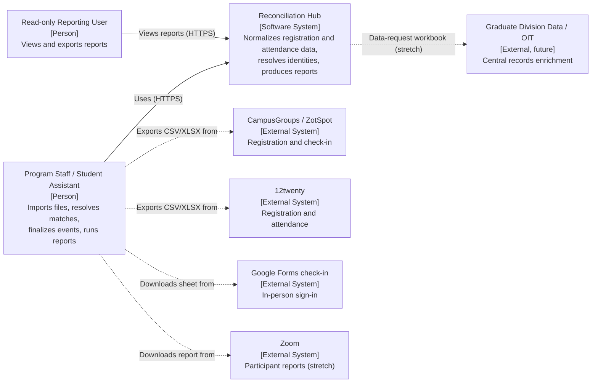
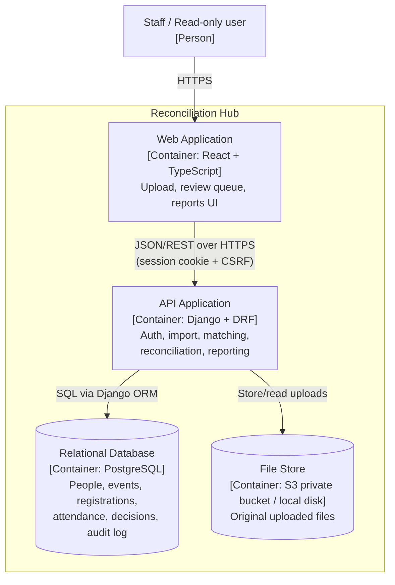
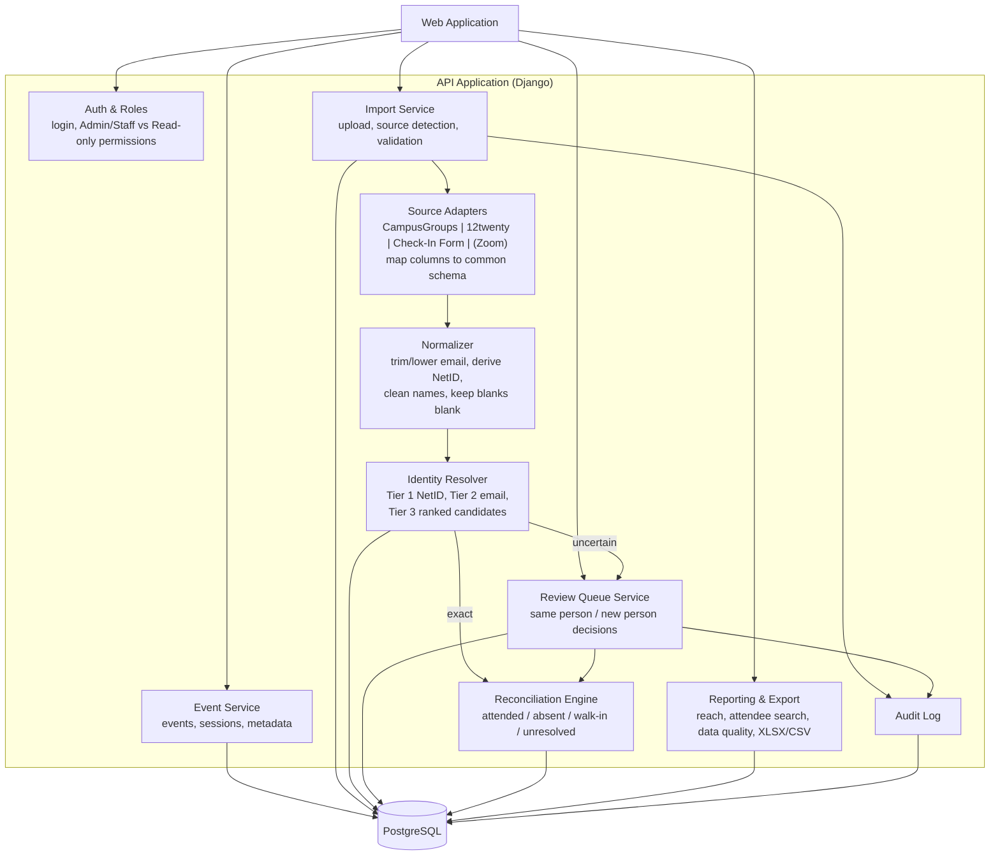
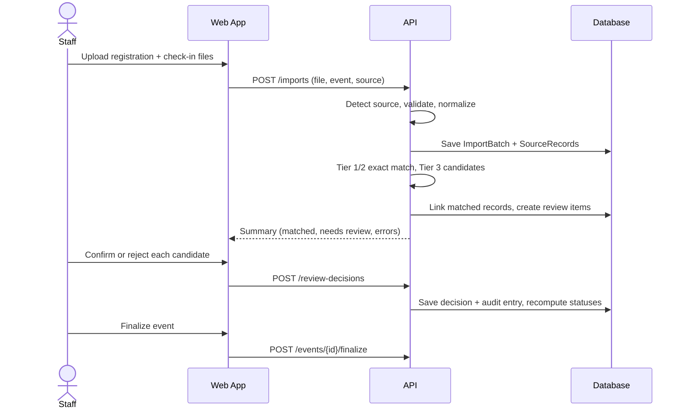

# Project Scope and High-Level Design
## Program Registration & Attendance Reconciliation Hub

**Sponsor:** Kayleigh Anderson-Natale, PhD, Director of Postdoc and Professional Development, UCI Graduate Division (with Rosie and Karen, GPSRC staff)
**Team:** Brandon Lau, Molly Tran, Jennifer Sun, Zhenyu (Eric) Song
**Project period:** September 24 – December 4, 2026
**Document status:** Draft v1. It is based on the sponsor proposal, the 10/7/26 kickoff meeting, and the sample templates the sponsor shared. Items marked *(to confirm)* are still open with the sponsor.

---

## 1. Project Overview

### 1.1 Description and Purpose
The UCI Graduate Division's Graduate & Postdoctoral Scholar Resource Center (GPSRC) runs workshops, wellness events, fellowship sessions, and certificate programs for graduate students and postdocs. Registration is collected on two platforms whose exports look different: **CampusGroups/ZotSpot** and **12twenty**. Attendance comes from an iPad/laptop **Google Form check-in** (in person) or a **Zoom participant report** (virtual). Undergraduate student assistants currently compare these sources by hand. They mark attendees in CampusGroups/12twenty, download the checked-in list, and copy and paste each row into one large Google Sheet, the "GPSRC Data Project". This takes roughly 20–30 minutes per event.

This approach has three problems:
1. **Inconsistent sources.** CampusGroups provides a NetID but 12twenty does not. 12twenty reports "Major/Academic Program" while CampusGroups reports "Department". Walk-ins added after the event lose their self-reported affiliation, school, and international/domestic status.
2. **No reliable identity.** The same person can appear with a NetID-based email, a dot-alias email (e.g., `k.freeland@uci.edu`), or a `@hs.uci.edu` address. Because of this, the master sheet counts *rows*, not *unique people*.
3. **Slow reporting.** Questions such as "How many unique Biological Sciences students attended GPSRC events in 2025–26?" or "Give me everyone who attended Bagel Breakfast so we can invite them to Donut Breakfast" require manual spreadsheet work. The sponsor also needs to answer data requests from leadership, such as the new dean's request for a full year of programming data.

We will build a **secure, file-based web application**. Staff upload the known exports. The system normalizes them into one data model, matches participants by exact identifiers, sends uncertain matches to staff for a decision, and produces filterable reports and Excel exports. The system never merges two identities without staff confirmation.

### 1.2 Target Users and Stakeholders
| Stakeholder | Role in the system | Primary needs |
|---|---|---|
| GPSRC program staff (Kayleigh, Karen, Rosie) | **Admin / Program Staff** | Import files, resolve uncertain matches, finalize events, run reports, manage users |
| GPSRC student assistants | **Program Staff** (import and review only, *to confirm*) | Faster, less error-prone event reconciliation |
| Graduate Division leadership, partner schools | **Read-only / Reporting** | View and export summary reports (reach by school, unique participants) |
| Graduate Division Data / OIT team | External (future) | Hosting, security review, and possible later enrichment from central records |
| MSWE instructors | Reviewers | Evidence of scope, design, and progress |

### 1.3 Success Criteria and Key Deliverables
**MOV (from Assignment 2, SWE 277P):** *This project will be successful if, by the end of the quarter (December 4, 2026), we deliver a working web prototype that reduces the average staff time needed to accurately reconcile registration/attendance for a single event (up to 50 attendees) by X%, from 20-30 minutes to X minutes, while routing every uncertain match to staff review.* (X is pending sponsor confirmation.)

**Acceptance criteria** (adapted from the sponsor proposal):
1. Staff can import each supported source format and see clear validation errors for unusable files.
2. Exact NetID / normalized-email matches are made automatically (100% of such records). Uncertain candidates go to a review queue, and no uncertain match is merged without staff confirmation.
3. Registration and attendance evidence are stored separately and produce the four final event statuses: **attended, absent, walk-in, unresolved**.
4. Authorized users can generate the required reports and download a reconciled Excel/CSV export.
5. A read-only user cannot import or change records.
6. A demo covers a one-time event end to end, and a multi-session program if certificate tracking is reached (see §2.1).

**Deliverables:** a working web prototype with setup instructions; the database schema and data dictionary; import templates, field mappings, and synthetic sample files; the matching and review workflow with test cases; reports and exports; and a user guide, known-limitations list, and technical handoff documentation.

---

## 2. Scope Definition

### 2.1 System Boundaries
| In scope (MVP) | Stretch (if time permits) | Out of scope |
|---|---|---|
| Import of **CampusGroups** export, **12twenty** export, and **GPSRC Check-In Form** (Google Form) sheet in their *known* formats | **Zoom** participant report import (sample file not yet provided) | Live APIs to CampusGroups, 12twenty, Zoom, or Google |
| Optional one-time import of the existing **GPSRC Data Project** master sheet as historical data *(to confirm)* | **Certificate / multi-session programs**: cohort status, attendance by session, staff-confirmed award (sponsor asked us to focus on non-certificate events first, 10/7) | Direct integration with student information systems |
| Common data model: people, events, sessions, registrations, attendance, imports | Data-request workbook (list of NetIDs with blank institutional fields for the Data team) | UCI SSO / Shibboleth; production hardening |
| Exact matching (NetID → normalized email) and a ranked candidate review queue | Cross-event alias management and record merge/split | Automatic fuzzy merges; predictive analytics |
| Event reconciliation statuses; blank fields allowed and never inferred | Dashboards with charts | Configurable certificate-rules engine |
| Reports: event reconciliation, program reach / unique participants, filtered attendee list, data quality; Excel/CSV export | Re-import of enriched data returned by the Data team | Arbitrary spreadsheet parsing |
| App login with two roles; audit log of imports and review decisions | | Use of real protected student data during the capstone |

### 2.2 Major Features
1. **Event management.** Create an event with name, date, term, modality (in person / virtual / hybrid), host/partners, event type (Professional Development, Wellness/Mental Health, Fellowships), and registration platform. These are the same metadata columns that student assistants fill in today.
2. **File import with source adapters.** Drag-and-drop upload. The source type is detected from the header row, required columns are validated, and errors are reported per row. Each source is mapped to common fields:

| Common field | CampusGroups | 12twenty | Check-In Form |
|---|---|---|---|
| First / last name | First name / Last name (registration-edited) | First Name / Last Name | First Name / Last Name |
| Email | Email | Email | UCI Email Address |
| NetID | Net ID | derived from `@uci.edu` email local part | derived from `@uci.edu` email local part |
| Student/Employee ID | Student ID # (self-entered) | — | — |
| Affiliation | "Please select what you identify as…" | Degree / Degree Level | Please select your affiliation |
| School | School (drop down) | College/School | — |
| Department / program | Department | Major/Academic Program | — |
| Domestic / International | "Are you an international or domestic…" | — | — |
| Attended | (checked-in export) | Attended? | presence = attended |

3. **Identity resolution.**
   - **Tier 1:** an exact NetID match.
   - **Tier 2:** an exact match on the normalized email (lower-cased and trimmed).
   - **Tier 3:** for records that still have no match, such as dot-alias emails, `@hs.uci.edu` addresses, or Zoom display names, the system ranks up to 5 candidates by name and email similarity and shows a confidence level (High/Medium/Low).
   - Staff choose **Same person** or **New person**.
4. **Reconciliation.** For each event the system computes *attended* (registered and attended), *absent* (registered, no attendance), *walk-in* (attended without registering), or *unresolved* (identity decision still pending). Staff then finalize the event.
5. **Reports and export.**
   - **Event reconciliation summary:** counts and exceptions per event.
   - **Program reach:** unique participants by school, affiliation, domestic/international, and term.
   - **Attendee search:** filter by event name, date range, school, and affiliation. For example, list "Bagel Breakfast attendees" and export their emails for outreach.
   - **Data quality:** missing NetIDs, possible duplicates, and unresolved records.
   - All results can be exported to `.xlsx` / `.csv`.
6. **Access control and audit.** Login is required. The Admin/Staff role can import, review, and edit. The Read-only role can view and export reports only. Imports and review decisions are logged with user and time.

### 2.3 Assumptions
- Export formats keep the column headers in the sponsor's templates (Rosie confirmed on 10/7 that the headers are exact). The sponsor will share raw CSV exports and a few more synthetic rows.
- For `@uci.edu` addresses, the email local part equals the NetID about 99% of the time (confirmed by Karen). Other cases go to review instead of being guessed.
- NetID is the preferred person key. Student ID numbers are self-entered, often wrong, and a FERPA concern when shown next to a name. They are stored only as an optional attribute, are not used for matching, and are excluded from exports by default.
- Files are small (most events have fewer than 50 attendees; a large event has a few hundred), so imports can be processed synchronously.
- Only synthetic or de-identified data will be used during the capstone.
- Hosting: the sponsor prefers a shared, cloud-hosted tool with a persistent database (10/7). The final hosting target depends on the sponsor's conversation with their Data/OIT team and on our cost estimate *(to confirm)*.

### 2.4 Initial Technology Stack
| Layer | Choice | Notes |
|---|---|---|
| Frontend | **React + TypeScript** (Vite), a component library such as MUI | Upload, review-queue, and report screens |
| Backend / API | **Python, Django + Django REST Framework** | Built-in auth, permissions, ORM, migrations, admin |
| File parsing and matching | **pandas / openpyxl**; **RapidFuzz** for name similarity | Python ecosystem for spreadsheet work |
| Database | **PostgreSQL** (SQLite for local development) | Relational model; Amazon RDS if hosted on AWS |
| Hosting *(to confirm)* | **AWS**: one small compute instance (Elastic Beanstalk or Lightsail) + RDS PostgreSQL + private S3 bucket for uploaded files; Docker Compose for local runs | HTTPS only |
| Tooling | GitHub (PR review, GitHub Actions CI with pytest / Vitest), Jira for sprints and burndown | |

---

## 3. High-Level Architecture (C4 Model)

### 3.1 Level 1 — System Context Diagram
**Figure 1. System context.** Source platforms are not called through APIs. Staff export files from them and upload those files.

### 3.2 Level 2 — Container Diagram
**Figure 2. Containers.**

The browser loads the React single-page app and calls the Django REST API. All business logic runs in the API: parsing, matching, status computation, and permission checks. The database is the system of record. The original uploaded files are kept in a private file store so that every record can be traced back to the file and row it came from.

### 3.3 Level 3 — Component Diagram (API Application)
**Figure 3. Components inside the API application.**

**Source adapters** isolate format-specific code. Supporting Zoom, or a changed 12twenty export, only requires a new adapter and mapping and does not touch matching or reporting. The **Identity Resolver** never writes a merge for Tier 3 candidates. It only creates review items, which enforces the human-in-the-loop requirement.

### 3.4 Core Data Model
| Entity | Key fields | Purpose |
|---|---|---|
| `Person` | id, net_id (unique, nullable), first/last name, affiliation, school, department, residency, student_id (restricted) | One real participant |
| `PersonEmail` | person_id, email (unique) | Aliases such as dot-alias and `hs.uci.edu` emails |
| `Event` / `Session` | name, date, term, modality, host/partners, event_type, platform | A one-time event has one session; a program has many |
| `ImportBatch` | source_type, file name, uploaded_by, uploaded_at, row/error counts | Provenance |
| `SourceRecord` | import_id, row_number, raw values (JSON), normalized values, person_id (nullable) | Keeps evidence as uploaded, never overwritten |
| `Registration` / `Attendance` | person_id, event/session_id, source_record_id | Registration and attendance stored separately |
| `MatchCandidate` / `ReviewDecision` | source_record_id, candidate person_id, score, decision, decided_by, decided_at | Human-in-the-loop record |
| `EventParticipantStatus` | event_id, person_id, status, finalized | Reconciliation result |
| `Program`, `CohortMember`, `Award` *(stretch)* | | Certificate tracking |
| `AuditLog` | user, action, target, timestamp | Accountability |

### 3.5 Key Scenarios
**Scenario A: Reconcile a one-time event.**
1. Staff create "Bagel Breakfast, 9/30/2026".
2. Staff upload the CampusGroups export and the Check-In Form sheet.
3. The system validates both files and normalizes them.
4. 42 of 45 attendees match by NetID or email.
5. Three check-in rows have no match and appear in the review queue with ranked candidates. Staff confirm two and mark one as a new person (a walk-in).
6. The system shows the counts of attended, absent, and walk-in, and staff finalize the event.

**Scenario B: A 12twenty record with a dot-alias email.** A postdoc registered as `k.freeland@uci.edu`, so no NetID can be derived from the email. The record goes to the review queue, where an existing person with the same name and a NetID-based email is shown as a High-confidence candidate. Staff confirm the match, and the alias is saved to `PersonEmail`, so future imports from this person match automatically.

**Scenario C: Reporting for leadership and outreach.** A read-only user filters by academic year 2025–26 and School = Biological Sciences. They see the number of *unique* attendees and the events they attended, then export the result to Excel. Staff can also filter by "Bagel Breakfast" to export an email list for a Donut Breakfast invitation.

### 3.6 Deployment (Physical View, proposed)
- **Cloud option (preferred by sponsor):** the Django app and the built React files run in a single container on AWS (Elastic Beanstalk or Lightsail). It connects to an RDS PostgreSQL instance and a private S3 bucket over HTTPS. Estimated cost is in the low tens of dollars per month at this scale, to be confirmed with the AWS Pricing Calculator before the next sponsor meeting.
- **Local fallback:** `docker compose up` runs the same containers on one machine with PostgreSQL or SQLite. This is useful for development and as a backup plan if campus hosting approval takes longer than the quarter.

---

## 4. Design Rationale

| Decision | Alternatives considered | Why we chose it / trade-offs |
|---|---|---|
| **File-based imports through per-source adapters** | Vendor APIs; generic "map any spreadsheet" UI | APIs are out of scope and need institutional access. A generic mapper is costly to build and error-prone for non-technical users. Fixed adapters are reliable for the known formats, but a new format requires code changes. |
| **Exact match first, human review for everything else** | Automatic fuzzy merging | The sponsor explicitly asked that unmatched records be flagged for people to review. A wrong merge corrupts reports and is hard to undo. The trade-off is that some review work remains for staff. Saving aliases reduces repeat reviews over time. |
| **NetID as the primary key, student ID not used for matching** | Match on student ID | NetIDs are assigned by the system and are not FERPA-sensitive alongside a name. Student IDs are self-entered and often unknown to students. |
| **Keep raw source records and separate registration/attendance tables** | Overwrite a single "attendee" row (as in today's master sheet) | This keeps provenance, lets staff see why a status was assigned, and allows re-running matching. The cost is more tables and storage. |
| **Blank values stay blank** | Infer school or affiliation from other events | Proposal requirement: never infer a characteristic. Reports show "Unknown" instead. |
| **Django + DRF backend** | FastAPI | Django provides authentication, permission groups, an admin UI, and migrations out of the box, which saves time with a part-time four-person team. FastAPI is lighter and faster but would need auth and ORM assembled by hand. |
| **PostgreSQL (relational)** | DynamoDB | The data is highly relational (people ↔ events ↔ registrations ↔ decisions), and reports require joins and aggregates (unique counts by school/term). Django's ORM needs a SQL database. DynamoDB would make these queries awkward. |
| **React SPA** | Django server-rendered templates | The review queue and filterable reports need an interactive UI, and the team already knows React. The cost is a separate build and the need for CORS/CSRF configuration. |
| **Synchronous import processing** | Background job queue (Celery + Redis) | Files contain fewer than a few hundred rows and process in seconds. A queue would add infrastructure with no user benefit. We can revisit this if large historical imports turn out to be slow. |
| **App-level login with two roles** | UCI SSO | SSO is out of scope and needs campus approval. We will design the auth layer so that SSO can replace it later. |

**Constraints:**
- 10-week schedule.
- Four team members, most of whom work full time, so work happens mainly in evenings and on weekends.
- Only synthetic or de-identified data.
- The hosting decision depends on the sponsor's Data/OIT input.
- Production use will require a later UCI privacy and security review.

**Main risks and mitigations:**
- **Export formats change.** Header-based validation will report a clear error, and adapters are isolated.
- **Hosting approval is delayed.** The Docker-based local fallback keeps the project moving.
- **Scope creep from certificate programs and dashboards.** These items are explicitly listed as stretch goals and reviewed with the sponsor at each weekly check-in.

---

## 5. Plan and Open Questions

| Weeks | Focus | Checkpoint |
|---|---|---|
| 1–3 | Confirm workflows, field mappings, data model; this document | Sponsor-approved scope and design |
| 4–5 | Import adapters, validation, normalization, core records | Sample files load successfully |
| 6–7 | Exact matching, candidate ranking, review queue, reconciliation | End-to-end demo of one event |
| 8 | Reports, export, roles, audit log, deployment | Feature-complete MVP |
| 9–10 | Testing, MOV timing study, documentation, handoff | Final demo (by Dec 4) |

**Open questions for the sponsor (10/14 meeting):**
1. Should student assistants have full staff access, or import-only access?
2. Should we import last year's GPSRC Data Project sheet as historical data?
3. Will the hosting go through Graduate Division Data/OIT, and are there approved AWS accounts or credits?
4. Which reconciliation-time reduction (X%) does the sponsor agree to for the MOV?
5. Can we get raw CSV exports and a sample Zoom participant report?
