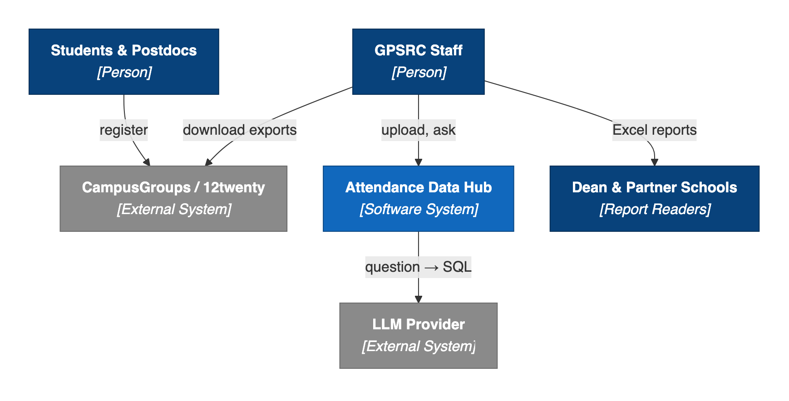
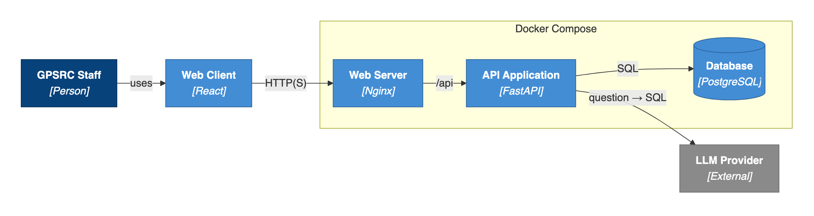
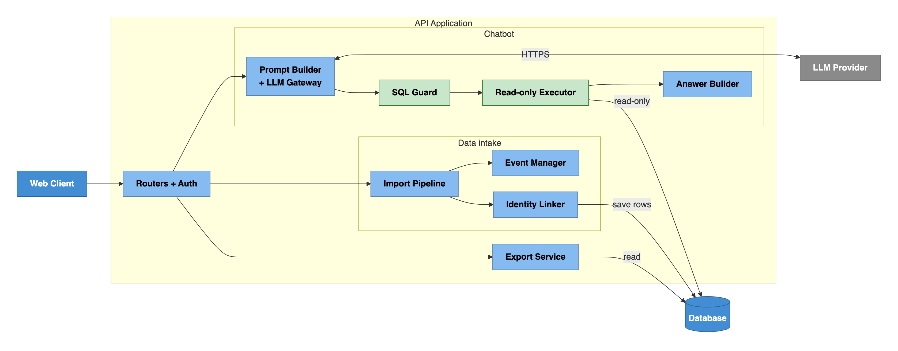
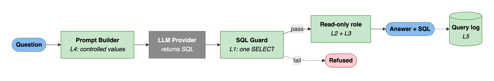

# Project Scope and High-Level Design

## Program Registration & Attendance Data Hub

**Team:** Brandon Y Lau, Molly Tran, Jennifer Sun, Zhenyu (Eric) Song

**Sponsor:** Kayleigh Anderson-Natale, PhD, Director of Postdoc and Professional Development, UCI Graduate Division

**Date:** October 16, 2026. Based on the sponsor proposal, the 10/7 and 10/14 sponsor meetings, the 10/16 instructor meeting, and the sponsor's sample data.

---

## 1. Project Overview

### 1.1 Description and purpose

The Graduate & Postdoctoral Scholar Resource Center (GPSRC) in UCI Graduate Division runs professional development, wellness, and fellowship events. Students and postdocs register on **CampusGroups/ZotSpot** or **12twenty**. After each event, student assistants mark who attended, download the platform's attendee list, and paste it into a year-long spreadsheet.

This makes reporting slow and limited:

- **The data is scattered.** It sits in one file per event and one large spreadsheet per year, and Excel is hard to filter across terms and years.
- **The platforms export different fields.** 12twenty has no NetID, Student ID, or domestic/international field.
- **Common questions are hard to answer.** A new dean asked for a year of programming data. A school asked how many of its students attended. Staff want to invite past Bagel Breakfast attendees to a new event. The spreadsheet counts rows, not unique people.

**What we will build.** A tool that runs on one computer:

- Staff drag in each event's attendee export, unchanged.
- The Hub adds the export to one permanent dataset that grows across academic years.
- Staff ask questions in plain English through an **AI chatbot**. They get exact numbers, student lists, and email lists, and can download them as Excel.
- The AI only writes SQL. The Hub runs that SQL locally under a read-only database role, so student records never leave the computer.

The sponsor's main goal is better reporting rather than saved time: showing the GPSRC's reach to leadership, and finding gaps in service, such as schools whose students rarely attend.

### 1.2 Target users and stakeholders

| Stakeholder | Role | Main interest |
|---|---|---|
| Kayleigh Anderson-Natale, Director (sponsor) | Primary user | Quick answers for reports to the dean and partner schools |
| GPSRC staff (Rosie Victor, Karen Friedlander) | Users | Pull counts and outreach lists; keep the current data process |
| GPSRC student assistants | Users who upload files | A simple upload flow for the files they already download |
| Graduate Division leadership, partner schools | Report readers (no login) | Accurate counts, e.g., how many of a school's students attended |
| Graduate students and postdocs | Data subjects (no login) | Privacy of their records under FERPA |
| UCI OIT | Possible future host; runs ZotGPT | Security review before hosting the tool or using real data |

### 1.3 Success criteria and key deliverables

The MVP succeeds when it passes these tests on the sponsor's synthetic sample data:

| Area | Success criterion |
|---|---|
| Compile | The 10 sample files import into the same attendee data as the sponsor's compiled dataset (293 rows, 79 unique NetIDs). Re-importing a file adds nothing |
| Query | The chatbot answers a benchmark of about 25 sponsor-style questions with at least 90% correct results (proposed target) on each configured LLM provider |
| Export | Every result downloads as Excel, and no exported cell runs as a formula |
| Privacy and security | No request to the LLM contains student rows or results. Harmful SQL is refused by two independent layers. No data is visible without signing in |

**Proposed measurable goal (to agree with the sponsor on 10/21).** By December 4, 2026, staff can answer the sponsor's typical reporting questions from one tool in under a minute each. This includes questions the spreadsheets cannot answer today, such as unique students per school across terms.

**Key deliverables (December 4, 2026):**

- the working prototype, packaged with Docker Compose, with a setup guide;
- the database schema and data dictionary;
- the chatbot pipeline with its benchmark results;
- automated tests, including the security tests;
- a user guide and handoff notes for a possible later move to a UCI OIT server.

---

## 2. Scope Definition

### 2.1 System boundaries

The sponsor narrowed the original proposal in the 10/7 and 10/14 meetings:

- Reconciling registrations against check-ins is now optional, because student assistants already do it as part of their front-desk work.
- Certificate programs are out of scope for now.
- Inputs are limited to two platform exports.
- Public cloud hosting is excluded for privacy.

The team then chose an AI chatbot as the query interface. We will confirm this with the sponsor on 10/21.

| In scope (P0, MVP) | Later (P1 should have, P2 optional) | Out of scope |
|---|---|---|
| Import of 12twenty and CampusGroups attendee exports, unchanged | P1: filter table without AI, data-quality view, chatbot follow-up questions, saved queries | Public cloud hosting, UCI SSO, deployment to OIT servers |
| One permanent, growing dataset in the sponsor's layout | P1: import of last year's spreadsheet; multiple staff accounts | Student information system (SIS) integration |
| One person tracked across events by NetID | P2: registration–attendance reconciliation | Live platform APIs; writing back to the platforms |
| AI chatbot with a pluggable LLM provider | P2: proactive AI insights, charts | Arbitrary spreadsheet formats; automatic fuzzy merging of people |
| Excel/CSV export; local install with login | P2: certificate rules, permission roles | Real student data during the capstone |

### 2.2 Major features and assumptions

**MVP features (P0):**

- **F1. Import.** Staff drop 12twenty (.xlsx) and CampusGroups (.csv or .xlsx) exports, unchanged. The Hub detects the source from the header row. It rejects unknown files and lists the missing columns. Rows with missing values are kept and flagged.
- **F2. Event details.** The files do not contain event details, so staff confirm them at upload: name, date, term, modality, host, and event type. Some are pre-filled, such as the name from the file name.
- **F3. One layout.** Rows are mapped to the sponsor's 19-column "GPSRC Data Project" layout. For example, 12twenty's Degree becomes Affiliation, and a NetID is derived from a `netid@uci.edu` email. Fields a source lacks stay blank and are never guessed.
- **F4. Permanent dataset.** The dataset grows with every upload and is not split by year. Uploading the same file twice adds nothing.
- **F5. One person across events.** Rows are linked by NetID, then by exact email. This makes counts of unique students possible.
- **F6. AI chatbot.** Plain-English questions return a number, a table, or a list. Each answer shows how the question was read and the SQL used, so staff can check it.
- **F7. Privacy and safety.** The LLM sees only the question and a description of the data. Generated SQL passes five safety layers (Section 3.4).
- **F8. Pluggable LLM provider.** ZotGPT Gateway (UCI OIT), OpenAI, or DeepSeek, chosen in a settings file. ZotGPT is the default for real data because UCI manages it.
- **F9. Export.** Every result downloads as Excel or CSV, protected against formula injection.
- **F10. Login.** No data can be viewed or exported without signing in. The MVP has one staff account; multiple accounts come in P1.

**Assumptions:**

- **A1.** The capstone uses synthetic data only. The sample files have the same headers as the real exports.
- **A2.** Each input file lists only people who attended. Reconciliation stays manual.
- **A3.** NetID is the person key. 12twenty emails match `netid@uci.edu` about 99% of the time; the exceptions are flagged, not guessed.
- **A4.** Student ID is never a matching key. Students type it themselves and often get it wrong, and a name shown next to a student ID is a FERPA concern.
- **A5.** Volumes are small: most events have fewer than 50 attendees, there are a few staff users, and the dataset reaches tens of thousands of rows over several years.
- **A6.** The registration platforms stay the system of record. The Hub never writes back to them.
- **A7.** The chatbot needs internet access and an API key. ZotGPT Gateway is open to UCI graduate students, with $100 of test credits. The sponsor and OIT must confirm before any real data is used with it.

### 2.3 Initial technology stack

| Layer | Choice |
|---|---|
| Frontend | React 18 + TypeScript (Vite), MUI DataGrid, TanStack Query |
| Backend | Python 3.12, FastAPI, Pydantic v2; pandas and openpyxl for CSV/XLSX |
| Database | PostgreSQL 16 with SQLAlchemy and Alembic; a read-only role and a single view for the chatbot |
| LLM integration | Our own text-to-SQL pipeline: the `openai` Python SDK behind a provider interface (ZotGPT Gateway, OpenAI, DeepSeek), sqlglot to check SQL, Pydantic to check replies |
| Security | Argon2 passwords; JWT in an httpOnly, SameSite cookie; API keys only on the server |
| Testing | pytest, Vitest, Playwright, and a chatbot benchmark with known answers |
| Delivery | Docker Compose with Nginx, the FastAPI app, and PostgreSQL on one computer; the same containers can later run on a UCI OIT server with HTTPS |

---

## 3. High-Level Architecture (C4 Model)

We describe the system with the C4 model: context, containers, and the components of the API application. Sections 3.4 and 3.5 add the chatbot's safety layers and the data model. In the diagrams, dark blue is people, blue is the Hub, green is a safety layer, and grey is external.

### 3.1 Context diagram

Figure 1 shows the system in its environment.

- **Input arrives as files.** Staff download attendee exports from the registration platforms and upload them. The Hub has no live connection to the platforms.
- **Only one live external connection.** The Hub calls the LLM provider, sending only the question and a description of the data. The provider returns SQL and never sees student records or results.
- **Output is controlled by staff.** Results appear on screen and download as Excel. Staff decide what to send to the dean or partner schools. Students and postdocs never use the Hub.



*Figure 1. System context.*

### 3.2 Container diagram



*Figure 2. Containers.*

The four containers in Figure 2:

- **Web Client** (React SPA). Upload form, chat, result tables, and export buttons. It holds no API keys.
- **Web Server** (Nginx). Serves the web client and forwards `/api` requests. It is the only container with a published port: localhost only on one computer, HTTPS on a later OIT server.
- **API Application** (FastAPI). Handles login, import, identity linking, the chatbot pipeline, and export. It reads the provider settings and API key from a local `.env` file.
- **Database** (PostgreSQL). Holds all data, accessed through two roles: the application role (read-write) and `chatbot_ro`, which can only SELECT from one view.

### 3.3 Component diagram



*Figure 3. Components of the API Application. The green components are the two layers that stop harmful SQL.*

The application is a **modular monolith**: one deployable service whose modules match these components.

| Component | Responsibility |
|---|---|
| REST Routers + Auth | HTTP endpoints; every route checks the login cookie |
| Import Pipeline | Detects the export type, validates rows, and maps them to the common layout |
| Event Manager | Event details, pre-fill, and blocking duplicate files by SHA-256 hash |
| Identity Linker | Links rows to a person by NetID, then exact email; flags rows it cannot link |
| Prompt Builder + LLM Gateway | Build the prompt and call the configured provider |
| SQL Guard | Checks the generated SQL with sqlglot (Section 3.4) |
| Read-only Executor | Runs approved SQL as `chatbot_ro` in a read-only transaction with a timeout |
| Answer Builder | Builds the summary locally and writes the query log |
| Export Service | Writes XLSX/CSV with the formula guard; re-runs the logged SQL for exports |

### 3.4 Chatbot query pipeline and safety layers

**The LLM writes SQL; it never reads data.** The prompt holds:

- the question;
- a description of the chatbot's view;
- lists of controlled values (school names, event names, event types, terms);
- a few worked examples.

The database then computes the answer. This keeps student records local, gives exact counts, and lets staff read the SQL behind every answer.

For example, the question "How many unique Biological Sciences students came to a Bagel Breakfast in Fall 2026?" becomes:

```sql
SELECT COUNT(DISTINCT person_key) FROM attendance_view
WHERE school = 'School of Biological Sciences'
  AND event_name LIKE 'Bagel Breakfast%' AND term = 'Fall 2026';
```

On the sample data the answer is 6.

| Layer | What it does |
|---|---|
| 1. SQL check | sqlglot allows exactly one SELECT, on `attendance_view` only, using allow-listed functions. It also adds a row limit for the screen |
| 2. Read-only role | `chatbot_ro` can SELECT from that one view and nothing else, with a statement timeout. Even SQL that slips past layer 1 cannot write or read other tables. This is the real guarantee |
| 3. Separate connection | Generated SQL never runs on the application's read-write connection |
| 4. Controlled values | Only drop-down and staff-entered values reach the prompt, never free text that students typed. This blocks hidden instructions in student text (prompt injection) |
| 5. Query log | Every question, its SQL, the user, and the outcome are recorded for review |



*Figure 4. Chatbot query pipeline. Green steps are safety layers; L1–L5 match the table above.*

### 3.5 Data model (summary)

The database has six tables: `EVENT`, `IMPORT_FILE`, `ATTENDANCE`, `PERSON`, `APP_USER`, and `CHAT_QUERY_LOG`.

- **Rows are stored as recorded.** Each `ATTENDANCE` row keeps the values from its source export, plus the source file and row number for traceability. `PERSON` holds only identity (NetID and email).
- **No double counting.** A unique key on (event, person) keeps one row per person per event, and the file hash blocks duplicate uploads.
- **One view for the chatbot.** The chatbot queries a single flat view, `attendance_view`. It has 17 columns, including event, term, academic year, school, department, and affiliation. Student ID is left out.

---

## 4. Design Rationale

### 4.1 Key decisions

| Decision | Choice (vs. alternative) | Why | Trade-off |
|---|---|---|---|
| Product focus | Compile and query (vs. the proposal's reconciliation hub) | The sponsor's pain point is reporting; reconciliation is routine front-desk work | Matching and review features move to P2 |
| Query interface | AI chatbot (vs. fixed reports) | Questions vary by event, school, program, date, and contact list, and staff do not write SQL | The LLM can misread a question, so we show the SQL, run a benchmark, and add a P1 filter table |
| What the LLM sees | A description of the data only (vs. the data itself, or hashed identifiers) | Privacy, exact counts, a fixed prompt size, and answers staff can check | A question can still contain a name, so ZotGPT is the default and real-data use needs approval |
| Text-to-SQL implementation | Our own small pipeline (vs. a framework) | Vanna's repository is archived, Dataherald was last updated in 2024, WrenAI is a full platform, and LangChain's SQL agent sends results back to the LLM. Our schema is one 17-column view | We write and test the prompt and guard ourselves; this is the project's main engineering work |
| SQL safety | Database permissions as the guarantee, plus a parser check (vs. prompt rules alone) | Prompts can be ignored and parsers fooled; database permissions cannot | Two layers to keep in sync, tested separately |
| Database | PostgreSQL (vs. SQLite) | Roles and grants on a view make layer 2 possible; it is also ready for multiple users | Needs a database server, hidden by Docker Compose |
| Deployment | Docker Compose on one computer, with Nginx (vs. public cloud) | The sponsor excluded the cloud. The same containers move to an OIT server, where Nginx adds HTTPS | Docker Desktop may need admin rights on the sponsor's computer |
| Architecture | Modular monolith on FastAPI (vs. microservices or Django) | Fits four part-time developers and ten weeks; Pydantic validates imports, API, and LLM replies | Module boundaries are kept by code review |
| Identity | Exact NetID, then email; Student ID never a key (vs. fuzzy matching) | Inputs are already reconciled; exact rules are predictable and match the sponsor's FERPA guidance | Unusual emails may count one person twice until staff fix them |
| Output | XLSX and CSV (vs. CSV only or built-in charts) | The sponsor works in Excel and builds charts there | Formula injection risk, handled by the export guard |

### 4.2 Constraints

- **Time and team.** Ten weeks, ending December 4, 2026, with four team members, several working full time.
- **Data.** Synthetic data only. No SIS, no live platform APIs, and no UCI SSO.
- **Hosting.** No public cloud. Production hosting is a later decision for OIT.
- **AI access.** The chatbot needs internet access and an API key; ZotGPT Gateway gives $100 of test credits.

### 4.3 Main risks

| Risk | Mitigation |
|---|---|
| The chatbot gives a wrong but plausible answer | Show the interpretation, SQL, and rows for every answer; aim for at least 90% on the benchmark; add the P1 filter table |
| Real data may not be sent to any external LLM | Only the data description leaves the Hub; ZotGPT is the default; the filter table works without an LLM |
| The sponsor does not accept the chatbot-first plan on 10/21 | Import, dataset, and export are useful on their own; the filter table could become the main screen |
| Real exports differ from the samples, e.g., 12twenty school names ("Medicine, Medicine") or rows marked `Attended? = NO` | Adapters fail loudly; a school-name mapping and an attended-only filter, checked with sponsor staff |
| Docker Desktop cannot be installed on the sponsor's computer | Ask on 10/21; run demos on a team laptop until an OIT server is available |
