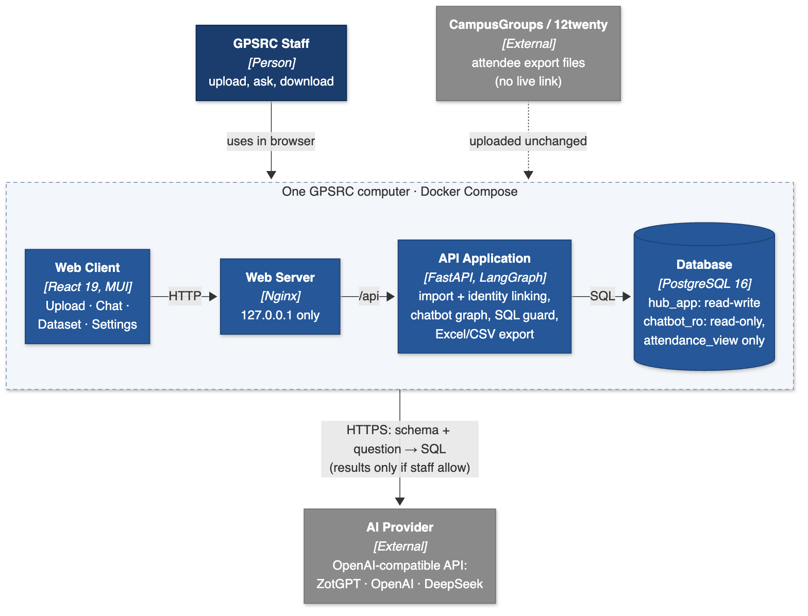
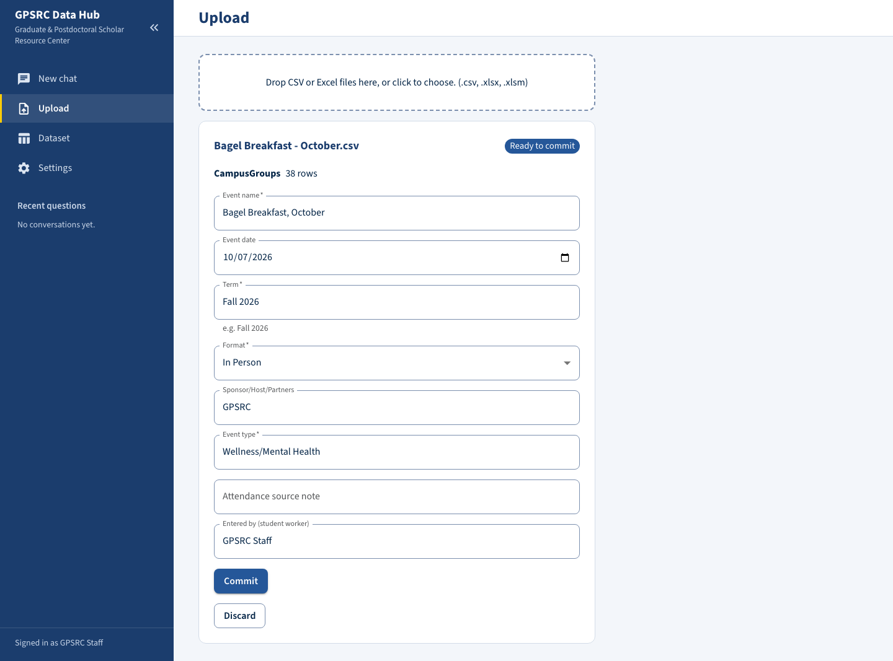
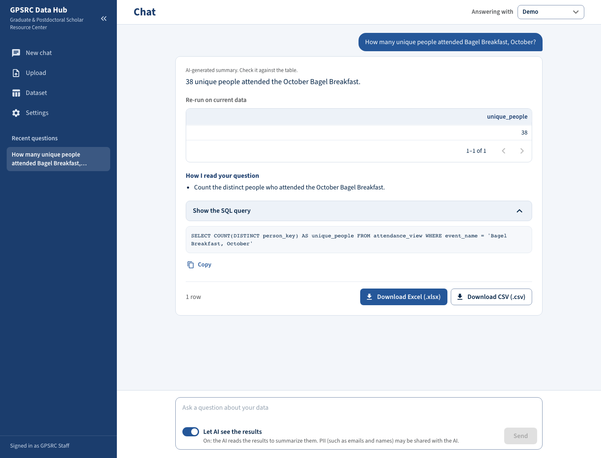

# Midterm Report

## Program Registration & Attendance Data Hub

**Team ZotSync**

| Name | Role |
|---|---|
| Brandon Y Lau | Database / DevOps |
| Jennifer Sun | Frontend |
| Molly Tran | Backend / Data Import |
| Zhenyu (Eric) Song | AI / Chatbot |

**Sponsor:** Kayleigh Anderson-Natale, PhD, Director of Postdoc and Professional Development, Graduate & Postdoctoral Scholar Resource Center (GPSRC), UCI Graduate Division

**Course:** SWE 276P, Fall 2026, University of California, Irvine

**Date:** October 26, 2026

## 1. Project Overview

The GPSRC runs professional development and wellness events for graduate students and postdocs. Students register on CampusGroups or 12twenty, and after each event a student assistant copies the attendee list into a yearly spreadsheet. The two platforms export different columns, so a question such as "how many unique students from one school came this term?" takes manual filtering and de-duplicating in Excel.

The **Data Hub** is a web app that runs on one GPSRC computer. Staff upload each event's export unchanged. The Hub merges it into one growing dataset and links the same person across events. Staff ask questions in plain English, see the answer with the SQL behind it, and download the result as Excel or CSV. The sponsor's goal is better reporting: showing leadership how many students the GPSRC reaches, and finding groups it is not reaching.

| Stakeholder | Main interest |
|---|---|
| Dr. Kayleigh Anderson-Natale (sponsor, primary user) | Fast, accurate reach reports for leadership |
| GPSRC staff and student assistants (users) | Easy uploads; counts and email lists |
| Graduate students and postdocs (data subjects) | Privacy of their records (FERPA) |
| UCI OIT (runs ZotGPT; possible future host) | Security review before real data is used |

## 2. Current Scope and Objectives

In the October 7 and 14 meetings, the sponsor narrowed the project from reconciling registration with attendance to compiling and querying attendance data.

- **In scope (MVP):** import of native 12twenty and CampusGroups exports with event details; one dataset in the sponsor's 19-column layout; people linked by NetID, then email; an AI chatbot that shows its SQL; Excel and CSV export; a local install.
- **Later:** staff login (Sprint 3). The P1 features (filter table, data-quality view, saved queries) only if the sponsor asks.
- **Out of scope:** reconciliation, certificates, charts, cloud hosting, live platform APIs, and real student data during the capstone.

**Primary user stories**

1. As a student assistant, I upload an export as downloaded and confirm the event details.
2. As GPSRC staff, I see each person linked across events, with doubtful matches flagged.
3. As the sponsor, I ask questions in plain English and see the answer, the SQL and the table.
4. As GPSRC staff, I choose the AI model and whether it may read query results.
5. As the sponsor, I download any result or the full dataset as Excel or CSV.

**Success metrics.** The sponsor confirmed these on October 21. They are due December 4, 2026.

| Metric | Target |
|---|---|
| Chatbot accuracy | At least 18 of 20 sponsor-style reporting questions answered correctly |
| Import accuracy | The sample files reproduce the sponsor's compiled sheet (293 rows, 79 unique NetIDs), with no duplicates after a re-upload |
| Speed | Under 1 minute from question to downloaded Excel file |

**Deliverables:** the Hub (Docker Compose), setup and user guides, data dictionary, tests, benchmark results and a handoff guide.

## 3. System Design

### 3.1 Architecture

*Figure 1. C4 container diagram of the Hub as built.*

- **One computer, three containers.** Nginx serves the React app and forwards `/api` to FastAPI, on `127.0.0.1` only.
- **Two database roles.** The app uses a read-write role. Generated SQL runs only as `chatbot_ro`, which can read one view, `attendance_view` (no Student IDs), with a 5-second timeout.
- **One outbound connection,** to the AI provider. To write SQL, the AI gets the schema, allowed values and the question, never attendee rows.

**Chatbot pipeline.** A LangGraph graph has the AI draft SQL (or a clarifying question), checks it with sqlglot (one `SELECT` on `attendance_view` only), runs it read-only and writes a summary. A rejected query goes back to the AI for repair, up to three times. Every question and its SQL is logged.

### 3.2 Technology stack

| Layer | Technology |
|---|---|
| Frontend | React 19, TypeScript, Vite, MUI 9 and DataGrid, TanStack Query |
| Backend | Python 3.12, FastAPI, SQLAlchemy 2, Pydantic v2, pandas, openpyxl |
| Chatbot | LangGraph, `langchain-openai` (any OpenAI-compatible provider), sqlglot |
| Database and delivery | PostgreSQL 16; Docker Compose (nginx, api, db) |
| Testing | pytest, Vitest, Playwright, and a chatbot benchmark with known answers |

### 3.3 Key design decisions

Rows marked *changed* differ from our October 16 design report.

| Decision | Rationale |
|---|---|
| The AI writes SQL; the database computes the answer | Exact counts that staff can check; the AI never needs student rows to write a query |
| A read-only database role is the real safety layer, behind a sqlglot check | Prompts can be ignored and parsers fooled; a role that can only read one view cannot change data |
| LangGraph graph for the chatbot (*changed*) | Follow-ups, clarifying questions and repair are easier to build and test as graph steps |
| The AI reads query results only when two switches are on (*changed*, provisional) | Gives the sentence answers the sponsor asked for, with staff in control; awaits the sponsor's approval |
| AI models managed in the app, with encrypted keys (*changed*) | Staff switch between ZotGPT, OpenAI and DeepSeek without editing files |

## 4. Progress Summary

### 4.1 Milestones

| Date | Milestone | Status |
|---|---|---|
| Oct 7–20 | Sponsor meetings; scope and design report, business case, charter | Done |
| Oct 20–22 | MVP designed, built and tested in six AI-assisted build sessions | Done |
| Oct 21 | Sponsor confirmed the three success metrics | Done |
| Oct 22 | Walkthrough of the sponsor's 14 requests in the app | Done (1 gap) |
| Oct 27–28 | WBS; ZotGPT check; sponsor meeting | In progress |

The MVP is about a month ahead of the charter's schedule. Owners specified, reviewed and tested the code that Claude Code generated.

### 4.2 Features implemented

- **Import:** native exports accepted unchanged, platform detected from the headers, a preview with flags before saving, and duplicate files refused.
- **Identity:** people linked by NetID, then email; rows without a usable identifier are flagged.
- **Chat:** follow-ups, clarifying questions, automatic repair and live progress; each answer shows its reading, SQL and table.
- **AI models:** a Settings page with presets, a Test button and encrypted API keys.
- **Export:** any answer or the full dataset as XLSX or CSV, safe against formula injection.

Not built yet: staff login.

### 4.3 Prototype

|  |  |
|---|---|
| *Figure 2. Upload: platform detected, event details pre-filled.* | *Figure 3. Chat: answer, reading, SQL and downloads.* |

### 4.4 Testing and results

| Acceptance check | Target | Result |
|---|---|---|
| Import matches the compiled sheet; re-upload adds nothing (A1, A2) | 293 rows, 79 NetIDs | Pass |
| Benchmark; second model with no code change (A3, A4) | At least 18 of 20 | 20/20; held-out 10/10; second model 19/20 |
| Question to downloaded Excel (A10) | Under 60 s | 4–7 s |
| Export, privacy, SQL safety, formula guard (A5, A6, A8, A9) | Pass | Pass |
| No data without signing in (A7) | Pass | Deferred with login |

917 backend, 227 frontend and 5 end-to-end tests pass. Manual walks covered 63 user stories (34 of 37 findings fixed, 3 minor ones documented) and the sponsor's 14 requests (8 pass, 5 pass with a caveat, 1 gap).

## 5. Challenges and Risk Management

| Challenge | Mitigation |
|---|---|
| **Scope changed** after the proposal | Re-scoped early; the sponsor confirmed three measurable metrics |
| **Privacy:** names and emails in the data; an external AI service | The AI writes SQL from the schema only; sharing results needs two switches and sponsor approval; ZotGPT (UCI-managed) is recommended |
| **Wrong but plausible AI answers** | SQL and table shown with every answer; benchmark and held-out questions re-run after each prompt change. The benchmark is optimistic (one model family, one term) |
| **Double counting** when an event's export is uploaded a second time | Found in the sponsor walkthrough; the fix (B4) is first in Sprint 2 |
| **Dependencies:** synthetic samples, ZotGPT, AI credits, the GPSRC computer | Dummy exports requested; ZotGPT check by Oct 28; credit request to the sponsor; demos on a team laptop |

**Lessons learned**

- With AI-assisted coding, the bottleneck is verification and sponsor decisions, not code.
- Walking the sponsor's own requests found a bug that over 1,100 automated tests missed.
- A written spec and session plans kept AI-generated code consistent across sessions.

## 6. Next Steps

| Sprint | Dates | Planned work |
|---|---|---|
| Sprint 1 (current) | Oct 20 – Nov 2 | ZotGPT check, credit request, sponsor meeting (Oct 28), code walkthrough by each module owner |
| Sprint 2 | Nov 3 – Nov 16 | Sponsor demo (week 7); duplicate-event warning and import delete (B4); chat delete (B1); Downloads page (B2); Insights button (B3); feedback fixes |
| Sprint 3 | Nov 17 – Dec 7 | Staff login, CI, install at the GPSRC, handoff guides and training, final testing; final demo (Dec 4) and Capstone Showcase (Dec 7) |

**Decisions needed from the sponsor:** whether the AI may read query results, how long chats are kept, whether date ranges matter, whether a filter table is wanted, and whether Docker can be installed on the GPSRC computer.
