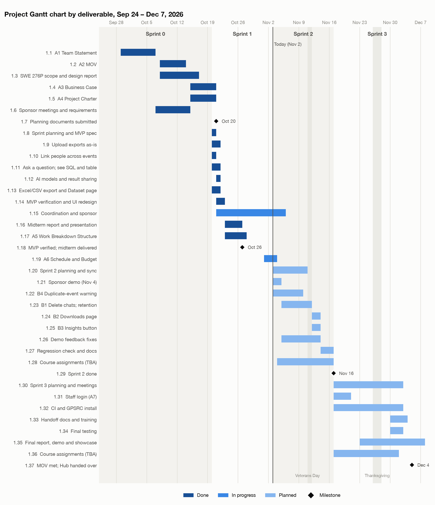
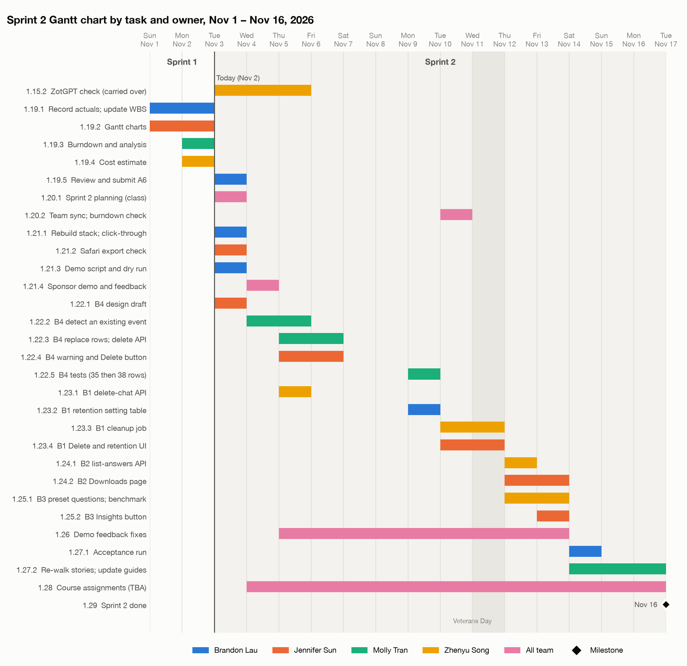
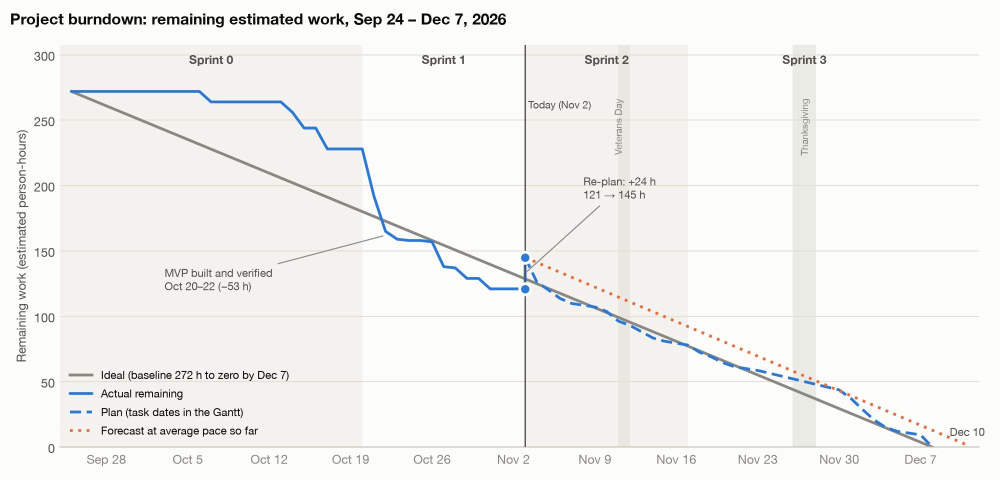

# Project Schedule and Budget: Program Registration & Attendance Data Hub

**Authors:** Brandon Lau, Molly Tran, Jennifer Sun, Zhenyu Song

**Date:** November 2, 2026

---

## Project Basics

- **Project name:** Program Registration & Attendance Data Hub
- **Project team name:** ZotSync
- **Team members:** Brandon Lau (Database / DevOps), Jennifer Sun (Frontend), Molly Tran (Backend / Data Import), Zhenyu Song (AI / Chatbot)
- **Sponsor:** Kayleigh Anderson-Natale, PhD, Director of Postdoc and Professional Development, UCI Graduate Division

---

## 1. Project Description

*Adapted from the project charter and the WBS.*

**Problem.** The Graduate & Postdoctoral Scholar Resource Center (GPSRC) runs events all year, and students register on CampusGroups or 12twenty. After each event, a student assistant copies the attendee list into a yearly Google Sheet. The two platforms export different columns, and the data is spread over many files. In the sponsor's words, finding out who comes to the programs "takes several files and a long time": staff filter, sort, copy between sheets and remove duplicates by hand.

**Solution.** A web app that runs on one GPSRC computer. Staff upload each event's export as-is, and the app merges it into one dataset and links the same person across events. Staff ask questions in plain English, see the SQL the AI wrote and the result table, and download any result as Excel or CSV.

**Desired impact.** Staff can quickly show Graduate Division leadership how many students the GPSRC reaches, by school and term, and spot groups it is not reaching, without compiling sheets by hand.

**Status on November 2.** The MVP was built and verified on October 20–22 and passes every acceptance test except staff login, which is planned for Sprint 3. Sprint 1 closed today with one task carried over (the ZotGPT check). The open bug from the sponsor walkthrough, where a second download of an already imported event is counted twice (B4), is the first feature task of Sprint 2.

---

## 2. Measurable Organizational Value (MOV)

> This project will be successful if, by December 4, 2026, staff can load the sponsor's sample files into one dataset that matches the sponsor's compiled sheet, with no duplicates, and the chatbot correctly answers at least 90% (18 of 20) of a set of sponsor-style reporting questions, with each answer downloaded as an Excel file in under one minute.

| Area | Value | Metric | Target | Status on Nov 2 |
|---|---|---|---|---|
| Strategic | Do more | Benchmark questions answered correctly | At least 18 of 20 | 20 of 20, and 10 of 10 held-out questions |
| Operational | Better | Sample files imported correctly | 293 rows and 79 unique NetIDs; no duplicates on re-upload | Met, except that a second download of the same event is counted twice; fixed in Sprint 2 (WBS 1.22) |
| Operational | Faster | Question to downloaded Excel file | Under 1 minute | 4 to 7 seconds |

The sponsor confirmed these metrics on October 21. The schedule keeps them true through the remaining changes: every change to the chatbot prompt is followed by a benchmark re-run (WBS 1.25.1, 1.34.1).

---

## 3. Detailed Project Plan

### 3.1 Updated WBS with Actual Time

This is version 2 of the WBS from Assignment 5. It is in the attached **WBS.xlsx** (sheet "WBS") and copied below.

- **Est. (h)** is the estimate in person-hours, unchanged from version 1 for finished work. A row owned by "All team" counts all four members, so a 1-hour meeting is 4 hours.
- **Actual (h)** is the time spent on finished tasks. Meetings are counted from their recordings (length × people), build work from the commit times of the build sessions, and writing tasks from each owner's own count.
- **Dates** are when a task was done (Sprints 0 and 1) or is planned (Sprints 2 and 3). They feed the Gantt charts in 3.2.
- "(unplanned)" marks work that was not in version 1. "Carried over" marks a task that did not finish in its sprint.

**Summary by sprint.** Capacity is 4 members × 10 hours per week, from the charter.

| Sprint | Dates | Goal | Est. (h) | Actual (h) | Capacity (h) | Status |
|---|---|---|---|---|---|---|
| Sprint 0 | Sep 24 – Oct 19 | Team, scope and planning documents | 60 | 66 | 140 | Complete |
| Sprint 1 | Oct 20 – Nov 2 | Build and verify the MVP; midterm; WBS | 93 | 107 | 80 | Complete; 2 h carried over |
| Sprint 2 | Nov 3 – Nov 16 | Sponsor demo; follow-up features B1–B4 | 65 + 2 carried over | – | 80 | **Current** |
| Sprint 3 | Nov 17 – Dec 7 | Login, CI, handoff; final report, demo and showcase | 78 | – | 100 | Planned |
| **Total** | | | **296** (version 1: 272) | **173 to date** | **400** | |

**What changed since version 1 (October 25)**

- **Actual time** is recorded for Sprints 0 and 1.
- **Two unplanned tasks** were added to Sprint 1: the UI redesign and the 34 fixes from the user-story walkthrough (1.14.4, 12 h), and a rewrite of the Assignment 2 MOV write-up with the confirmed metrics (1.17.4, 3 h).
- **One task was carried over.** The ZotGPT check (1.15.2) depends on UCI's OIT and moves to November 3–5.
- **Sprint 2 is broken into 28 dated tasks**, because it is the current sprint. Sprint 3 keeps the version 1 level of detail and is broken down at its planning meeting on November 17. WBS numbers from 1.19 on have changed.
- **New and re-estimated work adds 24 h:** this assignment (1.19, 9 h, replacing a 2-hour planning task), 6-hour placeholders for course assignments not yet posted (1.28, 1.36), a design draft and a test task for B4 (7 → 9 h), demo preparation (6 → 8 h) and the regression check (3 → 4 h).
- **The sponsor demo moved from week 7 to Wednesday, November 4**, our regular sponsor meeting slot. The week 7 slot falls on November 11, Veterans Day, and the demo answers questions that B1 and B2 depend on (see 3.2).

**Where the Sprint 1 estimates were off**

| Work | WBS | Est. (h) | Actual (h) | Why |
|---|---|---|---|---|
| Building the MVP | 1.8 – 1.13 | 45 | 41 | AI-assisted coding (Claude Code) wrote most of the code; owners specified, reviewed and tested it |
| Verifying the MVP | 1.14.1 – 1.14.3 | 8 | 14 | 63 user stories were walked twice, plus the sponsor's 14 requests |
| Unplanned work | 1.14.4, 1.17.4 | – | 15 | The walkthrough led to a UI redesign and 34 fixes; the MOV write-up was redone |
| Midterm and WBS documents | 1.16, 1.17.1 – 1.17.3 | 21 | 26 | Longer rehearsal; the WBS was drafted long, then cut down |
| Sponsor meetings | 1.15.1 | 8 | 2 | The October 21 meeting took 10 minutes |
| Other coordination | 1.15.3, 1.15.4 | 9 | 9 | |
| Carried over | 1.15.2 | 2 | – | ZotGPT is not checked yet |
| **Total** | | **93** | **107** | |

What we changed for Sprints 2 and 3 as a result:

- With AI-generated code, verification and design take longer than the code. Each backlog item now has its own design draft and test task.
- We did not cut the build estimates, even though they ran about 10% high, because B1–B4 need a design review and sponsor answers before coding.
- Course assignments appear that were not in the WBS, so each remaining sprint has a 6-hour placeholder.

**Hours by person.** "All team" rows are split evenly.

| Person | Sprint 0 actual | Sprint 1 actual | Sprint 2 plan | Sprint 3 plan | Total |
|---|---|---|---|---|---|
| Brandon Lau | 16.5 | 28 | 14.5 | 21.5 | 80.5 |
| Jennifer Sun | 16.5 | 31 | 18.5 | 16.5 | 82.5 |
| Molly Tran | 16.5 | 22 | 16.5 | 21.5 | 76.5 |
| Zhenyu Song | 16.5 | 26 | 17.5 | 18.5 | 78.5 |
| **Total** | **66** | **107** | **67** | **78** | **318** |

Sprint 1 ran over its capacity (107 of 80 h) because the whole MVP was built in it. In Sprints 2 and 3 every member stays under 10 h per week (20 h and 25 h per person).

**Full WBS**

| WBS | Task Description | Deliverable | Est. (h) | Actual (h) | Resources | Dates |
|---|---|---|---|---|---|---|
| **1** | **Program Registration & Attendance Data Hub** | Yes | **296** | **173 to date** | | Sep 24 – Dec 7 |

#### Sprint 0: Initiation and Planning · Sep 24 – Oct 19 · Complete

| WBS | Task Description | Deliverable | Est. (h) | Actual (h) | Resources | Dates |
|---|---|---|---|---|---|---|
| **1.1** | **SWE 277P Assignment 1: Team Statement (Oct 6)** | Yes | **8** | **8** | All team | Sep 29 – Oct 6 |
| **1.2** | **SWE 277P Assignment 2: MOV (Oct 13)** | Yes | **8** | **6** | All team | Oct 8–13 |
| **1.3** | **SWE 276P: Project Scope and High-Level Design report (Oct 16)** | Yes | **16** | **24** | All team | Oct 8–16 |
| **1.4** | **SWE 277P Assignment 3: Business Case (Oct 20)** | Yes | **8** | **10** | All team | Oct 15–20 |
| **1.5** | **SWE 277P Assignment 4: Project Charter (Oct 20)** | Yes | **8** | **8** | All team | Oct 15–20 |
| **1.6** | **Sponsor meetings and requirements (Oct 7, Oct 14)** | No | **12** | **10** | All team | Oct 7–14 |
| **1.7** | ***Milestone: scope, MOV, business case and charter submitted*** | No | **0** | – |  | Oct 20 |

#### Sprint 1: MVP Build · Oct 20 – Nov 2 · Complete

| WBS | Task Description | Deliverable | Est. (h) | Actual (h) | Resources | Dates |
|---|---|---|---|---|---|---|
| **1.8** | **Sprint planning and MVP design spec** | Yes | **5** | **4** | | Oct 20 |
| 1.8.1 | MVP design spec and build plans | No | 4 | 3 | Zhenyu Song | Oct 20 |
| 1.8.2 | Team GitHub repo and shared time log | No | 1 | 1 | Brandon Lau | Oct 20 |
| **1.9** | **User story: As staff, I can upload an event's export file as-is** | Yes | **14** | **11** | | Oct 20–21 |
| 1.9.1 | Database schema and migrations | No | 2 | 1 | Brandon Lau | Oct 20 |
| 1.9.2 | Read CampusGroups and 12twenty files; detect which platform a file came from | No | 4 | 3 | Molly Tran | Oct 20 |
| 1.9.3 | Block the same file from being imported twice; save the import | No | 2 | 2 | Molly Tran | Oct 20 |
| 1.9.4 | Upload page and event details form | No | 4 | 3 | Jennifer Sun | Oct 21 |
| 1.9.5 | Tests: the sample files give 293 rows and 79 unique students; a re-upload adds nothing | No | 2 | 2 | Molly Tran | Oct 20–21 |
| **1.10** | **User story: As staff, I see the same person linked across events** | Yes | **4** | **3** | | Oct 20 |
| 1.10.1 | Match people by NetID, then by email; flag uncertain matches | No | 3 | 2 | Molly Tran | Oct 20 |
| 1.10.2 | Tests for the matching cases | No | 1 | 1 | Molly Tran | Oct 20 |
| **1.11** | **User story: As staff, I can ask a question in plain English and see the SQL and the result table** | Yes | **13** | **15** | | Oct 20–21 |
| 1.11.1 | AI pipeline from question to SQL, with follow-up questions, clarifying questions and error repair | No | 4 | 6 | Zhenyu Song | Oct 20–21 |
| 1.11.2 | SQL guard: allow only one read-only SELECT on one view | No | 2 | 2 | Zhenyu Song | Oct 20–21 |
| 1.11.3 | Read-only database view and role | No | 1 | 1 | Brandon Lau | Oct 20 |
| 1.11.4 | Chat page: question box, progress steps, answer card | No | 4 | 4 | Jennifer Sun | Oct 21 |
| 1.11.5 | Tests: no student data reaches the AI when sharing is off; harmful SQL is blocked | No | 2 | 2 | Zhenyu Song | Oct 21 |
| **1.12** | **User story: As staff, I can choose the AI model and decide whether it may see query results** | Yes | **5** | **5** | | Oct 21 |
| 1.12.1 | AI model settings with encrypted keys, a Test connection button and sharing rules | No | 3 | 3 | Zhenyu Song | Oct 21 |
| 1.12.2 | Settings page and the per-question sharing switch | No | 2 | 2 | Jennifer Sun | Oct 21 |
| **1.13** | **User story: As staff, I can download results as Excel or CSV and see what was imported** | Yes | **4** | **3** | | Oct 20–21 |
| 1.13.1 | Excel and CSV export, safe against formula injection; whole-dataset export | No | 2 | 1 | Molly Tran | Oct 20 |
| 1.13.2 | Dataset page and download buttons | No | 2 | 2 | Jennifer Sun | Oct 21 |
| **1.14** | **MVP verification against the MOV and the acceptance tests** | Yes | **8** | **26** | | Oct 21–22 |
| 1.14.1 | Chatbot benchmark: 20 sponsor-style questions, plus 10 held-out questions | No | 2 | 3 | Zhenyu Song | Oct 21 |
| 1.14.2 | Run all acceptance tests; time a question to a downloaded Excel file | No | 2 | 2 | Brandon Lau | Oct 21–22 |
| 1.14.3 | Try every user story by hand (63 stories, walked twice), plus the sponsor's 14 requests from Oct 21 | No | 4 | 9 | Brandon Lau | Oct 21–22 |
| 1.14.4 | UI redesign (UCI blue and gold) and the 34 fixes the walkthrough found (unplanned) | No | – (unplanned) | 12 | Jennifer Sun | Oct 21–22 |
| **1.15** | **Coordination and sponsor communication** | No | **19** | **11** | | Oct 21 – Nov 5 |
| 1.15.1 | Sponsor meetings (Oct 21, Oct 28) | No | 8 | 2 | All team | Oct 21–28 |
| 1.15.2 | Check that UCI's ZotGPT AI service works with the Hub (was due Oct 28) | No | 2 | Carried over | Zhenyu Song | Nov 3–5 |
| 1.15.3 | Send the sponsor the request for AI usage credits | No | 1 | 1 | Brandon Lau | Oct 23 |
| 1.15.4 | Code walkthrough: each owner reviews their module | No | 8 | 8 | All team | Oct 29–30 |
| **1.16** | **Capstone midterm report and presentation (Oct 26)** | Yes | **16** | **18** | | Oct 23–26 |
| 1.16.1 | Report sections | No | 8 | 8 | All team | Oct 23–26 |
| 1.16.2 | Slides and rehearsal | No | 8 | 10 | All team | Oct 24–26 |
| **1.17** | **SWE 277P Assignment 5: Work Breakdown Structure (Oct 27)** | Yes | **5** | **11** | | Oct 23–27 |
| 1.17.1 | WBS and estimates (a long draft first, then cut to the submitted version) | No | 3 | 6 | Brandon Lau | Oct 23–26 |
| 1.17.2 | Project description and MOV update | No | 1 | 1 | Molly Tran | Oct 25 |
| 1.17.3 | Review and submit | No | 1 | 1 | Jennifer Sun | Oct 27 |
| 1.17.4 | Rewrite the Assignment 2 MOV write-up with the sponsor-confirmed metrics (unplanned) | No | – (unplanned) | 3 | Molly Tran | Oct 27 |
| **1.18** | ***Milestone: MVP passes every acceptance test except staff login (Oct 22); midterm delivered (Oct 26)*** | No | **0** | – |  | Oct 26 |

#### Sprint 2: Sponsor Demo and Follow-up Features · Nov 3 – Nov 16 · Current sprint

| WBS | Task Description | Deliverable | Est. (h) | Actual (h) | Resources | Dates |
|---|---|---|---|---|---|---|
| **1.19** | **SWE 277P Assignment 6: Project Schedule and Budget (Nov 3)** | Yes | **9** | – | | Nov 1–3 |
| 1.19.1 | Record Sprint 1 actual hours; update the WBS | No | 2 | – | Brandon Lau | Nov 1–2 |
| 1.19.2 | Gantt charts | No | 2 | – | Jennifer Sun | Nov 1–2 |
| 1.19.3 | Burndown chart and analysis | No | 2 | – | Molly Tran | Nov 2 |
| 1.19.4 | Cost estimate | No | 2 | – | Zhenyu Song | Nov 2 |
| 1.19.5 | Review and submit | No | 1 | – | Brandon Lau | Nov 3 |
| **1.20** | **Sprint 2 planning and team sync** | No | **8** | – | | Nov 3–10 |
| 1.20.1 | Sprint 2 planning in class: confirm owners and dates (Nov 3) | No | 4 | – | All team | Nov 3 |
| 1.20.2 | Weekly team sync and burndown check (Nov 10) | No | 4 | – | All team | Nov 10 |
| **1.21** | **Mid-project demo to the sponsor (moved to Wed Nov 4)** | Yes | **8** | – | | Nov 3–4 |
| 1.21.1 | Rebuild the main stack; click through every page with a real AI model; add the 12twenty attendance-source note (SF-3) | No | 1 | – | Brandon Lau | Nov 3 |
| 1.21.2 | Try an Excel and a CSV export in Safari | No | 1 | – | Jennifer Sun | Nov 3 |
| 1.21.3 | Demo script, questions for the sponsor and dry run | No | 2 | – | Brandon Lau | Nov 3 |
| 1.21.4 | Demo and feedback at the sponsor meeting | No | 4 | – | All team | Nov 4 |
| **1.22** | **B4: Warn when an event is uploaded twice; delete a saved import** | Yes | **9** | – | | Nov 3–9 |
| 1.22.1 | Design draft: preview warning with Replace, Add anyway and Cancel | No | 1 | – | Jennifer Sun | Nov 3 |
| 1.22.2 | Detect an existing event: same name and term, or mostly the same people | No | 2 | – | Molly Tran | Nov 4–5 |
| 1.22.3 | Replace an event's rows in one transaction; delete API for a saved import | No | 2 | – | Molly Tran | Nov 5–6 |
| 1.22.4 | Warning in the upload preview; Delete button on the Dataset page | No | 3 | – | Jennifer Sun | Nov 5–6 |
| 1.22.5 | Tests: a 35-row then a 38-row download of one event; Chat answers 38 | No | 1 | – | Molly Tran | Nov 9 |
| **1.23** | **B1: Delete a chat conversation; set how long chats are kept** | Yes | **6** | – | | Nov 5–11 |
| 1.23.1 | Delete API for a conversation | No | 1 | – | Zhenyu Song | Nov 5 |
| 1.23.2 | Settings table for the retention period (after the sponsor's answer on Nov 4) | No | 1 | – | Brandon Lau | Nov 9 |
| 1.23.3 | Cleanup job that deletes conversations older than the retention period | No | 2 | – | Zhenyu Song | Nov 10–11 |
| 1.23.4 | Delete button in Recent questions; retention choice in Settings | No | 2 | – | Jennifer Sun | Nov 10–11 |
| **1.24** | **B2: Downloads page that lists past AI results** | Yes | **3** | – | | Nov 12–13 |
| 1.24.1 | API that lists past answers | No | 1 | – | Zhenyu Song | Nov 12 |
| 1.24.2 | Downloads page in the side nav | No | 2 | – | Jennifer Sun | Nov 12–13 |
| **1.25** | **B3: Insights button on the Dataset page (first to drop if the sprint runs late)** | Yes | **4** | – | | Nov 12–13 |
| 1.25.1 | Preset questions; re-run the chatbot benchmark | No | 3 | – | Zhenyu Song | Nov 12–13 |
| 1.25.2 | Insights button | No | 1 | – | Jennifer Sun | Nov 13 |
| **1.26** | **Fixes from the sponsor's demo feedback (placeholder)** | Yes | **8** | – | All team | Nov 5–13 |
| **1.27** | **Regression check and docs** | No | **4** | – | | Nov 14–16 |
| 1.27.1 | Full acceptance run | No | 1 | – | Brandon Lau | Nov 14 |
| 1.27.2 | Re-walk the user stories B1–B4 touch; update the user guide and known limitations | No | 3 | – | Molly Tran | Nov 14–16 |
| **1.28** | **SWE 277P weekly assignments not yet posted (placeholder)** | Yes | **6** | – | All team | Nov 4–16 |
| **1.29** | ***Milestone: sponsor demo given (Nov 4); B1–B4 built and tested (Nov 16)*** | No | **0** | – |  | Nov 16 |

#### Sprint 3: Handoff and Final Delivery · Nov 17 – Dec 7 · Planned

| WBS | Task Description | Deliverable | Est. (h) | Actual (h) | Resources | Dates |
|---|---|---|---|---|---|---|
| **1.30** | **Sprint 3 planning and meetings** | No | **18** | – | | Nov 17 – Dec 2 |
| 1.30.1 | Record Sprint 2 actual hours; plan Sprint 3 | No | 2 | – | Brandon Lau | Nov 17 |
| 1.30.2 | Team syncs (Nov 17, Nov 24, Dec 1) and sponsor meetings (Nov 18, Dec 2; Nov 25 skipped) | No | 16 | – | All team | Nov 17 – Dec 2 |
| **1.31** | **Staff login (the one acceptance test not yet passing, A7)** | Yes | **6** | – | | Nov 17–20 |
| 1.31.1 | Login backend and its acceptance test | No | 4 | – | Molly Tran | Nov 17–19 |
| 1.31.2 | Login page | No | 2 | – | Jennifer Sun | Nov 19–20 |
| **1.32** | **Automated testing (CI) and installation at the GPSRC** | Yes | **5** | – | | Nov 17 – Dec 2 |
| 1.32.1 | GitHub Actions CI: run the tests on every change | No | 3 | – | Brandon Lau | Nov 17–20 |
| 1.32.2 | Install the Hub on the GPSRC computer | No | 2 | – | Brandon Lau | Dec 1–2 |
| **1.33** | **Handoff documents and staff training** | Yes | **5** | – | | Nov 30 – Dec 3 |
| 1.33.1 | Update the handoff, setup and user guides | No | 3 | – | Molly Tran | Nov 30 – Dec 2 |
| 1.33.2 | Training session for GPSRC staff | No | 2 | – | Zhenyu Song | Dec 3 |
| **1.34** | **Final testing** | No | **6** | – | | Nov 30 – Dec 2 |
| 1.34.1 | Final acceptance test run and chatbot benchmark | No | 2 | – | Zhenyu Song | Nov 30 |
| 1.34.2 | Regression check and bug fixes | No | 4 | – | All team | Nov 30 – Dec 2 |
| **1.35** | **Final report, final demo (Dec 4) and Capstone Showcase (Dec 7)** | Yes | **32** | – | | Nov 23 – Dec 7 |
| 1.35.1 | Final report | No | 8 | – | All team | Nov 23 – Dec 3 |
| 1.35.2 | Final presentation and demo | No | 12 | – | All team | Dec 1–4 |
| 1.35.3 | Capstone Showcase | No | 8 | – | All team | Dec 7 |
| 1.35.4 | Peer evaluations | No | 4 | – | All team | Dec 5–7 |
| **1.36** | **SWE 277P weekly assignments not yet posted (placeholder)** | Yes | **6** | – | All team | Nov 17 – Dec 1 |
| **1.37** | ***Milestone: MOV met and the Hub handed over (Dec 4); showcase (Dec 7)*** | No | **0** | – |  | Dec 4 |

### 3.2 Gantt Charts

We drew two charts from the dates in WBS.xlsx: one for the whole project by deliverable, and one for the current sprint by task and owner. Sprint 3 is shown only by deliverable and is broken down at its planning meeting.

*Figure 1. Project Gantt chart by deliverable, colored by status. The vertical line is today (Nov 2); shaded columns mark Veterans Day and Thanksgiving.*

*Figure 2. Sprint 2 Gantt chart by task, colored by owner.*

**Key dates**

| Date | Milestone | WBS |
|---|---|---|
| Oct 20 | Scope, MOV, business case and charter submitted | 1.7 |
| Oct 22 | MVP passes every acceptance test except staff login | 1.14 |
| Oct 26 | Midterm report and presentation delivered | 1.18 |
| Nov 3 | This assignment submitted; Sprint 2 planning in class | 1.19, 1.20.1 |
| Nov 4 | Mid-project demo to the sponsor | 1.21.4 |
| Nov 16 | B1–B4 built and tested | 1.29 |
| Nov 20 | Staff login and CI done | 1.31, 1.32.1 |
| Dec 2 | Final testing done; Hub installed on the GPSRC computer | 1.34, 1.32.2 |
| Dec 4 | Final demo; MOV met; Hub handed over | 1.35.2, 1.37 |
| Dec 7 | Capstone Showcase | 1.35.3 |

**Work done in parallel**

- **Back end and page at the same time.** Each backlog item starts with a short design draft that fixes the API. After that, the back end and the page are built side by side: B4's detection and replace logic (Molly, Nov 4–6) next to its warning and Delete button (Jennifer, Nov 5–6), and B1's cleanup job (Zhenyu) next to its Settings controls (Jennifer, Nov 10–11).
- **One stream per owner.** Molly owns the import work (B4), Zhenyu the chat back end (ZotGPT, B1, B2, B3), Jennifer the pages, and Brandon the demo, the settings table and the acceptance runs. Owners wait only on the API agreed in a design draft, not on each other's code.
- **The early demo removes a wait.** B1's retention period and B2's list of results need the sponsor's decisions. With the demo on November 4 instead of week 7, those answers arrive before that work starts on November 9.
- **Sprint 3.** Login (Molly, Jennifer) and CI (Brandon) run together in the week of November 17. The final report is drafted from November 23, while final testing and the handoff run from November 30 to December 2.

**Critical path.** Sponsor demo (Nov 4) → B1 retention and B2 (Nov 9–13) → regression check (Nov 14–16) → staff login (Nov 17–20) → final testing (Nov 30 – Dec 2) → install at the GPSRC (Dec 1–2) → final demo (Dec 4). Login is on the path because the installed Hub must include it. Thanksgiving week (Nov 23–27) holds only the report draft, so it is the buffer if login or CI slips. B3 is off the critical path, which is why it is the first item to drop.

### 3.3 Burndown Chart

We generated the chart with Python (matplotlib) from WBS.xlsx, using `schedule.py`. The script also writes the daily values and an Excel line chart to the "Burndown" sheet, so the chart can be refreshed at every sprint planning.

*Figure 3. Remaining estimated work. A task's estimate is subtracted on the day it finishes.*

- **Ideal:** version 1's 272 hours, burned evenly to zero by December 7.
- **Actual:** remaining work up to today, including today's re-plan.
- **Plan:** remaining work if every task keeps its dates in the Gantt chart.
- **Forecast:** remaining work if we keep our average pace so far: 151 estimated hours finished in 40 days, or 26 hours per week.

**What the chart tells us**

1. **A slow start, then a sharp drop.** Nothing finished until Assignment 1 on October 6, and Sprint 0 ended 48 h behind the ideal line (228 vs 180 h remaining). The first weeks went to forming the team and to planning documents while the sponsor was still narrowing the scope. Then the MVP build burned 53 h in three days, and by October 30 we were 19 h ahead of the ideal line (121 vs 140 h).
2. **The re-plan used up the lead.** Today's update added 24 h (121 → 145 h), mostly course work that version 1 did not show and more time for design and testing. We are now 16 h behind the ideal line (145 vs 129 h).
3. **Our estimates run low.** Finished work took 173 h against 151 estimated (1.15 times), and 15 of those hours were unplanned. Code took less time than estimated; verification, design and documents took more.

**What it predicts.** At our average pace, the remaining 145 h finish around **December 10**, three days after the showcase. To finish by December 7 we need about **29 h of estimated work per week**, which is 73% of the team's 40-hour weekly capacity, so the plan is feasible but has no slack. The plan line follows the ideal line through Sprint 2 (78 h left on Nov 16), then rises above it in Thanksgiving week and leaves 44 h for the last week (Nov 30 – Dec 7), when the final demo work lands.

**Adjustments**

- **Keep the dates and drop scope first.** At the November 10 sync we compare the actual line with the plan line. If we are more than 8 h above the plan line, B3 (4 h, off the critical path) moves to the post-capstone backlog, and the 8-hour feedback placeholder is limited to the fixes the sponsor ranks highest.
- **Front-load Sprint 3.** Login and CI are planned for November 17–20, before Thanksgiving, and the final report starts on November 23, to lighten the last week.
- **Correct new estimates.** At the Sprint 3 planning meeting we multiply new estimates for design, testing and documents by 1.15, our measured ratio. The same 15% is the contingency in the budget (3.4).
- **Check the burndown every week** at the team syncs (Nov 10, 17, 24, Dec 1), not only at sprint planning.

### 3.4 Cost Estimate

This section estimates what the project would cost if the four of us were employed to build it. Hours come from the WBS: actual hours for Sprints 0 and 1 and estimates for Sprints 2 and 3. Resources come from the charter: four developers, the sponsor and GPSRC staff, the AI services and the computers.

**Hourly rates**

| Resource | Rate | Basis |
|---|---|---|
| Developer (each team member) | $88 per hour | Software developers in the Los Angeles–Long Beach–Anaheim area, which includes Irvine, earn $61.31 per hour at the 25th percentile (BLS, May 2025). We use the 25th percentile because we would be entry-level hires. Wages are about 70% of an employer's cost, with benefits the rest (BLS), so the loaded rate is $61.31 / 0.70 = $87.59, rounded to $88. |
| Sponsor and GPSRC staff | $86 per hour | Median for postsecondary education administrators in the same area, $60.21 per hour (BLS, May 2025), loaded the same way. |

**Team labor by sprint.** The cost follows the Gantt chart; over half of it has already been spent.

| Sprint | Dates | Hours | Basis | Cost | Cumulative |
|---|---|---|---|---|---|
| Sprint 0 | Sep 24 – Oct 19 | 66 | Actual | $5,808 | $5,808 |
| Sprint 1 | Oct 20 – Nov 2 | 107 | Actual | $9,416 | $15,224 |
| Sprint 2 | Nov 3 – Nov 16 | 67 | Estimate | $5,896 | $21,120 |
| Sprint 3 | Nov 17 – Dec 7 | 78 | Estimate | $6,864 | $27,984 |
| **Total** | | **318** | | **$27,984** | |

**Other costs**

| Item | Calculation | Cost |
|---|---|---|
| Sponsor and GPSRC staff time | About 20 h (charter): meetings, sample data, the demos and staff training, × $86 | $1,720 |
| AI coding assistant | Claude Team premium seat (includes Claude Code), $125 per month × 4 seats × 2 months (Oct 20 – Dec 7) | $1,000 |
| AI model usage | Development, benchmark runs and demos on DeepSeek, OpenAI or ZotGPT: the upper end of the $100–200 credit request we sent the sponsor | $200 |
| Laptops | $1,999 MacBook Pro 14-inch over a 36-month life = $55.53 per month × 4 × 2.5 months | $555 |
| Docker Desktop | Docker Team, $16 per user per month × 4 × 2 months | $128 |
| GitHub | GitHub Team, $4 per user per month × 4 × 3 months | $48 |
| Software stack and hosting | React, FastAPI and PostgreSQL are open source; the Hub runs on an existing GPSRC computer | $0 |
| **Total** | | **$3,651** |

**Total cost**

| Category | Cost |
|---|---|
| Team labor (318 h) | $27,984 |
| Sponsor and staff time | $1,720 |
| Tools, AI services and equipment | $1,931 |
| Subtotal | $31,635 |
| Contingency: 15% of the remaining team labor (145 h × $88 × 0.15) | $1,914 |
| **Estimated total** | **$33,549 (about $33,500)** |

The contingency covers only the remaining work, because the hours already spent are known, and it uses the 15% our finished work ran over its estimates (3.3).

**Comparison with the charter.** The charter estimated $10,620: 400 hours at $25 per hour, plus $620 for staff time and AI usage. This estimate is about three times higher, for three reasons:

- The market rate for an entry-level developer, with benefits, is $88 per hour, 3.5 times the charter's $25.
- The team needs fewer hours (318 instead of 400), because AI-assisted development built the MVP in three days.
- The charter counted tools and computers as free. An employer pays for AI coding seats, licenses and laptops ($1,731).

Within the capstone, the GPSRC's only cash cost is the AI usage credits ($100–200); everything else is student time and free tools.

**Sources**

- U.S. Bureau of Labor Statistics, May 2025 wages via O\*NET OnLine: [Software Developers (15-1252), local wages](https://www.onetonline.org/link/localwages/15-1252.00?zip=92697); [Education Administrators, Postsecondary (11-9033), local wages](https://www.onetonline.org/link/localwages/11-9033.00?zip=92697)
- U.S. Bureau of Labor Statistics, [Employer Costs for Employee Compensation](https://www.bls.gov/news.release/ecec.nr0.htm) (wages are about 70% of compensation)
- [Claude pricing](https://claude.com/pricing) (Team premium seat, $125 per month billed monthly)
- [Docker pricing](https://www.docker.com/pricing/) (Docker Team, $16 per user per month billed monthly)
- [GitHub pricing](https://github.com/pricing) (GitHub Team, $4 per user per month)
- [PPC Land: Apple's M6 MacBook Pro stays at $1,999](https://ppc.land/apples-m6-macbook-pro-stays-at-1-999-after-two-price-rises-in-2026/) (14-inch MacBook Pro starting price)
- Sponsor meeting notes, October 21, 2026 (AI usage credit request of $100–200)
