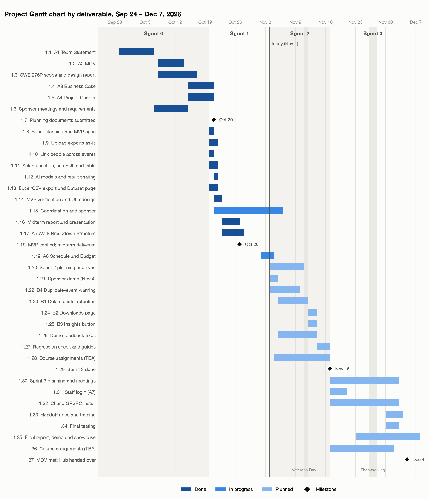
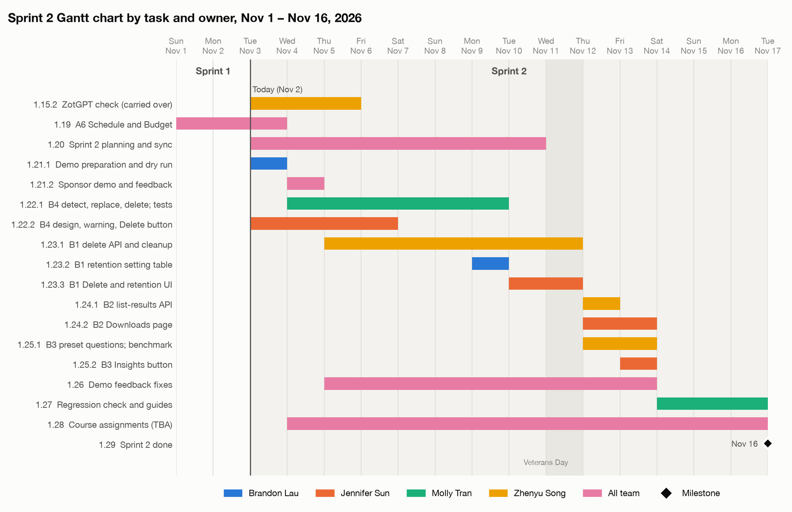
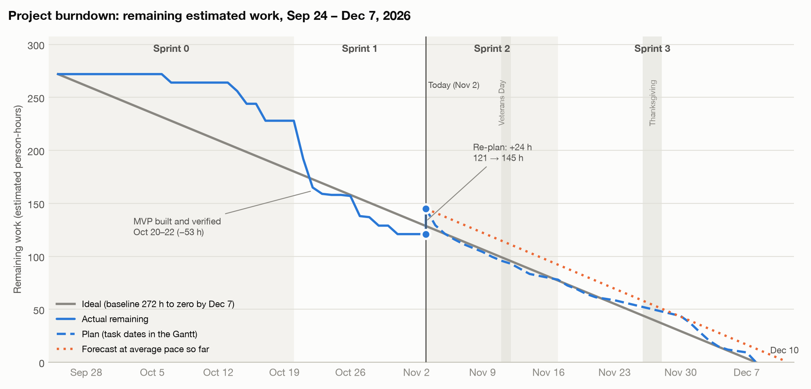

# Project Schedule and Budget: Program Registration & Attendance Data Hub

**Authors:** Brandon Lau, Molly Tran, Jennifer Sun, Zhenyu Song

**Date:** November 2, 2026

---

## Project Basics

- **Project name:** Program Registration & Attendance Data Hub
- **Project team name:** ZotSync
- **Team members:** Brandon Lau (Database / DevOps), Jennifer Sun (Frontend), Molly Tran (Backend / Data Import), Zhenyu Song (AI / Chatbot)

---

## 1. Project Description

*Adapted from the project charter.*

**Problem.** The Graduate & Postdoctoral Scholar Resource Center (GPSRC) runs events all year, and students register on CampusGroups or 12twenty. After each event, a student assistant copies the attendee list into a yearly Google Sheet. The two platforms export different columns, and the data is spread over many files. Answering a simple question, such as how many students from one school came this term, takes manual filtering, sorting and de-duplicating in Excel.

**Solution.** A web app that runs on one GPSRC computer. Staff upload each event's export as-is, and the app merges it into one dataset and links the same person across events. Staff ask questions in plain English, see the SQL the AI wrote and the result table, and download any result as Excel or CSV.

**Desired impact.** Staff can quickly show Graduate Division leadership how many students the GPSRC reaches, by school and term, and spot groups it is not reaching, without compiling sheets by hand.

---

## 2. Measurable Organizational Value (MOV)

> This project will be successful if, by December 4, 2026, staff can load the sponsor's sample files into one dataset that matches the sponsor's compiled sheet, with no duplicates, and the chatbot correctly answers at least 18 of 20 sponsor-style reporting questions, with each answer downloaded as an Excel file in under one minute.

| Metric | Target | Status on Nov 2 |
|---|---|---|
| Benchmark questions answered correctly | At least 18 of 20 | 20 of 20 |
| Sample files imported | 293 rows and 79 unique NetIDs; no duplicates on re-upload | Met, except that a second download of the same event is counted twice; fixed in Sprint 2 (WBS 1.22) |
| Question to downloaded Excel file | Under 1 minute | 4 to 7 seconds |

The sponsor confirmed these three metrics on October 21.

---

## 3. Detailed Project Plan

### 3.1 Updated WBS

This is the WBS from Assignment 5, updated at the end of Sprint 1. The full version, with every task, is in the attached **WBS.xlsx**.

- **Actual (h)** is the time spent on finished work. Meetings are counted from their recordings, build work from the commit times, and writing from each owner's count. A row owned by "All team" counts all four members.
- The current sprint (Sprint 2) is broken down into tasks. The other sprints are shown by deliverable.

| Sprint | Dates | Est. (h) | Actual (h) | Status |
|---|---|---|---|---|
| Sprint 0 | Sep 24 – Oct 19 | 60 | 66 | Complete |
| Sprint 1 | Oct 20 – Nov 2 | 93 | 107 | Complete; 2 h carried over |
| Sprint 2 | Nov 3 – Nov 16 | 65 + 2 carried over | – | **Current** |
| Sprint 3 | Nov 17 – Dec 7 | 78 | – | Planned |
| **Total** | | **296** (Assignment 5: 272) | **173 to date** | |

**Changes since Assignment 5**

- **Unplanned work in Sprint 1 (15 h):** a UI redesign with 34 fixes from the user-story walkthrough (in 1.14), and a rewrite of the Assignment 2 MOV write-up (in 1.17).
- **Carried over:** the check of UCI's ZotGPT service (1.15) moves to November 3–5.
- **Added to the plan (+24 h):** this assignment, placeholders for course assignments not yet posted, and more time for B4's design and tests and for demo preparation.
- **The sponsor demo moved up to Wednesday, November 4.** The week 7 meeting would fall on Veterans Day (November 11), and B1 and B2 need the sponsor's answers.

#### Sprint 0: Initiation and Planning · Sep 24 – Oct 19 · Complete

| WBS | Task Description | Deliverable | Est. (h) | Actual (h) | Resources | Dates |
|---|---|---|---|---|---|---|
| **1.1** | **SWE 277P Assignment 1: Team Statement (Oct 6)** | Yes | **8** | 8 | All team | Sep 29 – Oct 6 |
| **1.2** | **SWE 277P Assignment 2: MOV (Oct 13)** | Yes | **8** | 6 | All team | Oct 8–13 |
| **1.3** | **SWE 276P: Project Scope and High-Level Design report (Oct 16)** | Yes | **16** | 24 | All team | Oct 8–16 |
| **1.4** | **SWE 277P Assignment 3: Business Case (Oct 20)** | Yes | **8** | 10 | All team | Oct 15–20 |
| **1.5** | **SWE 277P Assignment 4: Project Charter (Oct 20)** | Yes | **8** | 8 | All team | Oct 15–20 |
| **1.6** | **Sponsor meetings and requirements (Oct 7, Oct 14)** | No | **12** | 10 | All team | Oct 7–14 |
| **1.7** | ***Milestone: scope, MOV, business case and charter submitted*** | No | **0** | – |  | Oct 20 |

#### Sprint 1: MVP Build · Oct 20 – Nov 2 · Complete

| WBS | Task Description | Deliverable | Est. (h) | Actual (h) | Resources | Dates |
|---|---|---|---|---|---|---|
| **1.8** | **Sprint planning and MVP design spec** | Yes | **5** | 4 | Zhenyu, Brandon | Oct 20 |
| **1.9** | **User story: As staff, I can upload an event's export file as-is** | Yes | **14** | 11 | Brandon, Molly, Jennifer | Oct 20–21 |
| **1.10** | **User story: As staff, I see the same person linked across events** | Yes | **4** | 3 | Molly | Oct 20 |
| **1.11** | **User story: As staff, I can ask a question in plain English and see the SQL and the result table** | Yes | **13** | 15 | Zhenyu, Brandon, Jennifer | Oct 20–21 |
| **1.12** | **User story: As staff, I can choose the AI model and decide whether it may see query results** | Yes | **5** | 5 | Zhenyu, Jennifer | Oct 21 |
| **1.13** | **User story: As staff, I can download results as Excel or CSV and see what was imported** | Yes | **4** | 3 | Molly, Jennifer | Oct 20–21 |
| **1.14** | **MVP verification against the MOV and the acceptance tests** | Yes | **8** | 26 | Zhenyu, Brandon, Jennifer | Oct 21–22 |
| **1.15** | **Coordination and sponsor communication** | No | **19** | 11 (2 h carried over) | All team | Oct 21 – Nov 5 |
| **1.16** | **Capstone midterm report and presentation (Oct 26)** | Yes | **16** | 18 | All team | Oct 23–26 |
| **1.17** | **SWE 277P Assignment 5: Work Breakdown Structure (Oct 27)** | Yes | **5** | 11 | Brandon, Molly, Jennifer | Oct 23–27 |
| **1.18** | ***Milestone: MVP passes every acceptance test except staff login (Oct 22); midterm delivered (Oct 26)*** | No | **0** | – |  | Oct 26 |

#### Sprint 2: Sponsor Demo and Follow-up Features · Nov 3 – Nov 16 · Current sprint

| WBS | Task Description | Deliverable | Est. (h) | Actual (h) | Resources | Dates |
|---|---|---|---|---|---|---|
| **1.19** | **SWE 277P Assignment 6: Project Schedule and Budget (Nov 3)** | Yes | **9** | – | All team | Nov 1–3 |
| **1.20** | **Sprint 2 planning and team sync (Nov 3, Nov 10)** | No | **8** | – | All team | Nov 3–10 |
| **1.21** | **Mid-project demo to the sponsor (moved to Wed Nov 4)** | Yes | **8** | – |  | Nov 3–4 |
| 1.21.1 | Demo preparation and dry run | No | 4 | – | Brandon Lau | Nov 3 |
| 1.21.2 | Demo and feedback | No | 4 | – | All team | Nov 4 |
| **1.22** | **B4: Warn when an event is uploaded twice; delete a saved import** | Yes | **9** | – |  | Nov 3–9 |
| 1.22.1 | Detect an event already in the dataset; replace or delete its rows; tests | No | 5 | – | Molly Tran | Nov 4–9 |
| 1.22.2 | Design draft; warning in the upload preview; delete button | No | 4 | – | Jennifer Sun | Nov 3–6 |
| **1.23** | **B1: Delete a chat conversation; set how long chats are kept** | Yes | **6** | – |  | Nov 5–11 |
| 1.23.1 | Delete API and automatic cleanup of old chats | No | 3 | – | Zhenyu Song | Nov 5–11 |
| 1.23.2 | Database table for the retention setting | No | 1 | – | Brandon Lau | Nov 9 |
| 1.23.3 | Delete button and retention choice in Settings | No | 2 | – | Jennifer Sun | Nov 10–11 |
| **1.24** | **B2: Downloads page that lists past AI results** | Yes | **3** | – |  | Nov 12–13 |
| 1.24.1 | API that lists past results | No | 1 | – | Zhenyu Song | Nov 12 |
| 1.24.2 | Downloads page | No | 2 | – | Jennifer Sun | Nov 12–13 |
| **1.25** | **B3: Insights button on the Dataset page (first to drop if late)** | Yes | **4** | – |  | Nov 12–13 |
| 1.25.1 | Preset questions; re-run the chatbot benchmark | No | 3 | – | Zhenyu Song | Nov 12–13 |
| 1.25.2 | Insights button | No | 1 | – | Jennifer Sun | Nov 13 |
| **1.26** | **Fixes from the sponsor's demo feedback (placeholder)** | Yes | **8** | – | All team | Nov 5–13 |
| **1.27** | **Regression check and user guide update** | No | **4** | – | Molly Tran | Nov 14–16 |
| **1.28** | **SWE 277P assignments not yet posted (placeholder)** | Yes | **6** | – | All team | Nov 4–16 |
| **1.29** | ***Milestone: sponsor demo given; B1–B4 built and tested*** | No | **0** | – |  | Nov 16 |

#### Sprint 3: Handoff and Final Delivery · Nov 17 – Dec 7 · Planned

| WBS | Task Description | Deliverable | Est. (h) | Actual (h) | Resources | Dates |
|---|---|---|---|---|---|---|
| **1.30** | **Sprint 3 planning and meetings** | No | **18** | – | All team | Nov 17 – Dec 2 |
| **1.31** | **Staff login (the one acceptance test not yet passing, A7)** | Yes | **6** | – | Molly, Jennifer | Nov 17–20 |
| **1.32** | **Automated testing (CI) and installation at the GPSRC** | Yes | **5** | – | Brandon | Nov 17 – Dec 2 |
| **1.33** | **Handoff documents and staff training** | Yes | **5** | – | Molly, Zhenyu | Nov 30 – Dec 3 |
| **1.34** | **Final testing** | No | **6** | – | All team | Nov 30 – Dec 2 |
| **1.35** | **Final report, final demo (Dec 4) and Capstone Showcase (Dec 7)** | Yes | **32** | – | All team | Nov 23 – Dec 7 |
| **1.36** | **SWE 277P assignments not yet posted (placeholder)** | Yes | **6** | – | All team | Nov 17 – Dec 1 |
| **1.37** | ***Milestone: MOV met and the Hub handed over (Dec 4); showcase (Dec 7)*** | No | **0** | – |  | Dec 4 |

**Hours by person:** each member has about 78 to 82 hours over the quarter (actual to date plus plan), 318 hours in total.

### 3.2 Gantt Chart

*Figure 1. The whole project by deliverable. The vertical line is today (November 2).*

*Figure 2. The current sprint by task, colored by owner.*

**Parallel work.** Each feature starts with a short design draft that fixes the API, so its back end and its page are built at the same time by different owners: for example, B4's detection logic (Molly) and its warning in the upload preview (Jennifer) on November 4–6. In Sprint 3, login (Molly, Jennifer) and CI (Brandon) run in parallel in the week of November 17, and the final report is drafted while final testing runs.

**Critical path.** Sponsor demo (Nov 4) → B1 and B2 (Nov 9–13) → regression check (Nov 14–16) → staff login (Nov 17–20) → final testing and install at the GPSRC (Nov 30 – Dec 2) → final demo (Dec 4). Thanksgiving week is the buffer, and B3 is off the critical path.

### 3.3 Burndown Chart

*Figure 3. Remaining estimated work, made with Python (matplotlib) from WBS.xlsx. A task's estimate is subtracted on the day it finishes.*

**What it tells us.**

- **Slow start, fast middle.** Sprint 0 ended 48 h behind the ideal line, because the first weeks went to forming the team and to planning documents. The MVP build then burned 53 h in three days, and by October 30 we were 19 h ahead.
- **The re-plan used up the lead.** Today's update added 24 h, so we are now 16 h behind the ideal line (145 vs 129 h left).
- **Our estimates run low.** Finished work took 173 h against 151 h estimated, 15% more. Code took less time than estimated; testing, design and documents took more.

**What it predicts.** At our average pace (26 h per week), we finish around **December 10**, three days late. To finish by December 7 we need about 29 h per week, which is within the team's 40-hour capacity but leaves little slack.

**Adjustments.**

- If we are behind the plan line at the November 10 sync, B3 (Insights button) is dropped first.
- Login and CI are done before Thanksgiving, so the last week is not overloaded.
- New estimates for testing, design and documents are raised by 15%.

### 3.4 Cost Estimate

If the four of us were employed to build the Hub, we estimate it would cost about **$33,500**.

- **Developer rate: $88 per hour.** Entry-level software developers in the Los Angeles–Long Beach–Anaheim area earn $61.31 per hour (25th percentile, BLS May 2025). Wages are about 70% of an employer's cost, so the rate with benefits is $61.31 / 0.70 ≈ $88.
- **Hours:** 173 h spent so far plus 145 h planned, from the WBS.

| Item | Calculation | Cost |
|---|---|---|
| Team labor | 318 h × $88 | $27,984 |
| Sponsor and GPSRC staff time | About 20 h (charter) × $86 (education administrator median $60.21, BLS, with benefits) | $1,720 |
| AI coding assistant (Claude Code) | Claude Team premium seat, $125 per month × 4 seats × 2 months | $1,000 |
| AI model usage | Upper end of the $100–200 credit request to the sponsor | $200 |
| Laptops | $1,999 MacBook Pro over 3 years ≈ $56 per month × 4 × 2.5 months | $555 |
| Docker Desktop and GitHub | Docker Team $16 × 4 × 2 months; GitHub Team $4 × 4 × 3 months | $176 |
| Software stack and hosting | Open-source tools; runs on an existing GPSRC computer | $0 |
| Contingency | 15% of the remaining labor (145 h × $88), our measured overrun | $1,914 |
| **Total** | | **$33,549** |

The charter estimated $10,620 at a student rate of $25 per hour. The employed cost is about three times higher, mostly because a developer costs $88 per hour with benefits. Fewer hours than the charter planned (318 instead of 400) offset part of that.

**Sources:** [BLS wages via O\*NET: software developers](https://www.onetonline.org/link/localwages/15-1252.00?zip=92697), [education administrators](https://www.onetonline.org/link/localwages/11-9033.00?zip=92697); [BLS employer compensation costs](https://www.bls.gov/news.release/ecec.nr0.htm); [Claude](https://claude.com/pricing), [Docker](https://www.docker.com/pricing/) and [GitHub](https://github.com/pricing) pricing; [MacBook Pro price](https://ppc.land/apples-m6-macbook-pro-stays-at-1-999-after-two-price-rises-in-2026/).
