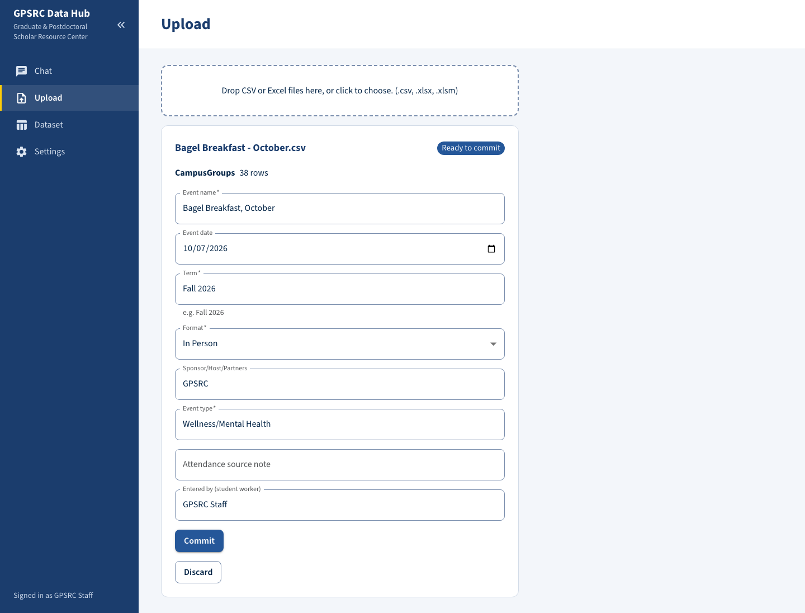
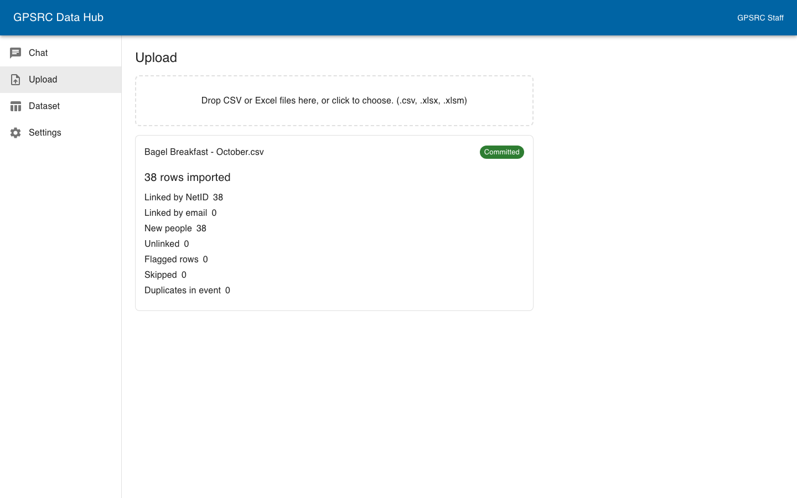
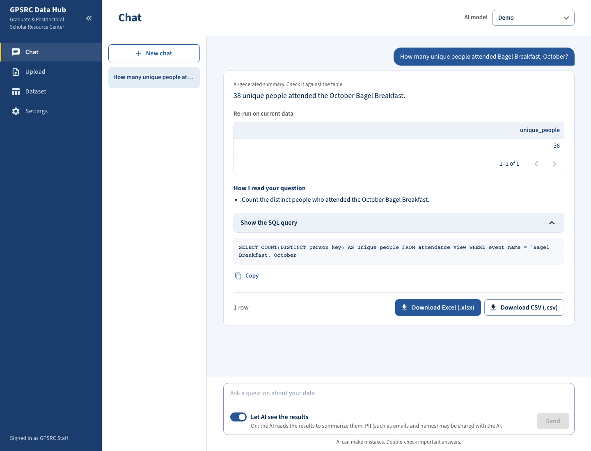
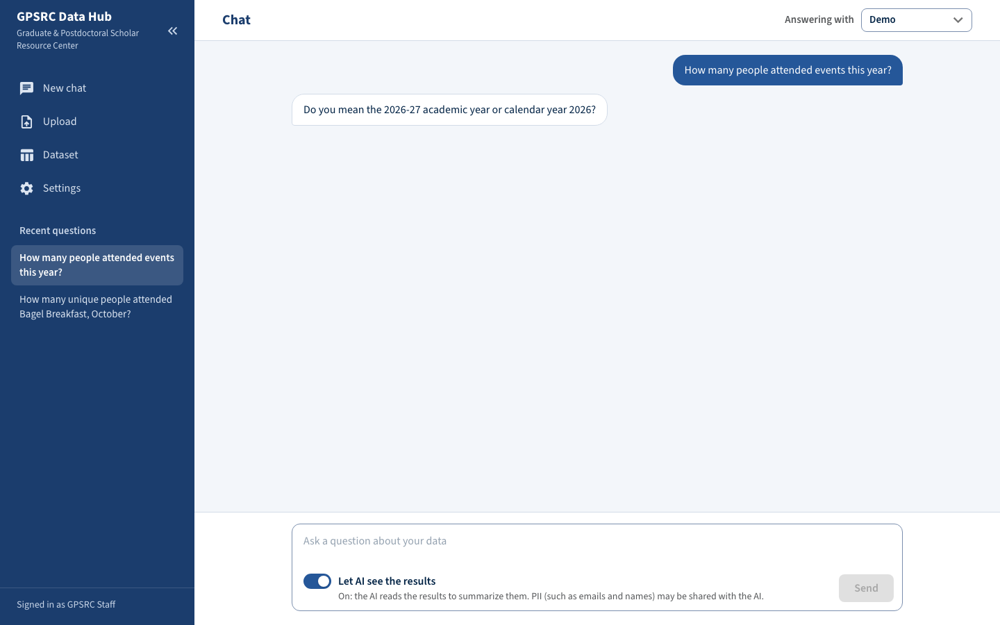
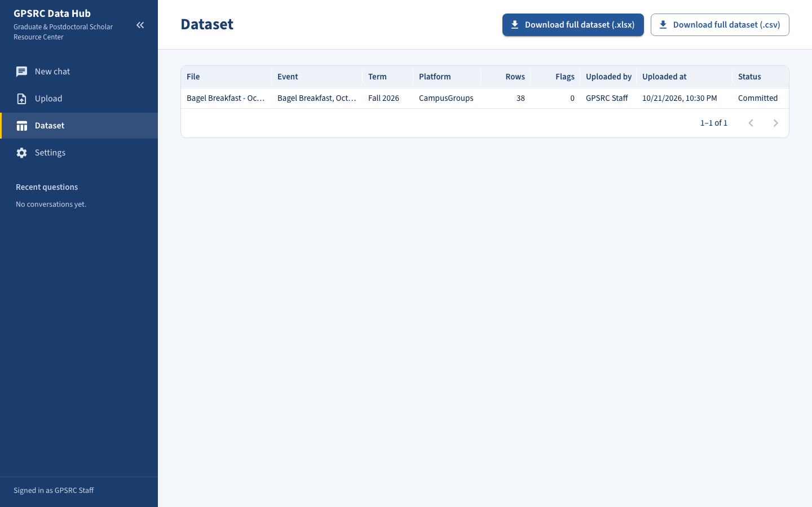
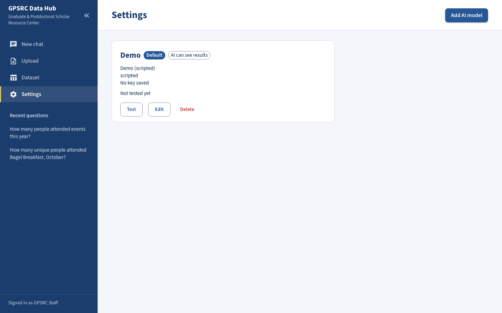

# User guide

For GPSRC staff. This guide shows how to add an event's attendee list to the Hub, ask questions about the data, and download the answers. You do not need to know SQL or any code.

Screens are described by their button and field names. Names in quotes are what you see on screen.

The Hub has four pages, listed in the navigation on the left: **New chat** (the chat page), **Upload**, **Dataset** and **Settings**. Click the arrows at the top of the navigation (**Collapse navigation** / **Expand navigation**) to shrink it to icons and give the page more room. Hover over an icon to see the page name. Below the pages, **Recent questions** lists your conversations on every page, newest first; click one to open it, or click **New chat** at the top of the navigation to start a new one. Long titles are cut after two lines; hover to read the whole title. The navigation and the Chat question box stay in place while the rest of the page scrolls. At the bottom it says who you are signed in as, or "Not connected" when the Hub cannot be reached. If you open an address that does not exist, the page says "Page not found".

## The idea in one minute

1. **Upload** the file that CampusGroups or 12twenty gave you, as it is. Do not edit it first.
2. Check the event details, then click **Commit**. The rows are added to one permanent dataset.
3. In **New chat**, ask a question in plain English. The Hub shows the answer and the SQL query (the database instruction an AI wrote to get it), so you can check how the answer was made.
4. Download the result as an Excel or CSV file.

## 1. Upload an event

1. Open **Upload**.
2. Drag the file into the box, or click the box and choose it. Accepted files are .csv, .xlsx and .xlsm. An old .xls file is not accepted and is refused before it is uploaded. Save it as .xlsx first, or download it again from the platform. A file larger than the size limit is rejected with a message such as "File exceeds the 10 MB limit." You can drop several files at once. Each file gets its own card.

   
3. The Hub reads the file and shows a card with:
   - the file name and a status tag;
   - the platform it recognized (CampusGroups or 12twenty) and the number of rows;
   - "N rows skipped", if any (click it to see which rows and why);
   - small tags for anything unusual in the data (see "Flags" below);
   - the event form.
4. Fill in the event form. Some fields are filled in for you, from the file name and the file:

   | Field | What to enter |
   |---|---|
   | Event name | The event's name. Required. Filled from the file name. |
   | Event date | The day of the event. Filled for CampusGroups files. 12twenty files do not contain it, so enter it if you know it, or leave it blank. |
   | Term | Season and year, like `Fall 2026`. Required. |
   | Format | In Person, Virtual or Hybrid. Required. |
   | Sponsor/Host/Partners | Who hosted the event. Separate several with " / ". |
   | Event type | For example Professional Development, Wellness/Mental Health or Fellowships. Required. |
   | Attendance source note | Where the attendance came from, when it is not CampusGroups. Filled in for 12twenty files. |
   | Entered by (student worker) | Your name. |

5. Click **Commit**. While **Commit** is off, a line under the form says "To commit, fill in: …" and names the fields still missing. A summary appears after the commit (see below). The file is now in the dataset.
6. Changed your mind before committing? Click **Discard**. The file is removed and nothing is added.

**Check the details before you click Commit.** After a commit the event details cannot be edited and the file cannot be removed (see [known limitations](known-limitations.md)).

### The status tag

| Tag | Meaning |
|---|---|
| Ready to commit | The file is read and waiting for your event details. |
| Committed | The file is in the dataset. |
| Duplicate | This file, or a file with exactly the same content, was already added. Nothing was saved. The card says "Already imported as {file name}.". Click "View it on the Dataset page" to find it, or **Dismiss** to remove the card. Uploading the same file twice never creates duplicate rows. |
| Rejected | The file is not a CampusGroups or 12twenty attendee export, or it has no attendee rows. The card says why and lists missing columns. Click **Dismiss** to remove the card. |

If you leave the Upload page with a file waiting, it is still there when you come back. Anything you typed in the form is kept while you move between pages, but lost if you reload the page.

### The commit summary

After a commit the card shows "N rows imported" and these counts:

| Count | Meaning |
|---|---|
| Linked by NetID | The person was already in the dataset, found by NetID. People first seen in this file are not counted here. |
| Linked by email | The person was already in the dataset, found by email address. People first seen in this file are not counted here. |
| New people | People seen for the first time. |
| Unlinked | Rows with neither NetID nor email. They are kept, but cannot be matched to anyone. |
| Flagged rows | Rows with at least one flag. |
| Skipped | Rows left out (for example, 12twenty rows that were not marked as attended). |
| Duplicates in event | Rows for a person who was already listed in the same file. Only the first is kept. |

The Hub recognizes the same person across events by NetID first, then by email. It never guesses from names. A person it cannot be sure of is flagged instead of merged.

### Flags

Flags point at rows to double-check. They do not stop the import, and the row is still added. The tags on the card are worded like this:

| Tag | What it means |
|---|---|
| Email/NetID unavailable | The row has neither a NetID nor an email, so the person cannot be matched. |
| NetID missing | No NetID in the row. |
| Email missing | No email in the row. |
| School missing, Department missing, Affiliation missing | The export left that answer blank. |
| Domestic/international missing | The CampusGroups answer is blank. (12twenty never has it.) |
| Degree missing | 12twenty only. The Degree field is blank, so the Hub used the Degree Level field for the affiliation. |
| Non-standard email, NetID not derived | 12twenty exports have no NetID, so the Hub takes it from emails like `name@uci.edu`. An address like `first.last@uci.edu` or `name@hs.uci.edu` does not qualify, so the row has no NetID. |
| NetID/email conflict | The row's email already belongs to a person who has a different NetID. The row is linked by its NetID. The email stays with the other person. |
| Email belongs to another person | The row's email is already linked to someone else, so it was not given to this person. |
| Duplicate in this event | The same person appears twice in this file. The second row is skipped. |
| Skipped, not attended | A 12twenty row that was not marked as attended. It is left out. |

The data dictionary lists the underlying flag codes: [data-dictionary.md](data-dictionary.md#flag-codes).

## 2. Ask questions

1. Click **New chat** in the navigation. The page opens on a new conversation.
2. Pick the AI model in the **Answering with** drop-down at the top right. The default is chosen for you. If the list is empty, add a model in **Settings** first (see the [setup guide](setup-guide.md#6-add-an-ai-model)).
3. Type your question in the box ("Ask a question about your data") and click **Send**. Press Enter to send, or Shift+Enter for a new line. A question can be up to 2,000 characters.
4. Watch the progress line: "Writing SQL", "Checking the query", "Running the query", and "Analyzing results" when sharing is on. The conversation scrolls your question to the top and leaves room for the answer; the question box stays at the bottom.

While an answer is being written you can already type your next question. **Send** waits until the answer is done.

To start a different topic, click **New chat** again. Your old conversations stay under **Recent questions**; click one to go back to it.

### Asking good questions

- Name the event, term or group you mean, in the words you use every day: "Bagel Breakfast", "Fall 2026", "School of Engineering", "postdocs".
- Say what you want counted. "Unique people" counts each person once. "Attendance records" or "turnout" counts every visit, so a person who came to three events counts three times.
- Say what you want to see: a number, a list of names and emails, a breakdown by school, "highest first".
- Ask follow-ups in plain words. "Now only the postdocs" or "Break that down by event" work, because the Hub remembers the earlier questions in the conversation.
- If your question could mean two things, the Hub asks you which one you mean. Just answer in the next message.

Examples (they work on the sample data):

- How many unique Biological Sciences students came to a Bagel Breakfast in Fall 2026?
- How many unique people attended each event type?
- Which event had the most attendees?
- Who attended both Cover Letters for Academic Jobs and Teaching Statements for Academic Jobs?
- Show the number of attendance records for each school, highest first.

What the chat can and cannot answer: it knows who attended which event, their name, email, NetID, affiliation, school, department, and the event's name, date, term, format, host and type. It cannot answer from Student IDs (they are not available to it), from 12twenty registrants who were not marked as attended (the Hub leaves those rows out), or from anything outside the uploaded files.

### Reading an answer

Each question gets one answer card. From top to bottom:

- **The summary.** When sharing is on (see section 4), the AI writes a short summary with a note "AI-generated summary. Check it against the table." When sharing is off, the Hub writes a plain one, such as "42 rows" or "No matching records.", with the note "The AI wrote the SQL, so check it."
- **The result table.** This is the answer. The table is the authority: if the summary and the table disagree, trust the table. It shows up to 1,000 rows. When the result is cut off, the footer says "More than 1,000 rows". Download the file to get them all.
- **How I read your question.** One or more plain sentences saying how the AI understood you, and what it assumed (for example, "Students" means everyone GPSRC serves, postdocs included, or "This term" means Fall 2026). Read this first when an answer looks strange. If an assumption is wrong, say so in a follow-up.
- **Show the SQL query.** Click it to see the database instruction that was run. The Hub always shows it so you can check the work, or hand it to someone technical. **Copy** copies it and briefly shows "Copied".
- **The row count and the download buttons** (see section 3).

Reopening an old conversation shows the question and the SQL, but not the rows. Click **Show results** to run the saved query again on today's data. The table is marked "Re-run on current data".

If something goes wrong, the card shows a short message and a **Retry** button. Retry uses the AI model ("Answering with") and sharing choice you have selected now, so you can switch the model and try again. The SQL is still shown so you can see what was attempted.

**The AI can make mistakes.** The note above each summary says so. Check important numbers against the table, and check the "How I read your question" lines. The team tested 20 realistic questions and the AI answered all of them correctly on the main model, but results on your own wording can differ (see [known limitations](known-limitations.md#chat-answers-can-be-wrong)).

## 3. Download results

**One answer.** At the bottom of the answer card, click **Download Excel (.xlsx)** for Excel or **Download CSV (.csv)** for a CSV file. The file holds the full result of that query, not only the first 1,000 rows, up to 100,000 rows. If the file is shorter than the full result, a notice says "This file stops at N rows."

**Everything.** On the **Dataset** page, click **Download full dataset (.xlsx)** or **Download full dataset (.csv)**. The file is in the GPSRC Data Project layout (the 19 columns of the sponsor's template), with a Notes column that says which platform the row came from and what is missing or needs checking. This file also contains the Student ID column. See the [data dictionary](data-dictionary.md).

Values that start with `=`, `+`, `-` or `@` are saved as plain text, so Excel does not run them as formulas.

The **Dataset** page also lists every file that was imported: file name, event, term, platform, rows, flags, who uploaded it and when, and the status (Committed or Pending). "Rows" is the number of rows the file added to the dataset. For a Pending file, it is the number of rows the file holds. A Pending file links back to the Upload page.

## 4. Who sees the data: the two switches

The AI model works in two steps, and they treat your data differently.

1. **Writing the SQL.** The AI gets your question, the names of the columns, and lists of allowed values like school names and event names. It never gets attendee rows. It never sees any Student ID. This step is always on.
2. **Summarizing the answer.** This is optional. If you allow it, the AI also receives the rows the query returned (at most 200 rows and 20,000 characters), so it can write the short summary. That can include names and emails. The rows come only from the Hub's read-only view, never from other tables, and never include Student IDs.

Two switches decide whether step 2 happens. **Results are sent only when both are on.**

| Switch | Where | What it controls |
|---|---|---|
| **Allow sending query results to this AI** | Settings, when you add or edit an AI model | The ceiling for that model. Off means this model never receives results. The ZotGPT preset starts on, every other preset starts off. |
| **Let AI see the results** | Chat, next to the question box | This question and the ones after it in the conversation. It starts at the model's setting. If the model does not allow sharing, the switch is off and cannot be turned on. Hover over it to see why. |

The helper text under the switch tells you the state:

- On: "On: the AI reads the results to summarize them. PII (such as emails and names) may be shared with the AI."
- Off: "Off: the AI sees only your question. You get the results without an AI summary."

With the switch off you still get the table and a plain summary. With it on, personal information such as emails and names may reach the AI provider.

The choice is kept for the rest of the conversation. It resets to the model's setting when you click **New chat** or choose another AI model.

Whether the AI may see results at all is **still to be confirmed with the sponsor**. Until then, keep it off for any model that is not approved. You can turn it off for a model in Settings with no code change.

## 5. Settings: AI models

Open **Settings** to see your AI models. Each card shows the name, the provider, the model, the last four characters of the saved key, and tags: **Default**, and either **AI can see results** or **AI never sees results**. That second tag is the model's result-sharing setting (section 4); hover over it for a one-line explanation.

- **Add AI model** opens the form. See the [setup guide](setup-guide.md#6-add-an-ai-model) for the fields.
- **Test** checks the connection and shows **Connected** or an error. After a passing test, the **Model** field in the form lists the models the provider offers.
- **Edit** changes the fields. Leave the API key empty to keep the saved key.
- **Make default** chooses which model Chat selects first.
- **Delete** removes the model and its key. Past answers keep their record of which model made them.

Do not put a username or password in the base URL. The form says "The base URL must not contain a username or password. Put the key in the API key field."

The API key is write-only: after you save it, no page ever shows it again.

## When something goes wrong

| What you see | What to do |
|---|---|
| "Could not reach the server." or "Not connected" | The Hub is not running. Start Docker Desktop and run `docker compose up -d` (see the [setup guide](setup-guide.md)). |
| A file is Rejected | Upload the export exactly as CampusGroups or 12twenty produced it, without editing or re-saving it with other tools. |
| "Page not found" | The address does not exist. Use the navigation on the left. |
| A file is a Duplicate but you think it is new | Its content matches a file already imported. Open Dataset to see which one. |
| An answer looks wrong | Read "How I read your question" and the SQL. Ask again with more detail, or say what is wrong in a follow-up. |
| An AI error (for example a bad key, or the provider is busy) | Open Settings and click **Test** on the model. Fix the key if needed, then use **Retry**. |

Anything else: see [known limitations](known-limitations.md), or ask the team.
